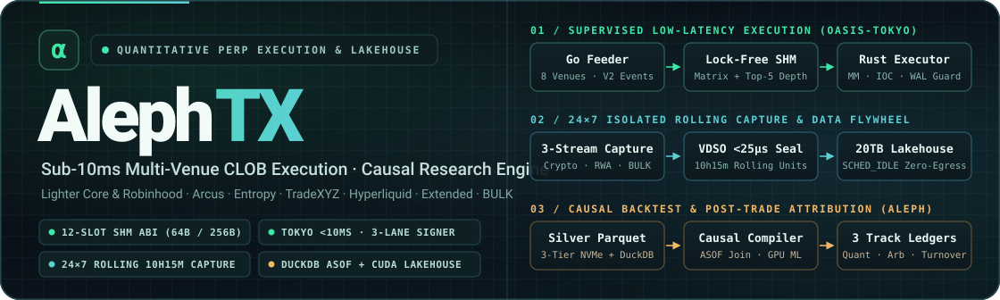
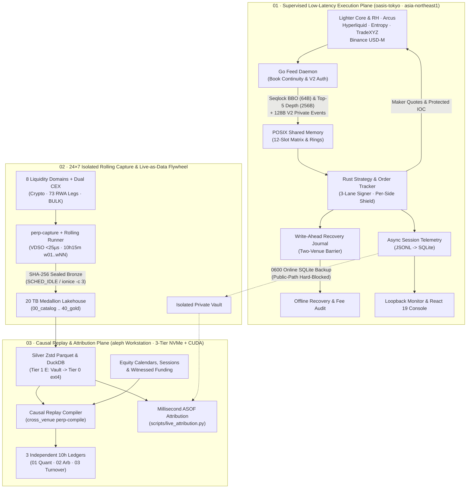

<h1 align="center">
  
</h1>

<p align="center">
  <a href="docs/QUICKSTART.md"><b>Quickstart</b></a> ·
  <a href="docs/LIVE_TRADING.md"><b>Trading &amp; Recovery</b></a> ·
  <a href="docs/DUAL_TRACK_IPC.md"><b>Shared-Memory ABI</b></a> ·
  <a href="docs/CROSS_VENUE.md"><b>Venue Matrix</b></a> ·
  <a href="docs/PERP_RECORDING.md"><b>24×7 Capture</b></a> ·
  <a href="docs/QUANT_DATA_LAKEHOUSE.md"><b>Medallion Lakehouse</b></a> ·
  <a href="docs/PERP_RELATIVE_VALUE.md"><b>Causal Replay</b></a> ·
  <a href="docs/TOKYO_RESEARCH_AND_EXECUTION_TODO.md"><b>Tokyo Roadmap</b></a>
</p>

<p align="center">
  <code>Rust 1.100.0</code> ·
  <code>Go 1.27.4</code> ·
  <code>12-Slot Seqlock SHM (64B / 256B)</code> ·
  <code>128B V2 Private Event Ring</code> ·
  <code>Tokyo &lt;10ms Edge</code> ·
  <code>DuckDB 2.0 + CUDA 12.6</code>
</p>

---

**AlephTX** is an institutional-grade perpetual futures execution and causal relative-value research engine engineered around three strictly separated operational planes:

1. **Sub-10ms Supervised Execution (`oasis-tokyo` · `Go 1.27` + `Rust 1.100`)** — A multi-venue Go feed daemon reconstructs full orderbooks and publishes lock-free BBO (`aleph-matrix`, `64B`) and Top-5 depth (`aleph-depth`, `256B`, `64B`-aligned) across **12 exchange slots**, paired with a `128`-byte V2 private execution ring (`aleph-events`). The Rust execution core (`lighter_inventory_mm`) runs zero-allocation multi-venue fair-value pricing, asymmetric adverse-selection cancel shields (`per_side_bound_cancel`), multi-lane API-key signing isolation (`Maker` / `Cancel` / `Taker`) with per-lane monotonic nonce management and failure rollback/resync, and write-ahead recovery journals with optional protected IOC hedging on native Hyperliquid.
2. **24×7 Rolling Public Capture & Live-as-Data Flywheel** — Three physically isolated systemd capture streams (`crypto`, `rwa`, `bulk`) record orderbooks, public trade prints (with Lighter fee-signature integers and edge-redacted Arcus prints), funding histories, and dual CEX anchors (`Binance USD-M` + `Coinbase Spot`) under a `<25 µs` paired VDSO monotonic/wall-clock guard. Completed `10h15m` (`36,900s`) windows and zero-gap in-process segments (`-segment-duration`) are cryptographically sealed (`.bronze_manifest.json`) and shipped under Linux `SCHED_IDLE` / `ionice -c 3` to a **20 TB Medallion Lakehouse** with zero impact on hot-path latency.
3. **Causal 10-Hour Backtesting & Post-Trade Attribution (`aleph` Workstation)** — A 3-tier NVMe workstation (`ext4` Hot Compute + `E:` Cold Bronze Vault + `C:` Bundle/Evidence Cache, `DuckDB 2.0` + `RTX 4070 Ti`) compiles arrival-ordered raw archives into causal replay frames (`cross_venue`) and runs millisecond `ASOF JOIN` fill markout attribution (`scripts/live_attribution.py`) across **three strictly non-subsidized strategy programs**: **Quant Profit (`01`)**, **Hedge Arbitrage (`02`)**, and **Incentive Turnover (`03`)**.

---

## System Architecture



The supervised Lighter order tracker consumes the `128`-byte V2 private event stream. The `[symbols]` table binds Go and Rust shared-memory slots to canonical tickers, keeping `symbol_id`, exchange slot ID (`1..12`), and venue `market_id` strictly distinct.
[Shared-memory ABI specification](docs/DUAL_TRACK_IPC.md) · [Example profile](config.example.toml)

---

## Multi-Venue Shared-Memory & Capture Matrix (`NUM_EXCHANGES = 12`)

Both `aleph-matrix` (`2,048` symbols × `12` exchanges × `64B` + `16 KiB` header) and `aleph-depth` (`2,048` symbols × `12` exchanges × `256B` + `16 KiB` header) share one canonical slot table across Go, Rust, and Python:

| Slot | Venue / Liquidity Domain | Config Section | Live SHM Feeds | 24×7 Public Capture Channels & Economics |
| :---: | --- | --- | --- | --- |
| **`1`** | **Hyperliquid Core** | `[hyperliquid]` | BBO (`l2Book`) | Native perp `l2Book`, `activeAssetCtx`, `trades`, 5m polled `fundingHistory`; IOC hedge venue for `[inventory_hedge]` |
| **`2`** | **Lighter Core** (`chain_id=304`) | `[lighter]` | BBO + Top-5 Depth + V2 Private Events | Stateful delta `order_book`, `market_stats`, fee-retaining `trade/*` (`fee_fields_version: 1`), 4m clock refresh (`USDC`) |
| **`6`** | **Binance USD-M** | `[binance]` | BBO (`@bookTicker`) | Real-time `@bookTicker` lead-lag reference & adverse-selection cancel shield anchor |
| **`7`** | **Arcus** | `[arcus]` | BBO + Top-5 Depth (`l2Orderbook`) | 20-level WS `l2Orderbook` + edge-sanitized microsecond `arcus_trades`; `0.00 bps` Maker fee on RWA equity perps |
| **`8`** | **Lighter Robinhood** (`chain_id=466324`) | `[lighter_robinhood]` | BBO + Top-5 Depth | Independent Robinhood Chain domain (`wss://api.rh.lighter.xyz/stream`), `order_book`, `market_stats`, `trade/*` (`USDG`) |
| **`9`** | **Entropy** (`io:*` HIP-3) | `[entropy]` | BBO (`l2Book`) | HIP-3 RWA perps (`io:NVDA`, `io:SNDK`, `io:AAPL`, `io:CRCL`, `io:DRAM`, `io:NBIS`), `activeAssetCtx`, `trades`, `fundingHistory` |
| **`10`** | **TradeXYZ** (`xyz:*` HIP-3) | `[tradexyz]` | BBO (`l2Book`) | 18 HIP-3 RWA equity/index perps (`xyz:NVDA`, `xyz:SNDK`, `xyz:TSLA`, `xyz:SP500`, etc.), `activeAssetCtx`, `trades`, `fundingHistory` |
| **`11`** | **Extended** | — | Reserved SHM slot | Sequenced Starknet CLOB `orderbooks/*`, `publicTrades/*`, and `extended_index` (`prices/index/*`) |
| — | **BULK** & **Coinbase Spot** |Capture-only | — | Physically isolated `-bulk-ws` 20-level snapshots (14 markets) + `-coinbase` USD spot `ticker` anchor (`BTC-USD`, `ETH-USD`, `SOL-USD`) |

*(Slots `3..5` remain reserved in the binary header to preserve backward compatibility with archived v3/v4 fixtures under [`legacy/v3_archive/`](legacy/v3_archive/).)*

---

## Operating Modes & Three-Track Research Contract

| Plane | Mode / Program | Execution & Accounting Mechanics |
| --- | --- | --- |
| **Supervised** | `quant` | Lighter (`Core` or `RobinhoodMainnet`) inventory-neutral market making with multi-venue median fair-value (`external_reference_exchanges`), empirical markout-calibrated asymmetric cancel shields (`per_side_bound_cancel`), 3-lane API key isolation, and persisted UTC daily drawdown guards. |
| **Supervised** | `inventory_hedge` | Lighter Core Maker quoting paired with confirmed-inventory protected IOC hedging on native Hyperliquid (`strategy_mode = "inventory_hedge"`). Blocked on `RobinhoodMainnet` so `USDG` and `USDC` collateral domains are never implicitly cross-settled. |
| **Paper (`01`)** | **Quant Profit** (`01_quant_profit`) | Single-venue passive quoting evaluated on complete-cycle net cash PnL after fees/rebates, drawdown, and fill-conditioned `1s / 5s / 30s` markouts (including cancel-pending cohorts). |
| **Paper (`02`)** | **Hedge Arbitrage** (`02_hedge_arbitrage`) | Matched two-leg basis reversion or funding carry (`pair_hedge` & [`maker-first`](docs/PERP_RELATIVE_VALUE.md#maker-first-replay) where public trade prints advance passive queue position and drive protected IOC hedges). RWA pairs enforce `America/New_York` session calendars and corporate-action gates. |
| **Paper (`03`)** | **Incentive Turnover** (`03_incentive_turnover`) | Separate capital, fee, and loss budgets across `neutral`, `long_first`, and `short_first` opening postures while maintaining full hedging. Reports target turnover separately from rule-window candidate turnover and confirmed eligible volume; unredeemed points carry zero assumed cash value. |

### Non-Subsidy & 10-Hour Validation Invariants

- **Strict Program Isolation**: Quant profit, hedge arbitrage, and incentive turnover maintain separate configurations, execution states, capital and loss budgets, cash ledgers, and Gold reports. Shared market recordings are counted once as empirical evidence and never permit cross-program PnL subsidy.
- **Continuous 10-Hour Validation Units**: Every accepted evaluation requires an unbroken **10-hour decision interval** (`36,900s` raw window reserving `15m` for pre-window warm-up and terminal drain), with inventory and cash carried across storage shards and funding boundaries. Short flat-restarted runs are preserved strictly as diagnostics.
- **Frozen Holdout Discipline**: Parameter selection and Binance A/B/C/D factor ablations occur exclusively on `tokyo_selection_dev`; strategy parameters and split boundaries are cryptographically frozen before evaluating `tokyo_holdout_vault`.

[Trading & recovery runbook](docs/LIVE_TRADING.md) ·
[Venue capabilities](docs/CROSS_VENUE.md) ·
[Independent research contract](docs/INDEPENDENT_STRATEGY_RESEARCH.md) ·
[Ten-hour validation protocol](docs/TEN_HOUR_RESEARCH.md)

---

## Three-Tier Infrastructure & Live-as-Data Flywheel

| Tier | Node / Storage | Hardware & Network Profile | Operational Role |
| --- | --- | --- | --- |
| **Tier 1 · Cloud Edge** | **`oasis-tokyo`** (`asia-northeast1-b`) | GCP `t2d-standard-2` (AMD Milan, `gVNIC`, `BBR + FQ`, `tcp_slow_start_after_idle=0`, `16 MB` socket buffers, `<10 ms` to Lighter/Binance Tokyo edge) | Runs `aleph-tx-feeder`, `aleph-tx-monitor`, three isolated 24/7 rolling `10h15m` capture services (`aleph-perp-capture-{crypto,rwa,bulk}.service`), and idle-priority flywheel shipping (`aleph-tx-flywheel.timer`). |
| **Tier 2 · Lakehouse Hub** | **`AlephTX-Quant-Lakehouse`** | 20 TB Google Drive Medallion Layout (`00_catalog`, `10_bronze_raw`, `20_silver_normalized`, `30_external_evidence`, `40_gold_experiments`) | `$0/GiB` GCP egress lakehouse storing SHA-256-sealed Bronze archives (`.bronze_manifest.json`), Silver Zstd Parquet bundles, external fee/session audits, and frozen Gold experiment manifests. |
| **Tier 3 · Local Compute** | **`aleph` Workstation** | `i7-13700` (24 threads), `23 GiB` RAM, `RTX 4070 Ti` (12 GB CUDA 12.6), `4 TB` PCIe 4.0 NVMe (`Tier 0 ext4` `2.4 GB/s` + `Tier 1 E:` `1.7 TiB` Vault + `Tier 2 C:` Cache) | Executes streaming Bronze-to-Silver normalization, multi-threaded `DuckDB 2.0` `ASOF JOIN` microstructure scans, `XGBoost` CUDA toxicity modeling, `cross_venue` 10-hour causal replays, and post-trade attribution. |

- **24×7 Rolling Capture (`scripts/perp_rolling_runner.py`)**: Automatically rolls `w01 -> w02 -> w03 ...` continuous `10h15m` windows without downtime, quarantines interrupted partials to `quarantine_partials/`, seals `.bronze_manifest.json`, uploads under `SCHED_IDLE`, and evicts SHA-256-verified older windows when local free disk drops below `16 GiB`.
- **In-Process Zero-Gap Segmenting (`perp-capture -segment-duration 1h`)**: Rotates `.segNNNN.ndjson.gz` slices inside the same collector process without dropping WebSockets or resetting L2 books, `run_id`, or `sequence` (`quant_lakehouse.py seal-segment-chain`).
- **Post-Trade Causal Attribution (`scripts/live_attribution.py`)**: Joins private SQLite fill records (`0600`, backed up via `scripts/flywheel_sync.py backup-private` with hard blocks against public folders) against multi-venue Silver Parquet BBOs at `-500ms, -100ms, 0ms, +100ms, +500ms, +1s, +5s, +30s` horizons.

[Medallion Lakehouse & WSL2 guide](docs/QUANT_DATA_LAKEHOUSE.md) ·
[Data-source registry](docs/RESEARCH_DATA_SOURCES.md) ·
[Tokyo research & execution backlog](docs/TOKYO_RESEARCH_AND_EXECUTION_TODO.md) ·
[50ms empirical baseline](docs/FIFTY_MS_STRATEGY_RESEARCH_2026_11_14.md) ·
[Priority venue design](docs/PRIORITY_VENUE_RESEARCH_DESIGN_2026_11_14.md) ·
[Binance A/B protocol](docs/BINANCE_REFERENCE_AB.md) ·
[Progress checkpoint](docs/RESEARCH_PROGRESS_2026_11_14.md) ·
[Execution & clock audit](docs/archive/EXECUTION_CLOCK_REVIEW_2026_11_14.md)

---

<a id="validate-locally"></a>
## Local Validation & Verification

Run the profile check from the repository root. It validates network, market, shared-memory slot bindings, and strategy guards without loading credentials or starting a feeder:

```sh
make trade MODE=check \
  CONFIG=config.example.toml
```

Use **Rust 1.100.0** (`rustfmt`, `clippy`) and **Go 1.27.4**. Offline CI covers Linux and macOS; the native Lighter CGo/FFI signer and supervised live sessions target `x86_64` Linux.
[CI workflow](.github/workflows/ci.yml) · [Go module](feeder/go.mod) · [Configuration reference](docs/CONFIGURATION.md)

```sh
# 1. Full Rust, Go, Python monitor, research pipeline, and React 19 console checks
make fmt-check
make check
make test
make test-python
make dashboard-build
make build

# 2. Deterministic synthetic causal replay checks (lost acks, funding carry, equity basis)
target/release/cross_venue hedge-replay examples/hedge_replay.json
target/release/cross_venue perp-replay examples/crypto_funding_paper.json
target/release/cross_venue perp-replay examples/equity_basis_paper.json
```

---

## Operational Contracts & Release Gates

| Boundary | Safety Invariant | Reference |
| --- | --- | --- |
| **Session Lifecycle** | Start only from verified flat positions and zero open orders in the configured scope. Stop via the supervisor (`SIGTERM`) and verify terminal flat cleanup before restart. | [Launch and shutdown](docs/LIVE_TRADING.md#start-and-stop) |
| **Exposure & Recovery** | Reserve worst-case exposure prior to dispatch and retain it across pending cancels, ambiguous acks, and stream gaps. Reconcile both venues before clearing an active write-ahead journal. | [Execution and recovery](docs/LIVE_TRADING.md#execution-and-recovery) |
| **Audit & Observability** | Keep source, receipt, availability, and journal timestamps distinct. Attribute fees by asset only with exact reconciled fill coverage; preserve unknown fee/telemetry states as `unknown`. | [Fee evidence](docs/LIVE_TRADING.md#bind-and-measure-fee-evidence) · [Oasis runbook](deploy/oasis/README.md) |
| **Research Admission** | Enforce causal arrival ordering (`available_at_ms >= received_at_ms`), `<25 µs` VDSO pairing (`±1 ms` drift gate), pre-holdout parameter freezing, and complete two-leg cash accounting. | [Recording](docs/PERP_RECORDING.md) · [Lakehouse](docs/QUANT_DATA_LAKEHOUSE.md) · [Paper execution](docs/PERP_RELATIVE_VALUE.md) |

### Release Gates for New Execution Routes

1. **Contract & Microstructure Equivalence** — Verify underlying payoff, settlement currency (`USDC` vs. `USDG`), funding cadence and multipliers, fee tier, tick/lot sizes, and session/halt calendars across both legs.
2. **Net Execution Economics on Unbroken 10-Hour Holdouts** — Demonstrate positive net cash expectancy or bounded incentive unit cost on untouched 10-hour holdout tapes after both legs' fees, adverse selection, funding settlements, and terminal drain. Retain all rejected and incomplete runs.
3. **Deterministic Fault & Recovery Verification** — Exercise partial fills, lost acknowledgments, nonce rejections (`21104`/`23000`), WebSocket sequence gaps, and restart barriers under deterministic fault injection before live promotion.

*(Historical 20-hour and 10-hour empirical studies: [20-hour Oasis holdout](docs/PERP_RELATIVE_VALUE.md#oasis-holdout-2026-11-12) · [Adaptive quoting & turnover replay](docs/PERP_RELATIVE_VALUE.md#adaptive-quoting-and-turnover-replay-2026-11-13).)*

---

## Repository Map

| Area | Path | Description |
| --- | --- | --- |
| **Supervised & Research CLIs** | [`src/bin/`](src/bin/) | `lighter_inventory_mm` (supervised Lighter MM & session supervisor) and `cross_venue` (`perp-compile`, `perp-replay`, `hedge-replay`) |
| **Strategy, Pricing & Venues** | [`src/strategy/`](src/strategy/) · [`src/exchanges/`](src/exchanges/) | Inventory-neutral quoting, `-4.2 bps` per-side cancel shield, causal relative-value engine, Lighter multi-lane FFI signer & `lighter_risk` math |
| **Go Multi-Venue Feeds & Recorder** | [`feeder/`](feeder/) | 12-slot `feeder-app` (`aleph-matrix`, `aleph-depth`, 128B V2 `aleph-events`) and `perp-capture` (VDSO-guarded public recorder with `-segment-duration`) |
| **Durable Recovery & Audit** | [`src/live_hedge/`](src/live_hedge/) | Write-ahead hedge intent journal, two-venue restart barrier, and read-only recovery/fee audit |
| **Lakehouse, Flywheel & Attribution** | [`scripts/`](scripts/) | `quant_lakehouse.py`, `perp_rolling_runner.py`, `flywheel_sync.py`, `live_attribution.py`, and 10-hour readiness/fee audit suite |
| **Cloud Deployment & Console** | [`deploy/oasis/`](deploy/oasis/) · [`dashboard/`](dashboard/) | `oasis-tokyo` systemd units (feeder, monitor, 3-stream rolling capture, flywheel timer), SQLite telemetry monitor, and React 19 / TypeScript console |
| **Profiles, Fixtures & Archives** | [`examples/`](examples/) · [`profiles/`](profiles/) · [`docs/archive/`](docs/archive/) · [`legacy/v3_archive/`](legacy/v3_archive/) | Synthetic replay scenarios, offline validation profiles, archived audit checkpoints, and preserved v3/v4 legacy venue modules |

Keep credentials, private profiles, and raw account records strictly outside Git. Review staged blobs and outgoing commits before publishing.
[Engineering rules](AGENTS.md#sensitive-data-and-git) · [Benchmark context](docs/archive/AUDIT_2026_11.md) · [MIT License](LICENSE)
