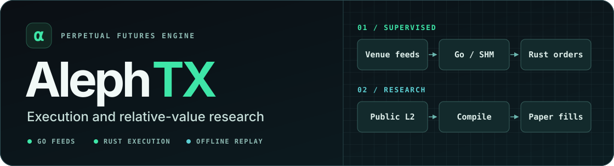

<h1 align="center">
  
</h1>

<p align="center">
  <a href="docs/QUICKSTART.md">Quickstart</a> ·
  <a href="docs/LIVE_TRADING.md">Trading and recovery</a> ·
  <a href="docs/CROSS_VENUE.md">Venue coverage</a> ·
  <a href="docs/PERP_RECORDING.md">Market data</a> ·
  <a href="docs/PERP_RELATIVE_VALUE.md">Paper execution</a>
</p>

AlephTX runs inventory-aware market making on Lighter, with an optional
inventory hedge on native Hyperliquid. Its separate research path compiles
recorded depth, funding and independent reference prices into reproducible
two-leg simulations for crypto and equity perpetuals.

## Validate locally

Run the profile check from the repository root. It resolves the network,
market and strategy mode without loading credentials or starting a feeder.

```sh
make trade MODE=check \
  CONFIG=config.example.toml
```

Use Rust 1.95.0 with rustfmt and Clippy and the pinned Go 1.25.0
toolchain. Offline CI covers Linux and macOS. The bundled
Lighter signer and supervised sessions require Linux x86-64.
[CI workflow](.github/workflows/ci.yml) · [Go module](feeder/go.mod)

```sh
make fmt-check
make check
make test
make build

target/release/cross_venue hedge-replay examples/hedge_replay.json
target/release/cross_venue perp-replay examples/crypto_funding_paper.json
target/release/cross_venue perp-replay examples/equity_basis_paper.json
```

The synthetic cases cover lost acknowledgments, funding carry and equity
basis reversion. The monitor tests use Python 3 with SQLite via
`make test-python`. The console build uses Node 22.12+ on the Node 22
line or Node 24 via `make dashboard-build`.
[Configuration reference](docs/CONFIGURATION.md)

## Operating modes

| Path | Mode | Strategy and configuration |
| --- | --- | --- |
| Supervised | `quant` | Lighter market making with fair-value, inventory and loss controls. Set `strategy_mode = "quant"`. |
| Supervised | `inventory_hedge` | Lighter market making with native Hyperliquid IOC hedges sized from confirmed inventory. Set `strategy_mode = "inventory_hedge"` and `[inventory_hedge]`. |
| Paper | `pair_hedge` | Funding carry or basis reversion on one matched pair per run. This is the default `pair.mode` for `perp-replay`. |
| Paper | Maker-first | Public prints advance a passive order's queue. Confirmed partials drive protected IOC hedges. See [maker-first replay](docs/PERP_RELATIVE_VALUE.md#maker-first-replay). |
| Paper | `turnover` | Round-trip turnover, fee and loss budgets. An optional incentive policy compares unit costs on a reviewed unissued-token venue. Set `pair.mode.kind = "turnover"`. |

The supervised launcher supports mainnet and testnet. Both network modes
can submit and cancel orders. The paper matrix covers the six pairings
among Entropy, Arcus, TradeXYZ and BULK. Entropy and TradeXYZ have distinct
books on shared Hyperliquid infrastructure, so that pair requires an
explicit shared-risk opt-in. [Trading runbook](docs/LIVE_TRADING.md) ·
[Venue capabilities](docs/CROSS_VENUE.md)

## Architecture

```mermaid
flowchart TB
    subgraph LIVE["01 · Supervised execution"]
        direction LR
        VENUE["Lighter and native Hyperliquid"] --> FEEDS["Go feeder"]
        FEEDS -->|BBO, depth and private events| SHM["Shared memory"]
        SHM --> EXEC["Rust strategy and order tracker"]
        EXEC -->|Orders and reconciliation| VENUE
        EXEC --> JOURNAL["Recovery journal"]
        EXEC --> TELEMETRY["Session telemetry"]
        JOURNAL --> AUDIT["Offline recovery and fee audit"]
        TELEMETRY --> AUDIT
        TELEMETRY --> OASIS["Oasis monitor and console"]
    end
    subgraph PAPER["02 · Public-data research"]
        direction LR
        PUBLIC["Public venue data"] --> RAW["Recorder and raw archive"]
        RAW --> COMPILER["Causal replay compiler"]
        INPUT["Reference prices, sessions and funding"] --> COMPILER
        COMPILER --> REPLAY["Two-leg paper execution"]
    end
```



The supervised Lighter order tracker consumes the 128-byte V2 private
event stream. The `[symbols]` table binds Go and Rust shared-memory
slots to tickers. Venue market IDs, tick sizes and lot sizes are separate
configuration values. [Shared-memory ABI](docs/DUAL_TRACK_IPC.md) ·
[Example profile](config.example.toml)

## Operations and evidence

| Boundary | Contract | Reference |
| --- | --- | --- |
| Session lifecycle | Start from verified flat positions and no open orders in the configured scope. Stop through the supervisor and verify cleanup before restarting. | [Launch and shutdown](docs/LIVE_TRADING.md#start-and-stop) |
| Exposure and recovery | Persist the UTC daily loss baseline and hedge intents. Retain reservations through ambiguous outcomes. An active journal blocks restart pending reconciliation. | [Execution and recovery](docs/LIVE_TRADING.md#execution-and-recovery) |
| Audit and observability | Bind fee evidence to exact order identity. Track venue-reported fees, modeled costs, trade PnL and account equity separately. | [Fee evidence](docs/LIVE_TRADING.md#bind-and-measure-fee-evidence) · [Oasis runbook](deploy/oasis/README.md) |
| Research acceptance | Preserve source and availability times, freeze parameters before the holdout, and report entry rejections, costs, residual exposure and final inventory. | [Recording](docs/PERP_RECORDING.md) · [Paper execution](docs/PERP_RELATIVE_VALUE.md) |

The 20-hour Oasis campaign measures cross-venue basis and funding alongside
a production-quote replay on public books and trades. Its holdout reports
include fee scenarios, entry rejections, fill costs and residual inventory.
Prospective venue rewards have zero value in the model.
[20-hour holdout](docs/PERP_RELATIVE_VALUE.md#oasis-holdout-2026-11-12) ·
[Adaptive quoting and turnover](docs/PERP_RELATIVE_VALUE.md#adaptive-quoting-and-turnover-replay-2026-11-13)

## Release gates for new execution routes

1. **Contract and market data.** Verify payoff, settlement, funding cadence,
   fee tier, tick and lot on both legs. Measure synchronization, depth and
   reference coverage in ordinary and stressed sessions.
2. **Net execution economics.** Use a chronological holdout to compare
   execution costs, funding coverage, residual exposure and liquidation
   marks with modeled edge. Retain rejected and incomplete runs.
3. **Failure recovery.** Exercise partial fills, lost acknowledgments, feed
   gaps, restart barriers and cleanup with deterministic fault injection.
   Schema 3 promotion also requires journal compatibility checks and
   commit tail latency measurements on the target host.

## Repository map

| Area | Source |
| --- | --- |
| Launch and CLI | [src/bin/](src/bin/) |
| Strategy and venue execution | [src/strategy/](src/strategy/) · [src/exchanges/](src/exchanges/) |
| Go feeds and shared memory | [feeder/](feeder/) |
| Durable recovery and evidence | [src/live_hedge/](src/live_hedge/) |
| Monitoring and console | [deploy/oasis/](deploy/oasis/) · [dashboard/](dashboard/) |
| Synthetic scenarios and capture profiles | [examples/](examples/) |

Keep credentials and private operational records outside Git. Review
the staged blobs and every outgoing commit before publishing.
[Engineering rules](AGENTS.md#sensitive-data-and-git) ·
[Benchmark context](docs/AUDIT_2026_11.md) · [MIT license](LICENSE)
