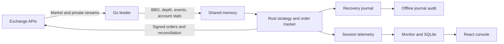

# AlephTX

AlephTX is a Go and Rust system for perpetual futures market making and
cross-venue research. Its primary trading path runs one Lighter market per
supervised session, with an optional Hyperliquid inventory hedge. The same
repository includes a public market recorder, offline execution and strategy
replays, and a console for monitoring trading sessions.

## Start locally

Use Rust 1.95.0 with `rustfmt` and Clippy, as pinned in
[CI](.github/workflows/ci.yml), and the Go version declared in [feeder/go.mod](feeder/go.mod).
The monitor tests require Python 3 with SQLite. Use Node 22.12+ on the Node 22
line or Node 24 for the dashboard. CI covers Linux and macOS. The bundled
Lighter signer and supervised trading require **Linux x86-64**.

Validate the checked-in example and run the core checks from the repository root.
The tests use offline fixtures and local test services. Installing build
dependencies can require network access.

```sh
make trade MODE=check CONFIG=config.example.toml
make fmt-check
make check
make test
make build
```

Run `make test-python` for monitor ingestion and alerts, and
`make dashboard-build` for the console type checks, tests, and production bundle.
`make benchmark` runs the opt-in local benchmarks. Record the hardware,
toolchain, workload, and baseline when comparing results. Historical
measurements and their scope are in the [engineering audit](docs/AUDIT_2026_11.md).

After `make build`, run the included synthetic scenarios without credentials.

```sh
target/release/cross_venue hedge-replay examples/hedge_replay.json
target/release/cross_venue perp-replay examples/crypto_funding_paper.json
target/release/cross_venue perp-replay examples/equity_basis_paper.json
```

These scenarios exercise order reconciliation, funding carry, and equity basis
reversion. The [paper replay guide](docs/PERP_RELATIVE_VALUE.md) describes the
liquidity, latency, and funding assumptions that limit how the results can be used.

## Architecture



Go owns ingestion and shared memory publication. Rust owns quoting, risk
reservations, signing, and submission. The Lighter strategy consumes the
128-byte V2 private events for the order lifecycle. Its quoting cycle wakes on
market updates or fills and checks freshness, worst-case exposure, and maker
edge before admitting new quotes. Pricing uses fresh external anchors when
available, with a local fallback and configurable inventory and markout controls.

The `[symbols]` table maps tickers to shared memory IDs across Go and Rust.
Each venue's market ID and tick and lot sizes are separate. See
[config.example.toml](config.example.toml) for a complete profile.

## Trading, recovery, and monitoring

- **Supervised trading.** Follow the [Lighter runbook](docs/LIVE_TRADING.md) to
  configure dedicated accounts, verify the mainnet or testnet profile, and start
  or stop the session. Startup requires the selected Lighter market to be flat
  with no open orders.
  Both `MODE=live` and `MODE=testnet` can submit and cancel orders. Keep
  credentials, local profiles with private data, and account evidence out of Git.
- **Risk and recovery.** The strategy persists the UTC daily loss budget across
  restarts. The optional hedge bounds single-leg and net exposure, records each
  IOC intent before dispatch, and waits for terminal order evidence and a
  matching account position before releasing its reservation. Unverified cleanup
  leaves an active journal that blocks restart.
- **Journal audit.** `cross_venue hedge-journal-audit JOURNAL [EVIDENCE]` reads
  local files and reports reconciliation gaps, possible exposure, and fee
  evidence when supplied. Its verdict covers the supplied evidence. Restart
  remains an operator decision after both venues are reconciled. Supervised
  sessions write schema 2. Schema 3 Lighter batch records and the shared serial
  journal are exercised in offline trials.
- **Oasis console.** Session telemetry is separate from the recovery journal.
  The [Oasis runbook](deploy/oasis/README.md) covers the public feeder, console,
  access tunnel, and emergency stop. The monitor uses the strategy's persisted
  daily loss baseline and configured threshold for drawdown alerts. Combined
  trade PnL identifies estimated hedge prices and fees and excludes funding.
  Account equity is reported separately.
- **Research and adapters.** The [cross-venue guide](docs/CROSS_VENUE.md)
  distinguishes public data, standalone order APIs, and replay. Use the
  [recording guide](docs/PERP_RECORDING.md) for public capture, clock alignment,
  equity sessions, and funding evidence. Legacy strategy launchers have their
  own execution and recovery behavior.

## Repository map

| Path | Responsibility |
| --- | --- |
| [src/bin/](src/bin/) | Supervised launcher, cross-venue CLI, and strategy entry points |
| [src/strategy/](src/strategy/) | Quoting, risk sizing, and offline replay |
| [src/exchanges/](src/exchanges/) | Venue protocols, metadata, signing, and execution |
| [src/live_hedge/](src/live_hedge/) | Journal records and read-only reconciliation audit |
| [feeder/](feeder/) | Go streams, shared memory producers, and public recorder |
| [deploy/oasis/](deploy/oasis/) and [dashboard/](dashboard/) | Monitor, deployment runbook, and console |
| [examples/](examples/) | Replay and capture inputs, plus venue diagnostics |

Repository engineering rules and review criteria live in [AGENTS.md](AGENTS.md).
[CLAUDE.md](CLAUDE.md) imports the shared rules for Claude Code.

## Roadmap

1. **Prove recovery under failure.** Expand deterministic replay and restart
   tests for lost acknowledgments, partial fills, feed gaps, and crashes around
   journal writes and order sends. Before enabling schema 3 in supervised
   trading, verify compatibility with existing journals and measure commit
   tail latency under contention on the target host. Require reconciliation when
   evidence is incomplete.
2. **Calibrate with recorded evidence.** Build synchronized depth, reference,
   and funding datasets for matched markets. Evaluate on a chronological
   holdout, including stressed sessions. Compare net execution cost, markout,
   time with residual exposure, and accounting coverage. Preserve the distinction
   between estimates, venue-reported costs, and actual account equity.
3. **Expand after the controls scale.** Add markets and venues only after
   validating contract identity, account and portfolio limits, and recovery for
   each integration. Benchmark execution changes with representative data and
   venue behavior before choosing a transport or claiming a latency improvement.

[MIT license](LICENSE).
