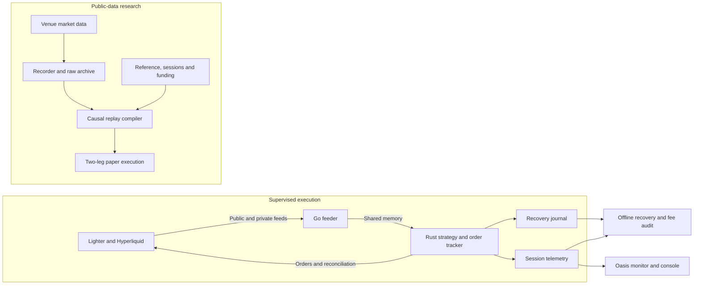

# AlephTX

AlephTX is a Go and Rust engine for perpetual futures execution and
cross-venue research. Its supervised execution path runs inventory-aware
market making on one Lighter perpetual per session, with an optional
inventory hedge on native Hyperliquid. Its research path turns recorded
order books, funding and independent reference prices into reproducible
simulations for crypto and equity perpetuals.

## Operating modes

| Mode | Scope | Entry point |
| --- | --- | --- |
| `quant` | Single-venue Lighter market making with fair-value, inventory and loss controls | Supervised profile with `strategy_mode = "quant"` |
| `inventory_hedge` | Lighter market making with Hyperliquid IOC hedges sized from confirmed inventory | Supervised profile with `strategy_mode = "inventory_hedge"` and `[inventory_hedge]` |
| `pair_hedge` | Offline two-leg funding carry or basis reversion, one matched market pair per run | `cross_venue perp-replay`, the default `pair.mode` |
| `turnover` | The same offline strategies with explicit turnover and fee budgets on new entries | `cross_venue perp-replay` with `pair.mode.kind = "turnover"` |

The current research matrix covers the six pairings among Entropy, Arcus,
TradeXYZ and BULK. Entropy and TradeXYZ have distinct books and share
Hyperliquid infrastructure. A replay pairing them requires an explicit
shared-risk opt-in. Standalone adapters and supervised routes have
different operational guarantees. [Venue capabilities](docs/CROSS_VENUE.md).

## Validate locally

Use Rust 1.95.0 with rustfmt and Clippy and the Go version pinned in the
module. The bundled Lighter signer and supervised trading require Linux
x86-64. Offline CI runs on Linux and macOS.
[CI workflow](.github/workflows/ci.yml) · [Go module](feeder/go.mod)

```sh
make trade MODE=check CONFIG=config.example.toml
make fmt-check
make check
make test
make build
```

`MODE=check` validates and resolves the profile without reading credentials.
After building, run the included synthetic scenarios from the repository root.

```sh
target/release/cross_venue hedge-replay examples/hedge_replay.json
target/release/cross_venue perp-replay examples/crypto_funding_paper.json
target/release/cross_venue perp-replay examples/equity_basis_paper.json
```

For the monitor, use Python 3 with SQLite and run `make test-python`. For
the console, use Node 22.12+ on the Node 22 line or Node 24 and run
`make dashboard-build`. `make benchmark` runs opt-in local benchmarks.
Record hardware, toolchain, workload and baseline when comparing results.
[Engineering audit](docs/AUDIT_2026_11.md).

## Architecture



Go owns ingestion and shared-memory publication. Rust owns pricing, risk
reservations, signing and submission. The Lighter order tracker consumes the
128-byte V2 private event stream. The `[symbols]` table maps tickers to
shared-memory IDs across both languages. Venue market IDs and order
precision are configured separately. [Example profile](config.example.toml).

## Operations and evidence

| Responsibility | Contract | Guide |
| --- | --- | --- |
| Launch and shutdown | Start from verified flat positions and no open orders in the configured scope. Both network modes can submit and cancel orders. Keep credentials, private profiles and account evidence outside Git. | [Supervised trading](docs/LIVE_TRADING.md) |
| Exposure and recovery | Persist the UTC daily loss baseline. Record hedge intents before sending and retain reservations through ambiguous outcomes. An active journal blocks restart until both venues are reconciled. | [Execution and recovery](docs/LIVE_TRADING.md#execution-and-recovery) |
| Audit and observability | Audit frozen journal and fee evidence offline. Keep venue-reported fees, configured-rate estimates, trade PnL and account equity separate. The monitor uses the strategy's daily loss baseline and threshold. | [Fee evidence](docs/LIVE_TRADING.md#bind-and-measure-fee-evidence) · [Oasis runbook](deploy/oasis/README.md) |
| Market research | Preserve source and availability times. Compile reviewed contract terms and reference data, then evaluate fixed parameters on a chronological holdout. | [Recording](docs/PERP_RECORDING.md) · [Paper execution](docs/PERP_RELATIVE_VALUE.md) |

A research run should retain the raw data and configuration hashes,
training cutoff, source-time coverage, entry rejections, round-trip execution
costs, maximum residual exposure and final inventory. Count settled funding
separately from forecasts and value prospective venue rewards at zero.
The four-venue NVDA sample establishes synchronized market-data coverage
under its recorded settings. [Coverage report](docs/PERP_RECORDING.md#nvda-coverage-check).

## Repository map

| Path | Responsibility |
| --- | --- |
| [src/bin/](src/bin/) | Supervised launcher, cross-venue CLI and strategy entry points |
| [src/strategy/](src/strategy/) | Quoting, risk sizing and offline execution |
| [src/exchanges/](src/exchanges/) | Venue protocols, metadata, signing and execution |
| [src/live_hedge/](src/live_hedge/) | Recovery journal and read-only evidence tools |
| [feeder/](feeder/) | Go feeds, shared-memory writers and public recorder |
| [deploy/oasis/](deploy/oasis/) and [dashboard/](dashboard/) | Monitor, deployment runbook and console |
| [examples/](examples/) | Synthetic scenarios, capture inputs and evidence fixtures |

[Quickstart](docs/QUICKSTART.md) · [Configuration reference](docs/CONFIGURATION.md) ·
[Shared-memory ABI](docs/DUAL_TRACK_IPC.md) · [Engineering rules](AGENTS.md)

## Release gates for new execution routes

1. **Contract and market data.** Verify payoff, settlement, funding cadence,
   fee tier, tick and lot on both legs. Measure synchronization, depth and
   reference coverage in ordinary and stressed sessions.
2. **Net execution economics.** On a chronological holdout, measure realized
   fill prices, fee and funding coverage, residual exposure and liquidation
   marks against the modeled edge. Keep rejected and incomplete runs.
3. **Failure recovery.** Verify partial fills, lost acknowledgments, feed
   gaps, restart barriers and cleanup with deterministic fault injection.
   Promoting schema 3 requires journal compatibility checks and commit tail
   latency measurements on the target host.

[MIT license](LICENSE).
