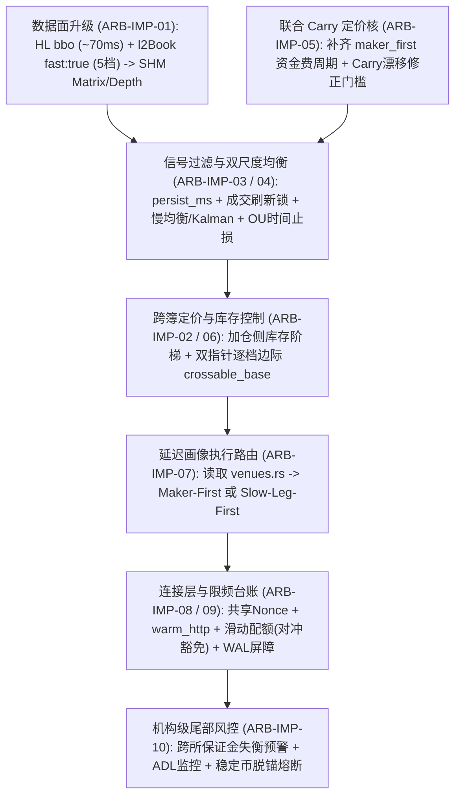

# 跨所永续套利策略深度研究与 AlephTX 改进方案（2026-11-22）

> **边界与合规声明**：本文档为**研究参考与架构改进设计**，基于对开源项目 [`your-quantguy/entropy-arb`](https://github.com/your-quantguy/entropy-arb) 的源码拆解、业界跨所永续套利最佳实践调研，以及对 AlephTX 现有源码的静态对比审阅。当前三条业务赛道（`01_quant_profit`、`02_hedge_arbitrage`、`03_incentive_turnover`）继续维持 **`HOLD`**，本文档**不授权**任何实盘下单、撤单、账户调整、部署或服务重启；所有策略参数与改造在推进实盘前，仍须严格通过 `AGENTS.md` 规定的独立账本、连续 10 小时因果回放及冻结样本外门禁。

---

## §1. 执行摘要（Executive Summary）

### 1.1 核心判断

[`your-quantguy/entropy-arb`](https://github.com/your-quantguy/entropy-arb) 是一个结构紧凑的单币种 Python 异步 **Taker–Taker** 跨所套利机器人，固定以 Hyperliquid HIP-3 上的 **Entropy**（`io` DEX）为一腿，以 **Lighter Core**（USDC）、**Lighter Robinhood**（USDG）或 **TradeXYZ**（`xyz` DEX）为对冲腿。

横向对比来看，**AlephTX 在系统底层可靠性、因果回放严谨度、写前恢复屏障与场所能力审计方面明显领先于 `entropy-arb`**（如 Go+Rust 12 槽无锁 Seqlock 共享内存、128B V2 私有事件环、写前对冲日志与双所重启屏障、[`src/venues.rs`](../src/venues.rs#L9-L209) 版本化场所能力与减速带档案、以及连续 10 小时零前视回放）。但 `entropy-arb` 直接面向我们同构的 HIP-3（`io` / `xyz`）与 Lighter（Core / RH）实盘生态，暴露出几处 **AlephTX 目前尚缺或可立即吸收的战术微结构设计**；同时将其与业界机构级统计套利、联合基差-资金费优化及尾部风险控制实践对照后，我们整理出 **10 项优先级清晰的改进方案（`ARB-IMP-01` ~ `ARB-IMP-10`）**。

### 1.2 全景横向对比总表

| 维度 | `your-quantguy/entropy-arb` | 业界机构级跨所套利最佳实践 | AlephTX 现状与真实差距 |
| :--- | :--- | :--- | :--- |
| **信号与均衡中枢** | 人工基于 1m CSV 中位数填写静态 `midline_bps` + 固定 `upper`/`lower` 带宽 | **双尺度均衡 + 体制感知**：慢卡尔曼截距/稳健中位数吸收结构差 + OU 均值回归 / Leung–Li 有界入场区间与时间止损 | [`MakerBasisReversion`](../src/strategy/relative_value/paper/maker_first/basis_reversion.rs#L8-L22) 与 [`BasisConfig`](../src/strategy/relative_value.rs#L309-L327) 仅有单一短半衰期 EWMA（`2m`–`30m`），缺慢均衡与 RTH/盘外体制切换 |
| **库存控制** | **非对称线性库存阶梯**：利用率超 `floor_frac` 后仅对**加仓方向**叠加最高 `+scale_bps`，减仓不加价 | 加仓侧凸性惩罚 + 减仓侧按持仓/资金费成本软化；控制净暴露与单腿杠杆不越界 | 当前主基差引擎为单仓开平模式，[`maker_first.rs`](../src/strategy/relative_value/paper/maker_first.rs#L53-L171) 尚缺连续持仓分档库存阶梯 |
| **资金费建模** | 完全不建模，仅靠仓位上限硬扛 | **基差与 Carry 联合优化**（Ackerer–Hugonnier–Jermann 无套利带宽 + 预期持仓期 $T^*$ 下的净资金流积分与盈亏平衡门槛） | [`multiday_carry.rs`](../src/strategy/multiday_carry.rs#L24-L69) 独立存在，而 [`maker_first.rs`](../src/strategy/relative_value/paper/maker_first.rs#L1550-L1568) 仍标阻塞项 `maker_first_funding_lifecycle_not_supported` |
| **执行模式与非对称延迟** | 双腿并发 Taker（HL IOC + Lighter Market/IOC），`0 bps` 乐观费率假设，忽视 Lighter `300 ms` 减速带 | 非对称延迟下默认 **Maker-First（慢/零费腿）+ Fast-Leg IOC**；若必须双吃单则 **Slow/Thin-Leg-First 顺序锁腿** + 断腿紧急平仓器 | 已有 [`venues.rs`](../src/venues.rs#L94-L209) 完整记录 `300 ms` 减速带与 `0.00` 通用 HIP-3 禁用规则，但尚未建立**按场所延迟画像自动选择执行拓扑**的路由层 |
| **深度与跨簿定价** | 双指针 `crossable_base` 逐档扫描，仅取扣费后边际仍满足阈值的深度再乘 `take_fraction` | 多档体积加权可执行价差 + 按滑点/冲击预算自适应切片 | [`Depth::build`](../src/strategy/relative_value.rs#L1070-L1104) 先按单腿 `max_impact` 截断再试手数；实盘 [`plan_ioc`](../src/live_hedge.rs#L948-L997) 仍只看 HL L1 单档 |
| **信号与盘口微结构护栏** | `premium_persist_sec`（过滤单 tick 幽灵）+ `book.last_update_ts > last_traded_ts`（防重复扫旧簿） | 双边到达偏斜检查 + 持续性门控 + 成交后快照栅栏 + API 延迟退化熔断 | 已有 `max_quote_skew_ms` 与 `SampleCadence`，缺 `persist_ms` 持续时间门控 |
| **Hyperliquid / Lighter 协议适配** | HL `l2Book fast: true`（5 档 ~500ms）、共用 `NonceAllocator`、核心净值去重、`warm_http` TLS 保活、Lighter REST 5s 宽限期 | HL 按场景区分 `bbo`（~70ms 区块级）与 `l2Book fast: true`、监控 `expiresAfter` 5× 惩罚；Lighter `maker-only` 密钥分通道 + WS 2m 保活 | [`perp-capture`](../feeder/cmd/perp-capture/main.go#L128-L132) 支持 `-hl-fast-book`，但实盘 [`hyperliquid.go`](../feeder/exchanges/hyperliquid.go#L126-L137) 仅订标准 `l2Book` 且未写 `aleph-depth`；[`HyperliquidTrading`](../src/exchanges/hyperliquid/client.rs#L226-L375) 缺 `warm_http` 与多 DEX Nonce 共享封装 |
| **风控与崩溃恢复** | 纯内存仓位/现金、`unresolved=True` 先记 `0` 成交再靠 15s 对账修正；有滑动限频与宕机探测 | 写前日志（WAL）+ 权威终态对账 + 最坏在途敞口预留 + **ADL 队列/跨所保证金再平衡/稳定币脱锚熔断** | WAL、双所重启屏障、最坏敞口预留及 `USDG`/`USDC` 隔离已达机构级；仍缺 **ADL 队列监控、跨所保证金水位平衡、稳定币脱锚熔断** |

---

## §2. `your-quantguy/entropy-arb` 源码深度拆解

该仓库共约 2,000 余行核心 Python 代码，结构清晰，核心路径集中在 `entropy_arb/` 与 `tools/`：

- **`entropy_arb/book.py`**：维护统一 `OrderBook`（兼容 zkLighter snapshot+diff 与 Hyperliquid 全量快照），以“任何入站 WS 帧刷新 `alive_ts`”做连接级保活；提供 `crossable_base`、`walk_depth` 与 `plan_arb`。
- **`entropy_arb/feeds.py`**：`LighterBookFeed` 校验 `begin_nonce > prev + 1` 时清空簿面并退订重订；`HLBookFeed` 订阅官方 WS `l2Book` 并显式传入 `"fast": true`，每 5 秒发送应用层 `ping`。
- **`entropy_arb/venue_hl.py`**：动态查询 `perpDexs` 计算 HIP-3 `asset_id = 110000 + (dex_index - 1) * 10000 + idx`；支持两腿共用同一 HL 代理私钥时共享 `NonceAllocator` 并清零对冲腿的 `include_core_equity`；IOC 超时或 5xx 时按 `cloid` 轮询 `orderStatus`；提供 `warm_http()` 保活连接。
- **`entropy_arb/venue_lighter.py`**：使用独立 `AccountOrdersFeed` 订阅 `account_orders/{market_id}/{account_index}`（每 8 分钟无在途单时刷新 auth token），发单走 `ORDER_TYPE_MARKET` + `IOC` 均价保护；支持 `warm_http()` 同时保活普通 REST session 与 Lighter SDK `signer.api_client` 内部连接池。
- **`entropy_arb/engine.py`**：主循环包括 `_scan`（方向评估、持续性 arming、头寸余量裁剪）、`_execute`（持双所锁并发 `send_taker`）、`_hedge`（超 `net_tolerance_base` 触发 `reduce_only` Taker 追平）、`_reconcile_positions`（设 `RECONCILE_GRACE_SEC = 5.0` 防 REST 覆盖新成交）与滑动 60s 下单预算 / 429 暂停 / 宕机 30s 探针。
- **`entropy_arb/recorder.py` & `tools/analyze.py`**：1 秒采样写入 1 分钟汇总 CSV（记录 `premium_*` 与税前 `sell_edge_max_bps` / `buy_edge_max_bps`），`analyze.py` 取中位数作 `midline_bps`，取扣费后各分钟可执行余量的 90 分位（~10% 分钟触发）作 `upper_bps` / `lower_bps`。

### 2.1 值得借鉴的 5 项设计细节

1. **非零常态中枢 + 仅针对加仓方向的线性库存阶梯**
   - 在 `engine.py` 的 `_eff_threshold` 与 `_inv_add_bps` 中，策略明确允许买方向阈值 `lower_bps - midline_bps` 为负值（当 Entropy 长期溢价 `+5 bp` 时，在 `0 bp` 买回本质是相对均衡便宜 `5 bp` 的盈利平仓）。
   - 更巧妙的是库存惩罚函数 `ramp(v, adding)`：仅当交易方向与该所现有净持仓同向扩大风险（`buy.position >= 0` 或 `sell.position <= 0`）且利用率超过 `floor_frac` 时，才线性叠加最高 `scale_bps` 的额外边缘要求；**反向减仓永远享受原始较低阈值**。这比“双向同时加宽”或“到达硬上限一刀切”更能温和控制单边累积，同时加速均值回归兑现。
2. **信号持续性门控（`premium_persist_sec`）+ 成交后双盘口刷新锁**
   - `_scan` 首次检测到满足扣费边缘时只把 `_armed[dkey]` 置为当前时间戳并预约定时唤醒（`_schedule_poke`），只有经过 `premium_persist_sec`（README 推荐 `0.3s`）价差依然存活才放行。这能低成本过滤掉跨所异步 WS 到达瞬间差形成的单 tick 假交叉。
   - 成交后记录 `buy.last_traded_ts = sell.last_traded_ts = time.time()`，强制要求双腿 `book.last_update_ts > last_traded_ts` 才允许下一次评估，防止撮合引擎尚未推送成交后新簿面时连续向同一残留盘口重复连射。
3. **双指针逐档边际跨簿定价（`crossable_base`）**
   - `book.py` 用两根指针同步步进 `buy_book.asks` 与 `sell_book.bids`，逐片验证 `b_px * (1 - sell_fee) >= a_px * (1 + buy_fee) * (1 + threshold)`。一旦边际档位不满足门槛立即截断，返回最大可执行量 `q_max`，按 `take_fraction`（如 `0.5`）折减后再顺着真实多档深度 `walk_depth` 计算最差可接受限价作为下发保护边界。这比“先看 L1 价差再盲目按百分比吃深度”准确得多。
4. **Hyperliquid `l2Book` `"fast": true` 与低频长连接 HTTP/TLS 保活**
   - `feeds.py` 在订阅 Hyperliquid 盘口时主动携带 `"fast": true`；`engine.py` 每 10 秒通过 `_http_keepalive_loop` 对所有交易链路的 HTTP 连接池（含 Lighter signer 内部 `pool_manager`）发送轻量级读请求，避免套利机会稀疏时 TCP/TLS 闲置断开导致首单冷握手多耗 `10–15 ms`。
5. **多 HIP-3 DEX 实盘工程经验与 Lighter 滞后印证**
   - **同账号多 DEX 处理**：当 Entropy (`io`) 与 TradeXYZ (`xyz`) 共用同一个 HL Agent 私钥与主账号时，显式共享同一个单调 `NonceAllocator`，并将对冲腿 `include_core_equity` 设为 `False` 防止双计核心保证金。
   - **Lighter REST 滞后警示**：`engine.py` L580-L583 注释明确指出 Lighter `/api/v1/account` REST 持仓查询显著滞后于 `account_orders` WS 成交回报，刚成交后若立即以 REST 结果覆写本地仓位会导致“幽灵对冲震荡”。这与 AlephTX 在 [`src/exchanges/lighter/trading.rs`](../src/exchanges/lighter/trading.rs#L121-L160) 坚持使用 `transaction_time` 成交水位线（`watermark_covers`）与 [`live_hedge.rs`](../src/live_hedge.rs) 双场所恢复屏障的工程判断完全一致。

### 2.2 绝不能照搬的 5 个硬伤（对照 AlephTX 红线）

1. **极度乐观的 0 费假设 + 无视 Lighter `300 ms` Taker 减速带**
   - `config.example.yaml` 将 `entropy.taker_fee_bps` 与 `hedge.taker_fee_bps` 默认设为 `0.0`（README 依赖 Tier 4 返佣推荐链接），完全忽略 HIP-3 各资产独立的 `deployerFeeScale` 与 `growthMode` 动态费率规则——而 AlephTX 已在 [`src/venues.rs`](../src/venues.rs#L84-L88) 与 [`src/exchanges/hyperliquid/model.rs`](../src/exchanges/hyperliquid/model.rs#L23-L31) 明确拒绝给 Entropy/TradeXYZ 填通用静态费率。
   - 更致命的是 **Lighter Standard 虽为 `0 bps`，但 Taker/Non-PostOnly 订单存在 `300 ms` 确定性减速带**（见 [`src/venues.rs`](../src/venues.rs#L94-L169)），而 Hyperliquid IOC 几乎按区块同步完成。在 `300 ms` 非对称延迟下“双腿并发 Taker”，极易演化成 HL 瞬间吃单成交、Lighter 300ms 后价格滑走/撤单失败的单腿裸露。
2. **完全缺位资金费（Funding）与 `USDG / USDC` 汇差建模**
   - 作者在 README 末尾也坦承“不建资金费模型”且“未隔离 `lighter-rh` 的 `USDG` 计价风险”。AlephTX 的 RWA 实证已表明 Lighter Core 小时资金费相当可观（例如 NVDA 日化可达 `+14–17 bp/d`），且 [`README.md`](../README.md#L99) 明确禁止在 `RobinhoodMainnet`（`USDG`）与原生 `USDC` 域之间做隐式跨结算对冲。忽视资金费漂移的静态网格极易在持仓数小时后“赚微薄点差、亏多倍资金费”。
3. **静态 `midline_bps` + 无体制切换 + 无样本外验证**
   - `tools/analyze.py` 直接将全部历史 1 分钟 CSV 的中位数和 P90 推荐给实盘配置文件，既没有切分美股 RTH 连续盘、盘前盘后和休市（不同阶段两所 Oracle 机制差异极大，而该仓库主打标的恰恰是美股 RWA `SNDK`），也没有冻结参数与独立前向 holdout 验证。一旦中枢漂移 `3–5 bp`，静态网格会单边吃满整个仓位上限并在亏损中反复止损。
4. **纯内存状态机、无写前日志与弱在途敞口预留**
   - 仓位与现金仅存内存；`send_taker` 返回超时（`unresolved=True`）时，`_execute` 先按 `filled_base = 0.0` 记账，再异步触发 `_reconcile_positions` 去 REST 捞状态。若此时进程崩溃重启或 REST 恰处 5 秒宽限期内，极易漏记已成交单腿或引发重复对冲。这完全不能满足 AlephTX 的写前日志（[`journal.rs`](../src/live_hedge/journal.rs)）和“无权威终态与仓位水位前严禁释放敞口”铁律。
5. **常规市场下双 Taker 结构缺乏经济可行性**
   - 如 [战略与战术优化路线图](./STRATEGIC_AND_TACTICAL_OPTIMIZATION_ROADMAP_2026_11_21.md) 与 [独立策略研究](./INDEPENDENT_STRATEGY_RESEARCH.md) 所示，双边 Taker 开平共四笔吃单，叠加双边点差、扫盘冲击及 `300 ms` 逆向选择，在无高额外部返佣补贴时，大多数中等波动窗口下收益天花板远低于 **Maker-First + Protected IOC Hedge** 或 **低换手多日 Carry**。

---

## §3. 业界跨所永续套利最佳实践深度综述

脱离单一开源脚本，机构级跨所永续套利系统通常围绕以下 **6 个核心支柱**构建：

### 3.1 动态基差均衡估计与体制感知（Kalman Filter + 双尺度解耦）

跨所永续价差 $B_t = \ln(P_{A,t} / P_{B,t}) \times 10^4$（或 bps 差）并非零均值白噪声，而是由三部分叠加：**慢变结构基差**（稳定币升贴水、指数/Oracle 构成差、永续资金费预期贴现）+ **中短周期均值回归偏离** + **微观结构噪声**。

1. **状态空间 Kalman 滤波（动态截距模型）**
   - 对于同标的同乘数线性永续（$\beta_t \equiv 1$ 物理约束，防止自由回归对斜率过拟合），一般将隐状态简化为随时间慢游走的结构基差 $\alpha_t$：
     $$B_t = \alpha_t + \varepsilon_t, \quad \varepsilon_t \sim \mathcal{N}(0, R_t)$$
     $$\alpha_t = \alpha_{t-1} + w_t, \quad w_t \sim \mathcal{N}(0, Q)$$
   - 通过调节过程噪声与观测噪声比 $Q / R_t$，使得 **Kalman 增益在常规平静期平滑追踪慢变中枢，在盘口流动性变薄或异常尖刺（提高 $R_t$）时自动降低跟随权重**，避免短时极端错价把“中枢基准”拽偏（对比普通短周期 EWMA 极易在单边剧烈偏离时迅速追高，反而把真实入场信号“自我消化”掉）。
2. **双尺度解耦与体制重置（Regime-Aware Reset）**
   - 工业界实践常拆成两层：**慢速均衡 $\mu_{\text{slow}, t}$**（例如 4h–24h 滚窗加权中位数或低增益 Kalman 截距，天然抗尖刺）与**快速交易信号 $s_t = B_t - \mu_{\text{slow}, t}$**。
   - 对 RWA 美股永续（如 `NVDA`、`SPY`、`SNDK`），**美股主盘（RTH）↔ 盘前盘后 ↔ 夜间休市/周末**属于完全不同的 Oracle 定价体制。切入新体制时若直接沿用上一体制的基差均值，会出现系统性假偏离，必须在跨体制边界显式切换独立统计桶或重置快速偏离滤波器。

### 3.2 Ornstein–Uhlenbeck（OU）过程、Leung–Li 最优双停时与库存控制

在提取干净的偏离序列 $X_t = B_t - \mu_{\text{slow}, t}$ 后，业界常以 **Ornstein–Uhlenbeck（OU）过程**建模其均值回归动力学：

$$dX_t = \theta(\mu - X_t)\,dt + \sigma\,dW_t$$

其中均值回归半衰期为 $T_{1/2} = \frac{\ln 2}{\theta}$，稳态标准差为 $\sigma_{\infty} = \frac{\sigma}{\sqrt{2\theta}}$。直接引入三个经典落地结论：

1. **基于半衰期 $T_{1/2}$ 的时间止损（Time-Stop）**
   - 若一笔套利入场后经历 $k \cdot T_{1/2}$（常用 $k \in [2, 4]$）仍未发生实质性收敛，意味着原稳态假设可能已失效（发生体制迁移或单一交易所预言机切换），应触发**降级退出或停止加仓**，防止“短期套利被熬成长期裸方向/资金费亏损仓”。
2. **Leung & Li（2015）含交易成本与止损约束的最优双停时启示**
   - Leung 与 Li 在 *Optimal Mean Reversion Trading* 中严格证明了两个经常被初级脚本忽略的反直觉结论：
     - **最优入场是一个“有界区间” $[a^*, d^*]$，而不是“越偏离越无脑加仓”**：当价差极端恶化超过外边界（类似统计止损域）时，继续加仓的风险收益比急剧恶化（往往对应行情断层、链上故障或 Oracle 脱锚），必须停止开新仓甚至止损；
     - **止损线 $S_L$ 与最优止盈线 $b^*$ 存在单调耦合**：风控止损收得越紧（$S_L$ 越靠近均衡），最优止盈门槛 $b^*$ 也必须相应下移、尽早落袋为安，因为提早砍单削减了未来等来极限大回归的期望收益。
3. **非对称库存阶梯与 Avellaneda–Stoikov 偏斜融合**
   - 借鉴做市理论的库存保留价偏移（$r(s,q) = s - q \gamma \sigma^2 \tau$）与分段阶梯思路：
     - **加仓侧**：超过安全缓冲比例 $u_0$ 后，附加惩罚随净库存利用率凸性或分段线性抬升（从 $0$ 升至 `scale_bps`），既允许在极深错价时吃大份、又避免在微小 edge 上一次把额度打满；
     - **减仓/平仓侧**：只要净现金或预期综合净值（含资金费）覆盖**真实退出成本**即可加速释放，不额外叠加加仓惩罚，加快资金周转与库存归一化。

### 3.3 基差与资金费联合优化（Joint Basis + Carry Optimization）

在永续合约套利中，**基差收益与资金费收益是同一枚硬币的两面**。Ackerer、Hugonnier 与 Jermann（*Perpetual Futures Pricing*, 2024）证明：在有交易摩擦的市场里，永续合约与基准价之间天然存在由交易成本决定的**无套利缓冲带**；只要在带宽内，偏差不会立刻归零，而是通过持续的资金费率（Funding Rate）向相反方向产生现金流漂移。

对一笔预期持有时长为 $T$ 的跨所头寸（做多 A 腿、做空 B 腿），联合净期望收益模型为：

$$\max_{T,\,q} \; \mathbb{E}\!\left[ \Delta B_T(q) + \int_{0}^{T} \bigl(f_{\text{short}}(t) - f_{\text{long}}(t)\bigr)\,dt - \mathcal{C}_{\text{entry}}(q) - \mathcal{C}_{\text{exit}}(q) - \mathcal{R}_{\text{legging+flip}}(T, q) \right]$$

其中关键工程推论有三点：

1. **盈亏平衡持仓时间（Break-Even Horizon $T_{\text{be}}$）**
   - $T_{\text{be}} = \frac{\mathcal{C}_{\text{entry}} + \mathcal{C}_{\text{exit}}}{\mathbb{E}[\Delta f_{\text{per\_slot}}]}$。如果纯靠 Carry 覆盖双边进出总成本需要十几个甚至几十个结算周期，就不能把它当短线交易，而必须要求**进场基差本身处于有利侧**或**长周期资金费差具备高持久性**。
2. **Carry 方向对基差门槛的非对称修正（Funding-Adjusted Effective Threshold）**
   - **顺 Carry 仓位（持有期间净收资金费）**：等待回归的每一小时都在“生息”，可以适度放宽持仓耐心与时间止损，或在基差略宽于纯成本线时即入场；
   - **逆 Carry 仓位（持有期间净付资金费）**：相当于“带租金做均值回归”，入场净基差必须额外预留 $\ge \mathbb{E}[T_{\text{hold}}] \times |\Delta f_{\text{hourly}}| + \text{安全边际}$，且绝不长期死扛不收敛仓位。
3. **结算时刻前后微结构窗口管理**
   - 在每小时或每 8 小时资金费结算前后的几十秒内，两所盘口常出现短暂抽离或抢结算冲击；高频基差策略应在结算窗口周边收紧滑点与新开仓保护，长周期 Carry 则须严格以交易所 `source_time` 判定仓位归属，防止延迟回报导致资金费记账错位。

### 3.4 非对称延迟环境下的执行排序与断腿风控

在跨所套利中，**“同时发单（Simultaneous）”在物理上只是幻觉**——两家交易所没有共享原子撮合引擎。特别是当一腿为传统/高速 CLOB、另一腿存在减速带或低流动性时，业界按场所延迟特征严格区分三种执行拓扑：

| 场所延迟与流动性特征 | 推荐执行拓扑 | 核心风控护栏 | 典型适用场景 |
| :--- | :--- | :--- | :--- |
| **对称低延迟 + 极低吃单费** （如 Tier-1 CEX ↔ CEX 同机房） | **并发保护 IOC**（Simultaneous Protected IOC） | 按双指针跨簿取交集深度的 `take_fraction`，设单笔保护限价，断腿后立即在深池侧触发紧急 Flattener | 极短瞬时大错价，两端 RTT 差 $<5\text{ ms}$ |
| **一腿 0ms/低费 Maker + 一腿高流快所** （如 Lighter `0 ms` PostOnly / Arcus ↔ HL / Binance） | **Maker-First + Fast-Leg Protected IOC** | 领先源异动触发 `cancel_lane` 抢先撤单；**确认 Maker 成交回报后再向快所下发多档扫盘保护 IOC** | 常态基差回归与 Carry 建平仓（**AlephTX 主力路线**） |
| **极端大错价且必须双方吃单，但存在显著慢腿/薄腿** （如 Lighter `300 ms` Taker ↔ HL `0 ms` IOC） | **Slow/Thin-Leg-First 顺序执行** | **先发慢/薄腿 IOC 并等待权威终态**；仅当慢腿确权成交量 $q_{\text{filled}} > 0$ 后，再向快/深腿打对应保护 IOC；若慢腿失败则零成本放弃 | 极端行情下瞬时基差足以覆盖四笔费 + 双倍滑点 + `300 ms` 漂移缓冲 |

> **关键原则**：当一腿存在 **`200–300 ms` 确定性 Taker 减速带** 时，并发双 Taker 几乎等价于“先在快所立刻花钱买单边风险，再去赌慢所 300ms 后价格还没变”。把顺序反转成 **Slow-Leg-First**（或直接用 **Maker-First**）能将最坏损失从“滑点 + 吃单费 + 无对冲裸敞口”压缩为“慢腿滑空零成交（无损失）或仅慢腿成交后由高速腿即时对冲”。

### 3.5 Hyperliquid（含 HIP-3）与 Lighter 协议级最佳配置要点

1. **Hyperliquid（Core 与 HIP-3 `io` / `xyz`）**
   - **行情通道分层选用**：
     - 标准 `l2Book`：默认 20 档，公网 WS 推送节流周期较慢（秒级）；
     - `l2Book` + `"fast": true`：官方提供的低延迟精简模式，推送 **Top-5 深度**，推送节流缩短至约 **500 ms**；
     - `bbo` 通道（`{"type": "bbo", "coin": ...}`）：基于 Hyperliquid 出块（约 **70 ms**）的**事件驱动 BBO**，每当买一/卖一发生变动即出块推送（无变化则静默），是目前公网 WS 捕捉 L1 跳变最快的方式；更高需求则需运行本地非验证节点或基础设施 gRPC 流。
   - **限频与 Nonce 规则**：
     - Batch 权重为 `1 + floor(batch_len / 40)`；单 IP 上限为 10 条 WS 连接、1,000 个订阅、100 个并发在途 POST；
     - 合理设定 `expiresAfter` 可防过期垃圾单在拥堵期意外成交，但若频繁触发因 `expiresAfter` 过期而被撤单，地址限频权重惩罚最高可达 **5×**；
     - 使用 **API Agent Wallet** 隔离主资金账户签名权，且同一签名地址跨多个 HIP-3 DEX（如同时操作 `io` 和 `xyz`）必须共享单调递增 Nonce 序列，否则相邻毫秒并发下单必撞 Nonce 拒单；多 DEX 组合净值核算时注意去重，避免多次累加 Core 余额。
2. **Lighter（zkLighter Core & Robinhood Chain）**
   - **减速带与账户分层**：Standard 免费档 `Maker PostOnly` 在 Core 为 `0 ms`（RH 为 `200 ms`），而 Non-PostOnly / Cancel / Taker 在 Core 为 `300 ms`；在 Premium/Advanced 账号下可指定独立的 `maker-only` API Key 享受 `0 ms` 减速带豁免通道。
   - **限频与鉴权**：加权请求配额在带鉴权时绑定至 L1 账户而非出口 IP；WebSocket 必须至少每 2 分钟有心跳/ping 帧保活；轻量保活请求定期探访订单 REST 端口可消除冷 TLS 握手带来的 `10–15 ms` 尾延迟。
   - **状态一致性**：私有 `account_orders` WS 成交回报先于 `/api/v1/account` REST 持仓快照更新，必须以订单终态 + 成交水位线（`transaction_time`）为裁决基准，严禁在成交后数秒内用无水位校验的 REST 持仓直接覆盖本地状态。

### 3.6 机构级跨所尾部风险治理

除了上述微观信号与执行，长期实盘稳定盈利还需要四条机构防线：

1. **跨所保证金水位失衡保护与 JIT 调拨**：双腿 Delta 为零不代表保证金安全——单边剧烈行情会让亏损腿保证金率飙升、盈利腿积压大量未实现浮盈。须监控各所独立 `margin_ratio` 与可提/可用保证金，超警戒线时主动降仓而不是等强平。
2. **自动减仓（ADL）队列风险监控**：当交易所保险基金在极端瀑布中击穿时，高浮盈低杠杆对冲腿可能被交易所 ADL 强行平掉，瞬间把原本无风险的套利组合变成单边爆仓裸仓。系统须采集各所 ADL 排队等级，高风险时提前轮换或按比例减仓退出。
3. **稳定币脱锚熔断预言机**：不同平台保证金与结算资产不同（如 `USDC`、`USDG`、`USDT`）。需接入独立多源稳定币汇率喂价（脱锚 $>30–50\text{ bp}$ 立即阻止新增开仓，严格隔离不同结算域）。
4. **写前日志（WAL）+ 不可取消的在途清算边界**：任何下单意图必须先落盘后发网，在途/超时/模糊 ACK 持续锁定最坏敞口，直至获得权威终态与仓位水位对账确认。

---

## §4. AlephTX 现状源码级差距诊断

逐行对照当前仓库代码，AlephTX 已经具备远超普通套利机器人的坚实底座（如 [`live_hedge.rs`](../src/live_hedge.rs)、[`journal.rs`](../src/live_hedge/journal.rs)、[`venues.rs`](../src/venues.rs)、[`multiday_carry.rs`](../src/strategy/multiday_carry.rs) 和 [`relative_value.rs`](../src/strategy/relative_value.rs)），但在以下 **6 个边界**存在明确可改进空间：

1. **Hyperliquid 实盘 Feeder 未接入低延迟通道与 Top-5 深度**
   - 对比：录制工具 [`feeder/cmd/perp-capture/main.go`](../feeder/cmd/perp-capture/main.go#L128-L132) 已支持 `-hl-fast-book` 注入 `"fast": true`，且 SHM 层 [`feeder/shm/depth.go`](../feeder/shm/depth.go#L14-L45) 已定义完备的 `DepthLevels = 5`（256B `aleph-depth`）。
   - 缺口：实盘 [`feeder/exchanges/hyperliquid.go`](../feeder/exchanges/hyperliquid.go#L29-L33) 中的 `Hyperliquid` 结构体只持有 `*shm.Matrix`（64B BBO），未写 `aleph-depth`；[`connect`](../feeder/exchanges/hyperliquid.go#L126-L137) 只订阅普通 `l2Book`，既未开启 `"fast": true`（~500ms 5 档），也未订阅 Hyperliquid 区块级（~70ms）的 `bbo` 通道。
2. **基差均衡模型偏单一且缺少非对称库存阶梯**
   - 对比：[`MakerBasisReversion`](../src/strategy/relative_value/paper/maker_first/basis_reversion.rs#L6-L38) 仅维护一条单尺度 EWMA（且 `validate` 限定 `warmup_ms` 与 `half_life_ms` 上限为 `1_800_000 ms` 即 30 分钟）；[`BasisConfig`](../src/strategy/relative_value.rs#L309-L345) 默认 `half_life_ms = 120_000`（2 分钟）。
   - 缺口：尚不支持小时/跨日级**慢稳健均衡或 1D Kalman 截距**，缺少**美股 RTH/盘外/休市体制重置**、**OU 半衰期时间止损**、**Leung–Li 有界极端保护**，以及像 `entropy-arb` 那样“仅针对加仓方向的线性/凸性库存阶梯”。
3. **缺少信号持续性门控与双指针逐档边际跨簿定价**
   - 缺口：[`RelativeValue::check_book`](../src/strategy/relative_value.rs#L1188-L1209) 检查了单腿新鲜度和双腿到达偏斜 `max_quote_skew_ms`，但没有可配置 `persist_ms`（要求边缘连续维持一定毫秒数才触发，过滤异步到达瞬间毛刺）；[`Depth::build`](../src/strategy/relative_value.rs#L1070-L1121) 按单腿 `max_impact` 分别截断，而实盘 [`live_hedge.rs`](../src/live_hedge.rs#L948-L997) 的 `plan_ioc` 仍局限于 HL L1 单档可见量（`observation.book.ask_size` / `bid_size`），尚未全面替换为双指针边际净价差跨簿截断与多档扫盘保护。
4. **基差回归与多日 Carry 资金费模型尚未打通**
   - 缺口：[`maker_first.rs`](../src/strategy/relative_value/paper/maker_first.rs#L1550-L1568) 在 `MakerFirstPreflight` 中显式标记了 `maker_first_funding_lifecycle_not_supported`（缺按 `source_time` 持仓水位线和迟到成交归属校验）；同时 [`basis_reversion.rs`](../src/strategy/relative_value/paper/maker_first/basis_reversion.rs) 未将预期/已见证的跨所资金费率差作为持有期漂移项动态修正开平仓门槛。
5. **非对称执行拓扑路由与 Hyperliquid 多 DEX 连接层优化不足**
   - 缺口：[`src/venues.rs`](../src/venues.rs#L94-L209) 已精确标出各场所的 `taker_delay_ms`（如 Lighter Standard `300 ms`、Lighter RH Premium `200 ms`、HL/Arcus `0 ms`），但策略执行路由尚未将其消费为结构化的拓扑选择（`Maker-First + Fast-Leg IOC` vs `Slow-Leg-First` vs `Concurrent`）；在 [`src/exchanges/hyperliquid/client.rs`](../src/exchanges/hyperliquid/client.rs#L226-L375) 中，`HyperliquidTrading` 各实例独立拥有 `nonce: AtomicU64`，尚缺跨同 Agent 多 HIP-3 DEX（`io` + `xyz`）共享 `Arc<AtomicU64>` 的封装、`warm_http` 定时连接保活循环，以及对 `expires_after` 触发 5× 限频惩罚的计数器监控。
6. **每所下单配额调度与机构级尾部风控尚未闭合**
   - 缺口：缺乏独立于 `Maker` 普通开仓预算的**跨所滑动窗口下单速率台账**（保证紧急减仓/对冲豁免排队）、`429`/保证金拒单的响应式退避冷却与只读探针；缺乏跨所保证金水位再平衡阈值预警、ADL 排队指标监控，以及面向稳定币（`USDG` / `USDC` / `USDT`）的外部脱锚硬停机预言机。

---

## §5. AlephTX 改进路线图（`ARB-IMP-01` ~ `ARB-IMP-10`）

总体改造闭环如下：

---

### P0 · 近期可直接入 Wave 2B 研究与数据采集的高性价比改进

#### `ARB-IMP-01` · Hyperliquid Feeder 接入 `bbo` 区块级通道与可选 `l2Book fast: true`
- **涉及文件 / 符号**：[`feeder/exchanges/hyperliquid.go`](../feeder/exchanges/hyperliquid.go)（`Hyperliquid`、`connect`、`handleMessage`）、[`feeder/shm/depth.go`](../feeder/shm/depth.go)（`DepthWriter`）、[`feeder/cmd/perp-capture/main.go`](../feeder/cmd/perp-capture/main.go#L128-L132)。
- **改造设计**：
  1. 为 `feeder/exchanges/hyperliquid.go` 增加可选配置项：同时支持订阅 `bbo` 通道（~70ms 出块事件驱动 BBO，写入 `aleph-matrix` 64B）与 `l2Book` + `"fast": true`（~500ms Top-5 深度，直接写入 `aleph-depth` 256B 的 5 档槽位）；
  2. 严格保留按 `book.Time` 单调递增校验（`book.Time <= lastPublication[target]` 丢弃旧包），防止 `bbo` 与 `l2Book` 双通道混写时旧时间戳回退覆盖新报价；
  3. 同步确保公开录制器 `perp-capture` 对 HIP-3 / HL 核心币种的 `-hl-fast-book` 与后续研究采样口径完全对齐。
- **验证与验收门槛**：Go 端 `go test -race ./...` 新增 `bbo` + `l2Book fast: true` 乱序/交叉盘口单测；实盘/录制影子运行验证单 IP WS 订阅数 $\ll 1000$ 且无跳包告警，BBO 中位到达延迟相对原 `l2Book` 显著下降。
- **红线约束**：严禁改动 64B `aleph-matrix` 与 256B `aleph-depth` 的内存布局/偏移/Seqlock 发布顺序（遵守 `AGENTS.md` Go/Rust ABI 契约）。

#### `ARB-IMP-02` · Wave 2B 回放引入「仅加仓方向生效的非对称库存阶梯」
- **涉及文件 / 符号**：[`src/strategy/relative_value/paper/maker_first.rs`](../src/strategy/relative_value/paper/maker_first.rs)（`MakerFirstConfig`）、[`src/strategy/relative_value.rs`](../src/strategy/relative_value.rs)（`PairConfig`）。
- **改造设计**：
  1. 新增独立可选配置 `InventoryLadderConfig { floor_frac, scale_bps, max_position_notional, convex_power }`（缺省 `None` 保持现有行为逐字节不变）；
  2. 将现行单笔开平仓状态扩展为“有界分批累积与渐进减仓”研究臂：当某方向交易会增大该腿或组合净名义暴露且利用率 $u > \text{floor\_frac}$ 时，叠加门槛 $\Delta\tau_{\text{inv}}(u) = \text{scale\_bps} \cdot \left(\frac{u - \text{floor\_frac}}{1 - \text{floor\_frac}}\right)^p$（$p \ge 1$）；减仓方向 $\Delta\tau_{\text{inv}} = 0$。
- **验证与验收门槛**：在 `selection_dev` 上做 10 小时连续因果消融（对比单仓固定门槛 vs 线性阶梯 $p=1$ vs 凸性阶梯 $p=2$），评估费用后净现金、最大未实现浮亏、库存占资均值与夏普比。
- **红线约束**：**严格限定在 `01_quant_profit` 与 `02_hedge_arbitrage` 赛道研究**；严禁在 `03_incentive_turnover` 中借“库存带延迟不对冲”绕过全额对冲合同（见 [十小时研究合同](./TEN_HOUR_RESEARCH.md)）。

#### `ARB-IMP-03` · 引入可选 `persist_ms` 信号持续门控与成交后双盘口刷新屏障
- **涉及文件 / 符号**：[`src/strategy/relative_value.rs`](../src/strategy/relative_value.rs)（`PlannerConfig`、`check_book`）、[`src/strategy/relative_value/paper/maker_first.rs`](../src/strategy/relative_value/paper/maker_first.rs)。
- **改造设计**：
  1. 在 `PlannerConfig` / `MakerFirstConfig` 增加可选参数 `min_edge_persist_ms: Option<u64>`（如消融测试 `0 ms / 100 ms / 300 ms / 500 ms`）：只有当同方向扣费后净边缘持续超过阈值达到 `min_edge_persist_ms`（且期间未出现盘口陈旧或逆向中断）才触发下单 intent；
  2. 新增**成交后盘口序列/时间戳屏障**：每次成交通知或发单落地记录双腿快照 `last_trade_book_ts[0..2]`，要求至少一条腿（或双腿）在本地可见新盘口时间戳严格大于成交前快照后才解除自锁。
- **验证与验收门槛**：在异步延迟敏感的跨所 10h 因果回放（如 `Arcus <-> xyz:ANT`、HL ↔ Lighter）上做单因素消融，核验是否显著降低“刚吃单就遇到前毫秒已被别人扫光的假交叉”。
- **红线约束**：严格基于本地**因果到达时间戳 `available_at_ms`** 计时，严禁偷看 `source_time` 未来信息。

---

### P1 · 核心定价、联合 Carry 与执行路由升级

#### `ARB-IMP-04` · 双尺度动态均衡（1D Kalman / 慢稳健中枢）+ 体制切换 + OU/Leung–Li 停时
- **涉及文件 / 符号**：[`src/strategy/relative_value/paper/maker_first/basis_reversion.rs`](../src/strategy/relative_value/paper/maker_first/basis_reversion.rs)（`MakerBasisReversion`、`BasisReversionState`）、[`src/strategy/relative_value.rs`](../src/strategy/relative_value.rs)（`BasisConfig`）。
- **改造设计**：
  1. **双尺度滤波**：解除 30 分钟 `half_life_ms` 上限限制，拆分为 **慢均衡层**（支持 `1h–24h` 加权滚窗中位数或 1D Kalman 动态截距 $\alpha_t$，并在盘口点差放大时自适应增大观测噪声 $R_t$ 以防极端尖刺污染中枢）+ **快偏离层** $X_t = B_t - \alpha_t$；
  2. **RTH / 盘外体制重置**：针对 `AssetClass::Equity`，当 `EquitySession` 跨越开盘、收盘或盘前/盘后切换边界时，显式分离或冷重校准快速偏离估计，防止把预言机换挡当套利信号；
  3. **OU 半衰期时间止损与有界极端保护**：实时估计近期 $\hat{\theta}$ 与半衰期 $\hat{T}_{1/2}$；持仓超 $k \cdot \hat{T}_{1/2}$ 触发渐进降仓；借鉴 Leung–Li，增设 `max_entry_z`（超出即判定结构断裂而停开新仓）与随止损收紧动态下移的目标退出边际。
- **验证与验收门槛**：在多日连续跨 RTH 窗口验证“慢中枢漂移跟踪误差”与“体制切换期错误开仓减少量”；确保所有参数先于 `holdout` 评估冻结。
- **红线约束**：延续 [`basis_reversion.rs`](../src/strategy/relative_value/paper/maker_first/basis_reversion.rs#L110-L113) 对重复 `last_identity` 快照的去重防污染逻辑，无新数据不推进均值。

#### `ARB-IMP-05` · 补齐 `maker_first` 跨资金费结算周期并落地 Carry-基差联合修正
- **涉及文件 / 符号**：[`src/strategy/relative_value/paper/maker_first.rs`](../src/strategy/relative_value/paper/maker_first.rs)（`MakerFirstPreflight`、[`funding` 子模块](../src/strategy/relative_value/paper/maker_first.rs#L25-L26)）、[`src/strategy/multiday_carry.rs`](../src/strategy/multiday_carry.rs)。
- **改造设计**：
  1. **结算生命周期闭环**：实现 [`MakerFirstPreflight`](../src/strategy/relative_value/paper/maker_first.rs#L1561-L1565) 列出的三项核心引擎要求——基于 `source_time` 的仓位水位线与迟到 Maker 成交归属解析、连续现金/损失账本中的 `WitnessedSettlement` 入账、以及结算边界前后的撤挂单守卫；
  2. **Carry 漂移修正基差门槛**：根据当前（或前向可观测的保守下界）小时资金费差 $\Delta f_{\text{net}}$ 与预估期望持仓时间 $\hat{T}_{\text{hold}}$，在有效净边缘中计入 $\text{carry\_adj\_bps} = \text{clamp}(\Delta f_{\text{hourly}} \cdot \hat{T}_{\text{hold}},\, [-M_{\text{neg}}, +M_{\text{pos}}])$——其中逆 Carry 方向**全额扣减**成本门槛，顺 Carry 方向给予有严格上限的温和容忍，防止盲目乐观。
- **验证与验收门槛**：通过带迟到成交与跨多个 UTC 整点结算的合成/真实 Tape 回归测试；账本必须满足 `price_pnl + witnessed_funding - fees == net_variable_cash` 独立校平。
- **红线约束**：严禁把未实证的预测资金费算作肯定收益；只能基于因果可用时点的见证费率或带衰减半衰期保守下界（类似 [`FundingCarryPolicy`](../src/strategy/relative_value.rs#L204-L226)）。

#### `ARB-IMP-06` · 落地双指针逐档边际跨簿定价与 `live_hedge` 多档扫盘保护 IOC
- **涉及文件 / 符号**：[`src/strategy/relative_value.rs`](../src/strategy/relative_value.rs)（`Depth::build`）、[`src/live_hedge.rs`](../src/live_hedge.rs#L948-L997)（`plan_ioc`）。
- **改造设计**：
  1. 在 `relative_value.rs` 新增双指针边际跨簿截断器 `crossable_marginal_depth`：同步遍历 `buy_book.asks` 与 `sell_book.bids`，严格在每一微片均满足扣双边费率 + 有效阈值（含库存阶梯）的最后一片停止，再叠合 `depth_fraction`、最小步长及单腿最坏敞口上限，直接输出两腿真实覆盖的多档保护限价；
  2. 升级 [`live_hedge.rs`](../src/live_hedge.rs#L948-L997) 的 `plan_ioc`，使其在 `HedgeLimits::slippage_bps` 保护带内累积多档可见深度（替代目前只读 HL L1 单档 `ask_size`/`bid_size`），并配合 [路线图 T6](./STRATEGIC_AND_TACTICAL_OPTIMIZATION_ROADMAP_2026_11_21.md#L170-L178) 解除小单被 L1 碎单卡死的瓶颈。
- **验证与验收门槛**：构造薄盘多档不对称测试夹具（L1 为碎单但 L2–L5 深度充足 / L3 超出阈值）验证不会在负边际深档发生过量吃单，且 `reduce_only` 方向与仓位上限边界在入口严格拦截。
- **红线约束**：任何多档扫盘后的 `order.limit_price * order.size` 仍必须低于 `max_order_notional_usd` 与可用保证金上限。

#### `ARB-IMP-07` · 场所延迟画像驱动的执行拓扑路由器
- **涉及文件 / 符号**：[`src/venues.rs`](../src/venues.rs#L57-L209)（`VenueExecutionCapability`）、[`src/hedging.rs`](../src/hedging.rs)、[`src/strategy/cross_venue.rs`](../src/strategy/cross_venue.rs)。
- **改造设计**：
  1. 将 `VenueExecutionCapability` 的延迟字段（`maker_post_only_delay_ms`、`taker_delay_ms`、`cancel_delay_ms`）直接注入跨所执行路由器：
     - 当任一腿 `taker_delay_ms >= 100 ms`（如 Lighter Standard `300 ms`、RH Premium `200 ms`）时，**默认禁用“无保护并发双 Taker”**，自动路由至 **`Maker-First`（慢/0bp 腿挂 `PostOnly` + 快腿保护 IOC）**；
     - 若触发极端大错价确需双吃单，强制切换至 **`Slow-Leg-First` 顺序执行模式**：先发送慢/薄腿受保护 IOC，等待权威终态回报并按真实 `filled_base` 向快/深腿打单对冲；
     - 仅当双腿均满足低延迟（如均 $< 20\text{ ms}$）且风控预算允许时，才开放并发双保护 IOC。
- **验证与验收门槛**：离线构造“HL `0ms` vs Lighter `300ms` 并发打单中途价格跳变”故障注入对照测试，定量对比并发双 Taker vs Slow-Leg-First vs Maker-First 的断腿尾部亏损。
- **红线约束**：`Slow-Leg-First` 发单前仍须将两腿最坏预期敞口记入 WAL 意图日志，慢腿未获终态确认前绝不提前释放或并发开第二笔同向仓。

---

### P2 · 实盘连接层加固与机构级尾部防线

#### `ARB-IMP-08` · Hyperliquid / Lighter 连接池 `warm_http` 保活与多 HIP-3 DEX 共享资源封装
- **涉及文件 / 符号**：[`src/exchanges/hyperliquid/client.rs`](../src/exchanges/hyperliquid/client.rs#L226-L375)（`HyperliquidTrading`）、[`src/exchanges/lighter/trading.rs`](../src/exchanges/lighter/trading.rs)。
- **改造设计**：
  1. 将 `HyperliquidTrading::nonce` 抽象为可跨多实例共享的 `Arc<AtomicU64>`（或 `Arc<NoncePool>`）与共享提交锁（当用户显式配置 `io` 与 `xyz` 复用同一个 Agent 私钥时在启动校验层自动绑定，严禁不同配置悄然冲突）；
  2. 为低频套利路径的 `HyperliquidTrading` 与 `LighterTrading` 增加后台轻量保活任务（如每 `10 s` 发送一次 `/info {"type":"exchangeStatus"}` 与 Lighter `/api/v1/status`），维持 HTTPS/TLS 连接池长热，消除空闲后首单 `10–15 ms` 冷握手抖动；
  3. 组合账号资产聚合器内置 `dex` 净值去重与 `expires_after` 过期撤单统计告警（防止悄悄触发 HL 5× 地址限频惩罚）。
- **验证与验收门槛**：单元测试验证同 Agent 绑定双 DEX 实例并发提交 50 笔订单时 Nonce 严格单调无碰撞；验证多 DEX 清算余额求和不重复计算 Core 保证金。
- **红线约束**：沿用 [`validate_agent`](../src/exchanges/hyperliquid/client.rs#L84-L97) 启动验签；绝不自动退回主私钥或混用不同结算资产域（`USDC` vs `USDG`）。

#### `ARB-IMP-09` · 每所滑动下单预算、429 响应式冷却与只读宕机探针
- **涉及文件 / 符号**：[`src/live_hedge.rs`](../src/live_hedge.rs)、[`src/bin/lighter_inventory_mm/`](../src/bin/lighter_inventory_mm.rs)（session 与风控模块）。
- **改造设计**：
  1. 为每个交易所实例建立独立**滑动 60 秒发单预算计数器**与**基于权重的 Token Bucket**（对照 HL 权重表与 Lighter L1 账号加权规则）：预算达 80% 预警线即主动抑制新建开仓单，但**永远豁免并优先保障 `reduce_only` 减仓、断腿对冲与安全撤单通道**；
  2. 收到 HTTP `429`、明确 `RATE_LIMITED` 或保证金不足拒单时，立即将对应交易所在本地标记为限流冷却期（暂停新开仓），若连续底层异常达到阈值（或超时未解敞口触发 `MAX_BLOCKED`），Fail-Closed 停机并转为低频只读健康探针，待连续 N 次只读快照及余额恢复正常后再允许人工或协议恢复。
- **验证与验收门槛**：通过本地 fake venue 故障注入测试，模拟 429 风暴与 API 挂起后验证“开仓被停、紧急 `reduce_only` 对冲正常放行、恢复后不重置未决 WAL 状态”。
- **红线约束**：对账宽限与恢复仍强制要求**双场所权威仓位 + `transaction_time` 水位对齐**，绝不用简单时间定时器替代权威水位检查。

#### `ARB-IMP-10` · 机构级尾部风控闭环（跨所保证金再平衡预警、ADL 队列监控、稳定币脱锚熔断）
- **涉及文件 / 符号**：[`src/venues.rs`](../src/venues.rs)、[`src/exchanges/hyperliquid/model.rs`](../src/exchanges/hyperliquid/model.rs#L35-L85)（`collateral_token`）、监控告警模块。
- **改造设计**：
  1. **跨所保证金失衡护栏**：实时计算各独立清算域（Core / HIP-3 isolated / Lighter / Arcus）的 `margin_utilization` 与可抗波动缓冲 $\Delta P_{\text{liq}}$；任意单边可用缓冲跌破阈值时强制进入“只减仓不加仓（Reduce-Only）”状态并推送告警，必要时触发联动减仓释放双边保证金；
  2. **ADL 优先级队列监控**：在支持 ADL 指示的交易所采集实时 ADL 档位评分，高风险档位下禁止继续扩大盈利腿净名义，并逐步轮换或成对缩减敞口；
  3. **多源稳定币脱锚熔断**：对跨所涉及的 `USDC`、`USDG`、`USDT` 引入外部多源参考喂价守卫；偏离平价超过设定阈值（如 `30–50 bp`）立即暂停受影响稳定币计价域的新开仓策略。
- **验证与验收门槛**：构建单边极端拉升触发保证金不均衡、模拟 ADL 报警、模拟 `USDG` 脱锚 `50 bp` 的离线单元测试与合成全链路演练，确保均在秒级进入受控降仓/熔断状态。
- **红线约束**：继续严格执行 **Core（`USDC`）与 Robinhood Chain（`USDG`）绝对物理账本与策略隔离**，禁止未经独立外汇对冲的跨稳定币净值合并。

> **组合层防崩盘配套改进（`CRASH-IMP-01` ~ `CRASH-IMP-04`）**：针对上述跨所微观执行之外的中频慢瀑布、渐进式风险预算回撤刹车、20–50 标的 Carry 逆波动率分配 / 经验 Expected Shortfall 上限，以及美股 RWA 宏观压力只收紧护栏与永续崩盘压测套件，已单独整理于 [`CRASH_PROTECTION_DEEP_RESEARCH_AND_IMPROVEMENTS_2026_11_22.md`](./CRASH_PROTECTION_DEEP_RESEARCH_AND_IMPROVEMENTS_2026_11_22.md#L66-L128)。

---

## §6. 预注册 Wave 2B 消融实验矩阵与验收门禁

为避免像 `entropy-arb` 那样仅凭样本内经验调参，所有拟落地至策略层的改进（`ARB-IMP-02` ~ `ARB-IMP-07`）均须严格遵守 `AGENTS.md` 研究合同：
1. 在 `selection_dev`（已冻结区间）上采用**单因素受控消融**；
2. 参数一经确定即写入预登记快照并算取 SHA-256，在未曾触碰过的 `holdout` 连续 **10 小时（`36,000 s`）** 独立窗口上一次通过检验（预热与排空单列）；
3. **保留全部失败、未完成与负收益变体**，严禁跨赛道（`01` / `02` / `03`）补贴。

| 实验臂编号 | 对比基线与新增改动 | 优先适用研究标的 | 关键观测指标 | 淘汰 / 一票否决（KILL）门槛 |
| :--- | :--- | :--- | :--- | :--- |
| **`EXP-ARB-A0`** | **现行基线**：单尺度 EWMA + 无持续门控 + 单档开平（如实计入 `venues.rs` 真实费档与减速带） | `Arcus <-> xyz:ANT`（盘外基差） `Long Arcus + Short Core NVDA/SPY` | 10h 费后+资金费后净现金 PnL、最大回撤、单腿超时/强平占比 | 若费后净现金为负或断腿救援损耗吞噬 $>50\%$ 毛基差，作为对照基准锁定 |
| **`EXP-ARB-A1`** | **`A0 + ARB-IMP-03`**（单因素叠加 `persist_ms ∈ {100, 300}` + 成交后双盘口刷新锁） | 同上 + `Entropy <-> Lighter`（按真实 HIP-3 `deployerFeeScale` 核验后） | 假交叉剔除率、1s/10s 成交后条件 markout 改善、净现金变化 | 若 `persist_ms` 滤掉过多真实机会导致净现金低于 `A0` 或逆向选择未改善，淘汰该门控 |
| **`EXP-ARB-A2`** | **`A1 + ARB-IMP-02`**（叠加仅加仓方向生效的线性库存阶梯 + 分批头寸） | `Arcus <-> xyz:ANT`、`Arcus <-> Core` | 单位峰值资金占用收益（ROC）、单边触顶时间占比、平均持仓周转 | 若分批入场导致平均退出滑点上升、净现金夏普低于 `A1`，淘汰阶梯配置 |
| **`EXP-ARB-A3`** | **`A2 + ARB-IMP-04 & 05 & 06`**（慢稳健均衡/RTH 体制重置 + Carry 漂移修正 + 双指针多档跨簿定价） | 多日连续 RWA 与加密多品种跨所组合（覆盖至少连续 `wNN` 多日边界） | 跨越美股换挡与结算整点时的回撤收敛性、资金费与基差拆分现金一致性 | 若跨越体制边界仍产生显著假信号亏损，或资金费现金账本存在未核平偏差，严禁晋级 |

---

## §7. 参考资料与一手来源索引

### 7.1 对照分析开源仓库
- `your-quantguy/entropy-arb`（MIT License，[`https://github.com/your-quantguy/entropy-arb`](https://github.com/your-quantguy/entropy-arb)）：重点核查 `entropy_arb/engine.py`、`entropy_arb/book.py`、`entropy_arb/feeds.py`、`entropy_arb/venue_hl.py`、`entropy_arb/venue_lighter.py`、`entropy_arb/recorder.py` 及 `tools/analyze.py`。

### 7.2 学术文献与量化经典理论
- **Tim Leung & Xin Li (2015)**, *Optimal Mean Reversion Trading with Transaction Costs and Stop-Loss Exit*, *International Journal of Theoretical and Applied Finance*（及同名专著 *Optimal Mean Reversion Trading: Mathematical Analysis and Practical Applications*, World Scientific）——论证了含交易摩擦与止损下界时的有界最优入场带与止损–止盈耦合关系。
- **Damien Ackerer, Julien Hugonnier & Urban Jermann (2024)**, *Perpetual Futures Pricing*（NBER / arXiv:2310.11771）——建立永续合约无套利随机到期期望定价与含交易成本无套利带宽理论。
- **Marco Avellaneda & Sasha Stoikov (2008)**, *High-frequency trading in a limit order book*, *Quantitative Finance*；及 **Olivier Guéant, Charles-Albert Lehalle & Joaquin Fernandez-Tapia (2013)**, *Dealing with the inventory risk*——库存保留价偏移与非对称报价理论基准。
- **Álvaro Cartea, Sebastian Jaimungal & José Penalva (2015)**, *Algorithmic and High-Frequency Trading*, Cambridge University Press——短时逆向选择、执行延迟与最优随机控制。

### 7.3 交易所官方协议与规则文档
- **Hyperliquid 官方文档**：WebSocket `l2Book`（含 `fast: true` 5 档 ~500ms 模式）与区块级 `bbo` 订阅、HIP-3 `perpDexs` 部署与 `deployerFeeScale`、`userSetAbstraction` 保证金抽象、API Rate Limits（batch 权重与 `expiresAfter` 过期撤单惩罚）与 Nonce 规则。
- **Lighter (zkLighter) 官方文档**：Account Types & Speed Bump（Standard `300 ms` vs Premium `maker-only` API key 豁免）、Rate Limits（加权配额与 L1 账户绑定）、WebSocket 2 分钟心跳保活规范及私有 `account_orders` 通道语义。

### 7.4 AlephTX 内部源码与相关研究文档
- 系统总览与策略合同：[README](../README.md) · [十小时研究合同](./TEN_HOUR_RESEARCH.md) · [独立策略研究](./INDEPENDENT_STRATEGY_RESEARCH.md) · [实盘交易与恢复手册](./LIVE_TRADING.md) · [相对价值回放指南](./PERP_RELATIVE_VALUE.md) · [跨所能力矩阵](./CROSS_VENUE.md)
- 前序战略与防崩盘关联研究：[战略错位与战术微结构优化路线图（2026-11-21）](./STRATEGIC_AND_TACTICAL_OPTIMIZATION_ROADMAP_2026_11_21.md) · [宏观防崩盘与组合风控改进方案（2026-11-22）](./CRASH_PROTECTION_DEEP_RESEARCH_AND_IMPROVEMENTS_2026_11_22.md) · [`hft.md/crash` 原文快照](./HFT_MD_CRASH_LLMS_SOURCE_2026_11_22.md)
- 核心关联源码：
  - 场所能力与减速带档案：[`src/venues.rs`](../src/venues.rs)
  - 跨所相对价值与基差引擎：[`src/strategy/relative_value.rs`](../src/strategy/relative_value.rs) · [`maker_first.rs`](../src/strategy/relative_value/paper/maker_first.rs) · [`basis_reversion.rs`](../src/strategy/relative_value/paper/maker_first/basis_reversion.rs) · [`basis_risk.rs`](../src/strategy/relative_value/paper/maker_first/basis_risk.rs)
  - 多日 Carry 与跨所计划器：[`src/strategy/multiday_carry.rs`](../src/strategy/multiday_carry.rs) · [`src/strategy/cross_venue.rs`](../src/strategy/cross_venue.rs)
  - 实盘对冲、WAL 与通道适配器：[`src/live_hedge.rs`](../src/live_hedge.rs) · [`src/live_hedge/journal.rs`](../src/live_hedge/journal.rs) · [`src/live_hedge/audit.rs`](../src/live_hedge/audit.rs) · [`src/hedging.rs`](../src/hedging.rs) · [`src/exchanges/hyperliquid/client.rs`](../src/exchanges/hyperliquid/client.rs) · [`src/exchanges/hyperliquid/model.rs`](../src/exchanges/hyperliquid/model.rs) · [`src/exchanges/lighter/trading.rs`](../src/exchanges/lighter/trading.rs)
  - Go Feeder 与 SHM ABI：[`feeder/exchanges/hyperliquid.go`](../feeder/exchanges/hyperliquid.go) · [`feeder/cmd/perp-capture/main.go`](../feeder/cmd/perp-capture/main.go) · [`feeder/shm/depth.go`](../feeder/shm/depth.go)
