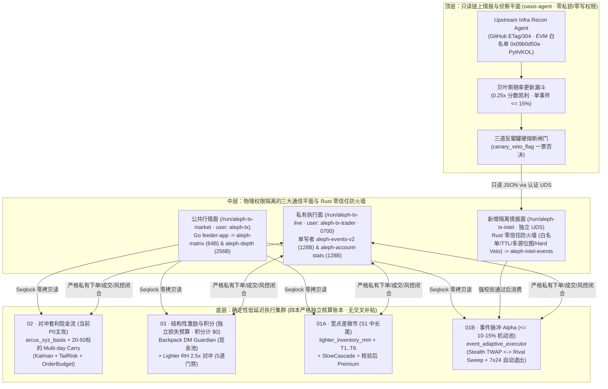

# AlephTX × Oasis-Agent 双项目稳定盈利指导文档：基于《@3i 非对称套利与现代量化微观结构》报告的现状校准与落地蓝图（2026-11-23）

> **边界、合规与信息披露声明**
> - **基线状态（`2026-11-23`）**：本文档对照报告《基于 @3i 链上非对称套利与现代量化微观结构的双项目优化研究报告：AlephTX 与 Oasis-Agent 稳定盈利架构蓝图》（下称“**Barbell 研究报告**”），以及 `AlephTX/aleph-tx` 截至 `origin/main = 5fe4251`（含 `4ea0a87` `ARB-IMP-05`、`da1c7d5` 账户费率审计、`b79b485` `ARB-IMP-04` 与 `CRASH-IMP-02`、`740dbc9` `#387` 与 Carry `v3`、`5fe4251` `#393` `CommonShock` V2 归因）及本轮零冲突 P0-B 本地加固撰写。
> - **实盘红线**：当前三条业务赛道（`01_quant_profit`、`02_hedge_arbitrage`、`03_incentive_turnover`）**继续维持 `HOLD`**。本文档是工程与研究指导蓝图，**不授权**任何实盘下单、撤单、账户变更、服务重启或集群迁移；任何策略升级均须通过独立账本、连续 10 小时因果回放及冻结样本外门禁。
> - **估值与收益口径**：所有未兑现积分（包括 Lighter Robinhood Chain LIT 积分）及未获账户实据确认的返佣，在现金账本中一律计 **`$0`**；情景推演模型属于研究假设，不视为已验证收益。
> - **姐妹项目可见性边界**：当前工作区仅包含 `aleph-tx` 完整源码，不含 `oasis-agent` 本地源码；且按最新用户定案，当前阶段暂不接入 `oasis-agent`，全力优先稳定运行 `aleph-tx` 主线。

---

## §0. 用户决策定案（2026-11-23）

经团队负责人确认，以下 4 项关键决策正式锁定并覆盖下文对应待决事项：

1. **决策 1 · Lighter 安全核查澄清、官方 `.so` 最佳实践对齐与职责边界**
   - **安全澄清**：核查提示源自 2026-11-16 行业第三方“自定义 Schnorr 签名代码 Nonce 复用”公开失窃案的**预防性审计建议**，并非在本地 `.env*` 私钥中发现了任何泄露或缺陷；`aleph-tx` 的 Rust 与 Go 侧均使用官方 `lighter-go` 签名栈（无自定义密码学）。
   - **最佳实践定论**：经核实 `elliottech` 官方仓库矩阵，Lighter **无官方 Rust 客户端 SDK**（仅官方维护 `lighter-go`、`lighter-python`、`lighter-ts`/WASM 与 `poseidon_crypto`）；对 Rust 客户端，`elliottech/lighter-go/examples/rust` 与 `lighter-python` 统一采用**官方 `lighter-go` 预编译共享库 C-FFI（`lighter-signer-linux-amd64.so`）**。其延迟 `< 100 µs`（零 IPC 序列化开销），且比第三方社区纯 Rust 移植库（`lighter-rs` 等）更免受协议漂移与自定义 Schnorr 随机数复用漏洞风险；而 API 禁用提现与权限最小化由 `@User` 负责配置，代码层负责零泄露与高效安全执行。
   - **已落地升级与加固**：① 已将 [lighter-signer-linux-amd64.so](../src/native/lighter-signer-linux-amd64.so) 与 [src/native/CLAUDE.md](../src/native/CLAUDE.md) 从 `v1.0.12` 对齐升级至 **`elliottech/lighter-go v1.0.13`**（`2026-11-18` 发布，`golang.org/x/crypto v0.56.0` 安全修补 + Go `1.26.10` 编译，SHA-256 `e4f0355e499c8608db4eae26824b81105b0d6a9fb91374661e61c1b4c70cc72c`，C ABI 与 `v1.0.12` 完全兼容），与 [feeder/go.mod](../feeder/go.mod) 同版对齐；② 已完成 Rust/Go 密钥内存擦除（[ffi_native.rs](../src/exchanges/lighter/ffi_native.rs) `Zeroizing` key buffer、[trading.rs](../src/exchanges/lighter/trading.rs) `Zeroizing<String>` 凭据、[session.rs](../src/bin/lighter_inventory_mm/session.rs) 早释放 `drop(env)`、[lighter_auth.go](../feeder/exchanges/lighter_auth.go) `defer clear(privKeyBytes)`）与 `9 min` 认证 Token 缓存复用（`401/403` 自动失效 + Go 侧 `sync.Mutex` 并发保护）；③ 已落地 P0-B 优化（[lighter_inventory_mm.rs](../src/bin/lighter_inventory_mm.rs) 私有 V2 事件环名义请求睡眠 `100 µs -> 1 ms` 自适应退避——受 Tokio ~`1 ms` 时间轮粒度约束，移除原 `10 ms` 固定上限，实测宿主机 p50 约 `1.51–3.04 ms` 对照 `14.33 ms`、[aleph-tx-feeder.service](../deploy/oasis/aleph-tx-feeder.service) `GOGC=400` / `GOMEMLIMIT=512MiB` 配置与 [feeder.toml](../deploy/oasis/feeder.toml) Hyperliquid `bbo` + `fast_book` 开启及同毫秒 fail-closed 退化修复）。
2. **决策 2 · Backpack 申请与 Lighter Robinhood 账户确认**
   - Backpack Market Maker Program 申请由 `@User` 自主推进；
   - 确认本地多所私有环境配置（Git 忽略）已包含 **Lighter Robinhood** 账户配置（移除原“尚未建户”阻塞项；上线 `03` 对冲积分研究仍须保留只读账户费档核验、`USDC/USDG` 脱锚硬熔断、`$0` 积分记账与周五 ROI 停机 4 道门禁）。
3. **决策 3 · `oasis-agent` 暂缓接入，只保稳定主线**
   - 当前阶段**暂不接入 `oasis-agent`**；§7（只读侦察、隔离智库总线 `/run/aleph-tx-intel/aleph-intel-events` 与 `event_adaptive_executor`）及 §8 `Stage 3` 相关任务整体标记为 **`DEFERRED（暂缓接入）`**，全员集中精力做稳做实 `aleph-tx` 基建与确定性现金流引擎。
4. **决策 4 · 云拓扑与现场采集红线**
   - 保持 `oasis-tokyo`（GCP `asia-northeast1-b`）专职 24×7 采集与 `$0/GiB` 湖仓零干扰运行（严禁打扰 `W18` 采集与周一 ANT RTH 盲测）；仅在 Stage 1 现金流策略通过 Holdout 门禁后，再单开独立轻量 AWS `apne1-az4` 执行节点跑只读 `bench-latency` 影子对照。

---

## §1. 执行摘要：核心判断与报告 10 大主张逐项裁决

### 1.1 顶层判断

**Barbell 研究报告**在战略方向上与团队已沉淀的[《战略错位与战术微结构优化路线图》](./STRATEGIC_AND_TACTICAL_OPTIMIZATION_ROADMAP_2026_11_21.md)高度同频：**普通量化团队不应在以太坊主网 MEV 或 1-tick 超窄点差红海里用裸速度与顶级机构（如 Wintermute `0x51c7...2a7f`）硬碰硬，而应把“7×24 确定性复利基座（`aleph-tx`）”与“零私钥上游基建只读侦察（`oasis-agent`）”组合成物理隔离的双引擎杠铃架构。**

但该报告在立项假设上存在明显的**版本滞后与实证盲区**——它仍基于 `v5.0.0` 旧心智（例如默认存在 `backpack-up`、`edgex-up`、`lighter_adaptive_mm`，并假定我们尚未落位 Seqlock、跨所参考矩阵与 WAL 恢复屏障），且把情景推演（如 Lighter 做市每千万美元赚 `$498–$618`）当作可快速复现的基准线。**如果直接照搬报告排期，团队会在已落地基建上重复施工、用 50 万 LIT 引入巨大裸多头风险、或破坏现有的私有 IPC 安全边界。**

### 1.2 报告 10 大核心主张的现状逐项裁决

| 编号 | 外部报告原主张 | `aleph-tx` 真实代码与实证现状（含源码/报告定位） | 裁决结论与动作校准 |
| :---: | :--- | :--- | :--- |
| **1** | **P0 紧急审计 Lighter 签名器 Nonce 复用**（吸取 2026-11-16 约 `$10.39M` API 失窃教训），防止在 Rust 中自写 Schnorr 导致随机数复用 | 2026-11-16 Lighter 事件经查属实（第三方自定义签名代码复用随机数导致私钥反推，约 `$10.39M–$15.5M` USDC 被提走，Lighter 启动 Guardian 模式后更新池权限与限制签名公开度）。核查 `aleph-tx`：**未在本地 `.env*` 发现安全问题，且 Rust 并未自写 Poseidon2/Schnorr**；`elliottech` 官方仓库无官方 Rust 客户端 SDK，官方为 Rust 提供的最佳实践即通过 C-FFI 链接官方 `lighter-go` 预编译共享库 `lighter-signer-linux-amd64.so`（已在本地由 `v1.0.12` 对齐升级至官方 **`v1.0.13`**，`golang.org/x/crypto v0.56.0` + Go `1.26.10`，SHA-256 `e4f0355e...`，与 [feeder/go.mod](../feeder/go.mod) 同版且 C ABI 零破坏性变更）；[ffi_native.rs](../src/exchanges/lighter/ffi_native.rs)、[trading.rs](../src/exchanges/lighter/trading.rs)、[session.rs](../src/bin/lighter_inventory_mm/session.rs) 与 [lighter_auth.go](../feeder/exchanges/lighter_auth.go) 已完成密钥 `Zeroizing`/`clear` 内存擦除与认证 Token 缓存并发加固，[trading.rs](../src/exchanges/lighter/trading.rs#L510-L685) 按 `api_key_index` 通道隔离单调 `AtomicI64` Nonce 与提交锁。 | **官方最佳实践已对齐并完成内存/认证加固（P0-A）**：① 继续坚持官方 `.so` C-FFI（禁用非官方纯 Rust 移植与自研密码学）；② `@User` 负责 API Key 禁提现/权限设置，代码层已保证密钥零日志/错误泄露与内存即时擦除；③ 补齐 `x86_64` Linux 构建机/CI 原生 `.so` 链接签名向量测试与本地 Tx-Nonce 防复用意图断言。 |
| **2** | **改造 `/dev/shm` 为 Seqlock 无撕裂读，并将 `aleph-matrix` 升级为跨所领航矩阵** | **主体已超前落地且 P0-B 低冲突项已就地加固**：[DUAL_TRACK_IPC.md](./DUAL_TRACK_IPC.md) 已定义 12 槽位 `ALEPHTX_SHM_V12`（`aleph-matrix` 64B）与 `ALEPHTX_DEP_V12`（`aleph-depth` 256B），Acquire-Release Seqlock 已通过 5,000 次跨进程并发零撕裂压测（`1516bb8`、[shm_abi_check.rs](../src/bin/shm_abi_check.rs)）；Slot `1/2/6/7/8/9/10` 已接入多所；`inventory_neutral_mm` 已具备 `external_reference_exchanges` 与 `per_side_bound_cancel`。本轮已在不触碰冻结文件前提下完成：[lighter_inventory_mm.rs](../src/bin/lighter_inventory_mm.rs) 私有 V2 事件环名义请求 `100 µs -> 1 ms` 自适应退避（受 Tokio ~`1 ms` 轮盘粒度约束、将原 `10 ms` 唤醒上限降至 ~`1 ms`）、[aleph-tx-feeder.service](../deploy/oasis/aleph-tx-feeder.service) `GOGC=400` / `GOMEMLIMIT=512MiB`、以及 [feeder.toml](../deploy/oasis/feeder.toml) 开启 Hyperliquid/Entropy/TradeXYZ `feeder_fast_book` 与 `feeder_bbo_channel`（[hyperliquid.go](../feeder/exchanges/hyperliquid.go) 已补齐同源毫秒显式空侧/穿仓 fail-closed 清理与逐分段隔离）。剩余待解冻后推进项：[inventory_neutral_mm.rs](../src/strategy/inventory_neutral_mm.rs#L4232-L4259) `5 ms` 轮询（当前受 `W17+` `crash_pause` 冻结校验保护）、`oasis-tokyo` 2 vCPU 混跑限流，以及 [arcus.go](../feeder/exchanges/arcus.go)/[binance.go](../feeder/exchanges/binance.go) 快成交流。 | **已完成无冲突 P0-B 加固，剩余按冻结边界推进**：待获授权窗口部署上述三项本机改动；[inventory_neutral_mm.rs](../src/strategy/inventory_neutral_mm.rs) 轮询改造须待 `W17+` 锁解冻或退役后再动；快成交流按 `T2` 先补同机无撤单对照验证。 |
| **3** | **将实盘集群迁入 AWS 东京 `ap-northeast-1 (apne1-az4)`** | Lighter 官方确推荐 `apne1-az4` 且主要撮合边缘在东京。但 `oasis-tokyo`（GCP `asia-northeast1-b`）实测 TCP RTT 已达 **`3.4–5.7 ms`**（Arcus `3.4`、RH `4.6`、Backpack `4.8`、Lighter Core `5.5`、HL `5.7 ms`），且 GCP 到 20 TB Google Drive Lakehouse 享受 **`$0/GiB`** 零出网费（[README.md](../README.md)）。当前实盘/回放软件抖动高达 `15–50+ ms`，远大于跨云 `3–4 ms` 网络差。 | **已定案（决策 4）：“采集永驻 GCP + 执行先消内耗，Holdout 后再开 AWS 影子测速”**：严禁迁移正在采集 `W18+` 数据的 GCP 节点；待 Stage 1 跑通 Holdout 门禁后再单开轻量 AWS `apne1-az4` 纯执行节点跑 `bench-latency` 对比。 |
| **4** | **使用 Lighter `sendTxBatch`：“全批次仅计 1 次请求额度（6 权重）”，单包 50 笔放大吞吐量** | **存在致命协议误读**：[src/venues.rs](../src/venues.rs#L29-L36)（`BatchQuotaSemantics::PerTransaction`）及 Lighter 官方文档明确：**`sendTxBatch` 仅在 API 频率桶（rate-limit bucket）算 1 次请求 / 权重 `6`，但在交易量配额（Volume Quota）上，批次内含 `n` 笔交易即消耗 `n` 份 Volume Quota（50 笔 = 消耗 50 份配额）**，且批量路径防胖手指校验弱于单笔 `sendTx`。[trading.rs](../src/exchanges/lighter/trading.rs#L852-L853) 当前已实现 `/api/v1/sendTxBatch` REST 提交。 | **严重纠偏（红线）**：绝不能把 `sendTxBatch` 当成免费额度放大器；维持 Rust 执行入口全字段价滑与 `reduce-only` 本地防胖手指硬校验；将 WS `jsonapi/sendtxbatch` 列为降传输延迟优化，而非省配额手段。 |
| **5** | **Lighter 切 Premium（0ms 撤单）+ 质押 50 万 LIT 降费至 `0.28 bps` + GLFT 闭式定价（测算赚 `$498–$618 / $10M`）** | **Plus 确为负期望陷阱（`0.50 bps` 费 + `300 ms` 撤单）**，但报告 `$498–$618` 建立在 `half_spread = 1.15 bps` 的理想假设上。现实是：Core `BTC/ETH` 全价差仅 `0.14–0.50 bps`；`W15/W16` 零激励纯做市 RWA 6 标的总净额仅 `+$1.17–$3.24 / $1M`（`+0.012–0.032 bps`），仅能再承受 `< 0.03 bp` 额外成本；而质押 `500k` LIT 按 `$2.71` 计高达 **`$1.355M` 裸山寨币方向性敞口**！GLFT 与现行 A-S 在 `t50_iso0` 上同受配置下限夹紧（99.99923% 锁死，[报价约束审计](./RESEARCH_SYNTHESIS_AND_QUOTE_CONSTRAINTS_2026_11_20.md)）。 | **去泡沫后定向采纳**：① 严禁为降 `0.12 bp` 费率去裸买/质押 50 万 LIT；② 仅在 [S1 宽价差中长尾标的](./STRATEGIC_AND_TACTICAL_OPTIMIZATION_ROADMAP_2026_11_21.md#L70-L79) 用 10h 因果回放证明“Premium 0ms 撤单省下的逆向选择 `> 0.40 bps`”时才按子账户升级 Premium（且牢记子账户不可删除、降级有 24h 冷却与 `4/16/64` 数量上限）；③ 保留 GLFT 作为归一化后在独立 Holdout 上与现有方案盲比的候选。 |
| **6** | **在 `/dev/shm/aleph-account-stats` 上线 `arXiv:2608.04373` 账户毒性评分 + `arXiv:2606.15715` 阳光 `twap-sub` 识别 + 多视界 Markout** | 两篇论文实证真实有效（2026 年 Hyperliquid 逐笔研究）。但报告忽略两个代码铁律：① [perp-capture/trades.go](../feeder/cmd/perp-capture/trades.go#L5-L38) 在采集边缘**主动剥离**了 `ask_account_id`/`bid_account_id`/`type` 等私有/身份字段，现有 `W05–W16` Lakehouse 数据**不含对手账户 ID**；② [account_stats.go](../feeder/shm/account_stats.go#L14-L30) 的 `ShmAccountStats` 是固定 **128B 私有账户风控结构（仅留 48B reserved）**，绝不能塞入千级对手地址表；多视界 Markout 也已在 [markout.rs](../src/strategy/inventory_neutral_mm/markout.rs) 与 [live_attribution.py](../scripts/live_attribution.py) 成型。 | **机制采纳，数据前提与落位双纠偏**：① 先在独立只读研究采集流保留加盐哈希后的对手标识，于 Lighter 跑通“连续两个 10 天邻窗秩相关 + 样本外增量”验证；② 毒性表放入 Rust 策略内部有界哈希环或独立只读 SHM，**严禁改动 128B `ShmAccountStats` ABI**。 |
| **7** | **上线 `backpack_dm_guardian` 吃 Backpack 每月 `$250k` 永续现金池与首月 MM5 返佣（主攻 Tier 3/4）** | Backpack 官方确有 `$325k/月`（永续 `$250k` + 现货 `$75k`）真现金池、深度乘数（DM 下限 `0.25`）及首月 MM5。但代码现状是：**`backpack-up` 已归档至 `legacy/v3_archive/`**，现行主仓仅有公开采集 [backpack.go](../feeder/cmd/perp-capture/backpack.go)、[audit_venue_specs.py](../scripts/audit_venue_specs.py)、[screen_cross_venue_pairs.py](../scripts/screen_cross_venue_pairs.py)，[venues.rs](../src/venues.rs#L376-L381) 将其标为 `AccountEvidenceRequired`，且其非 PostOnly 订单存在 **`100 ms` 减速带**（[DEEP_OPTIMIZATION_RESEARCH](./DEEP_OPTIMIZATION_RESEARCH_2026_11_17.md#L47)）。 | **高优先级增量真现金候选（决策 2：MM 申请由 `@User` 推进）**：`@User` 提交 MM 申请并取回真实 MM5 费档后，先用已有 Backpack 采集数据回测 Tier 3/4“挂在考核带宽外沿防毒流”净期望，过门后再建 WAL 级 Rust 执行适配器。 |
| **8** | **Lighter 主网 ↔ Robinhood Chain `1,100 万 LIT` `2.5x` 对冲积分收割（`lighter_rh_hedge_farmer`）** | 1,100 万 LIT 池与最高 `2.5x` 跨版对冲加成属实。最新核认：① **本地多所私有环境配置（Git 忽略）已包含 Lighter Robinhood 账户**（原“未建户”阻塞解除）；② 但 `Core=USDC` 与 `RH=USDG` 属不同结算域，[session.rs](../src/bin/lighter_inventory_mm/session.rs#L88-L92) 与 [venues.rs](../src/venues.rs) 默认**强禁止**跨稳定币隐式对冲；③ LIT 积分兑换率与确切发币日均未官宣；④ 2.5x 方向可能周度微调且双 Standard 对敲记 0 分。 | **严格归入 `03_incentive_turnover`（积分账本记 `$0`），补齐 4 道剩余门禁再启动**：只读账户费档核验 + `tail_risk.rs` USDG 脱锚熔断 + 显式跨稳定币 FX 账本授权 + 周五 ROI 负收益硬停机，绝不预支虚幻积分估值。 |
| **9** | **跨所资金费率套利 + ADL 断路器 + 停做无补贴 edgeX 刷量** | 与团队现状高度共振且推进最深：edgeX 创世 TGE 已于 2026-03-31 结束并迁至 USDC V2（实测 4h 结算），无补贴高费率刷量早已叫停。`aleph-tx` 已交付 9 所选标器（`1,014` 对）、[portfolio_risk.rs](../src/strategy/portfolio_risk.rs)、[tail_risk.rs](../src/strategy/tail_risk.rs)、[order_budget.rs](../src/order_budget.rs)、[kalman_basis.rs](../src/strategy/kalman_basis.rs)（`b79b485`）、[maker_first.rs](../src/strategy/relative_value/paper/maker_first.rs) 资金费生命周期 `ARB-IMP-05`（`4ea0a87`）与 `#387` 部分配对冲突锁（`740dbc9`），且 Carry `v3`（`audit_carry_liquidity_spreads.py`）已完成 74 对三时钟严格门禁审计；VVV 两个月 `0/146` 窗口覆盖 9 bp 双吃单费，证实必须走低摩擦 `Maker-First`。 | **当前确定性最高的现金流主攻方向（Stage 1 首要收口）**：待周一 US RTH 开盘后（`>=21:30 CST`）用 Carry `v3` 同步重采全 74 对盘口，并将 `kalman_basis` 与 `ARB-IMP-07/08` 接入主执行与回放链，推动 20–50 标的多日 Carry 与 ANT/RWA 基差进入独立 Holdout 验收。 |
| **10** | **`oasis-agent` 上游侦察 + 贝叶斯漏斗 + 反蜜罐硬熔断 + 写入 `/dev/shm/aleph-events`** | **战略与反蜜罐数学论证极佳**（证明软惩罚 `LR=0.05` 下后验仍达 `51.48%`，1/4 凯利依然会触及 `15%` 仓位上限）。**但 IPC 命名直接违反隔离红线**：[feeder/shm/events.go](../feeder/shm/events.go#L68-L95) 的 `aleph-events-v2`（及旧 `aleph-events`）是**单写者 128B Lighter 私有成交/订单执行环**，生产环境亦通过 `/run/aleph-tx-market`（`aleph-tx` 用户）与 `/run/aleph-tx-live`（`aleph-tx-trader` 用户 `0700`）物理隔离（[aleph-tx-live.service](../deploy/oasis/aleph-tx-live.service)）。 | **架构留档、按决策 3 暂缓接入（`DEFERRED`）**：当前阶段先不接入 `oasis-agent`，全力保障 `aleph-tx` 主线稳定；未来重开时严禁触碰 `aleph-events*`，必须走 `/run/aleph-tx-intel/aleph-intel-events` 独立防火墙。 |

---

## §2. 深度数学与协议审计：复算报告全部关键模型与防坑纠偏

在动任何一行实盘代码前，必须用数学复算把报告中的“情景假设”与“物理硬约束”剥离开来。

### 2.1 Lighter 延迟毒流模型复算 vs. 真实市场结构差距

按报告给定参数复算基准情景：秒级波动率 $\sigma = 1.336\text{ bps}/\sqrt{\text{s}}$（对应 ETH 75% 年化），假设捕获半价差 $1.15\text{ bps}$、非延迟逆向选择 $0.20\text{ bps}$、$35\%$ 成交遭遇 $2.5\sigma$ 跨所知情冲击流：

$$\text{AS}_{\text{latency}}(\Delta t) = 0.35 \times 2.5 \times \sigma \sqrt{\frac{\Delta t}{1000\text{ ms}}}$$

逐项复算结果与现实差距对照如下（注：1 bp 在 `$10M` 名义成交额上等于 `$1,000`）：

| 账户方案与行情源组合 | 有效盲区 $\Delta t$ | Maker 费率（bps） | 延迟毒流（bps） | 总摩擦（bps） | 理论净边际（bps） | 情景测算净盈利 / `$10M` | 对照 `aleph-tx` 实证现实的边界警告 |
| :--- | :---: | :---: | :---: | :---: | :---: | :---: | :--- |
| **Standard（仅本地 50ms 簿）** | `352 ms` | `0.00` | `0.694` | `0.894` | `+0.256` | `+$256.4` | 假设半价差 `1.15 bp` 远高于 Core BTC/ETH 真实半价差（`0.07–0.25 bp`） |
| **Standard + 主所领航** | `302 ms` | `0.00` | `0.642` | `0.842` | `+0.308` | `+$307.6` | 300ms 撤单硬排队下，对高波标的极易被击穿 |
| **Plus + 主所领航** | `302 ms` | `0.50` | `0.642` | `1.342` | `-0.192` | `-$192.4` | **确凿负期望陷阱**：付了 `0.50 bp` 却保留 `300 ms` 撤单延迟，全仓禁用 |
| **Premium（0 LIT，仅本地簿）** | `52 ms` | `0.40` | `0.267` | `0.867` | `+0.283` | `+$283.4` | 仅换 Premium 不接领航流，提升微乎其微 |
| **Premium（0 LIT）+ 主所领航** | `2 ms` | `0.40` | `0.052` | `0.652` | `+0.498` | `+$497.7` | 仅当 `S1` 标的真实半价差显著高于 `0.40 + 0.20` bp 且增量消险成立时才成立 |
| **Premium（质押 50 万 LIT）+ 领航** | `2 ms` | `0.28` | `0.052` | `0.532` | `+0.618` | `+$617.7` | **风险不对称警告**：为省 `0.12 bp` 需承担 `500k LIT ≈ $1.355M` 裸多头波动 |

**仓库实证硬校核**：
1. 在刚刚完成的 `W15` / `W16` 独立周末 10 小时 RWA 零激励纯做市诊断中（`.agent-state/forward_ops_20261118/w15_w16_rwa_diagnostic_20261123/REPORT.md` 及 `rwa_terminal_drain_20261123/REPORT.md`），6 标的加 `15 s` 模型排空后总盈利仅 `+$2.98`（`W15`）/ `+$6.09`（`W16`），单位百万美元做市额仅赚 `$1.17` / `$3.24`（即 **`+0.0117` / `+0.0324 bp`**），全量成本容忍极限不足 `0.033 bp`！在这类超薄边际标的上贸然切换收费 `0.40 bp` 的 Premium 账户会立刻把微利打成深亏。
2. **因此确立 Lighter Premium 升级数学门控**：只有当某个 **独立子账户** 专门跑 `S1` 高 `spread/vol` 宽点差市场，且在 10 小时因果回放中同时满足以下双不等式时，才允许切至 Premium（0 LIT 质押起步）：

$$\Delta \text{AS}_{300\text{ms}\to 0\text{ms}} > 0.40\text{ bps} \quad \text{且} \quad \frac{1}{2}\text{spread}_{\text{eff}} - 0.40\text{ bps} - \text{AS}_{\text{res}} > 0$$

同时严格遵守运维红线：**Lighter 子账户一旦创建不可删除，账户降级需 `24h` 冷却且当前子账户总数必须不超过目标低档上限（主网 Standard `4` 个 / Plus `16` 个 / Premium `64` 个）**，禁止盲目批量开户导致账户锁死在高费档。

### 2.2 GLFT 闭式定价模型复算与 `t50_iso0` 归一化教训

报告给出的 GLFT 示例参数（$A = 2.98\text{ s}^{-1}, k = 0.85\text{ bps}^{-1}, \sigma = 1.335\text{ bps}/\sqrt{\text{s}}, \gamma = \xi = 0.08, \Delta = 1$）经精确复算：

$$c_1 = \frac{1}{\xi \Delta} \ln\!\left(1 + \frac{\xi \Delta}{k}\right) = 1.124\text{ bps}, \quad c_2 = \sqrt{\frac{\gamma}{2 A \Delta k}\left(1 + \frac{\xi \Delta}{k}\right)^{\frac{k}{\xi\Delta}+1}} = 0.212$$

$$\text{half\_spread} = c_1 + \frac{\Delta}{2}\sigma c_2 = 1.266\text{ bps}, \quad \text{skew\_per\_unit} = \sigma c_2 = 0.283\text{ bps}$$

数值本身完全正确，但直接上线会遇到我们在[《双报告核验与报价约束审计》](./RESEARCH_SYNTHESIS_AND_QUOTE_CONSTRAINTS_2026_11_20.md#L111-L128)已证实的工程现实：
- 现行 `inventory_neutral_mm.rs` 在 `t50_iso0` 族中 **99.99923%（`4,959,031 / 4,959,069` 次）基础入场价差被 `fee_floor_bps` 与 `vol_cap_bps` 锁死**；如果只把闭式公式换成 GLFT 而不先解耦归一化库存 $x = q / Q_{\max}$ 与利润下限约束，GLFT 算出来的半价差同样会被 `minimum_spread_bps()` 钳死而失效；
- 此外，GLFT 的 `A`、`k` 必须严格遵循浅层窗口（0–70 ticks）对数线性回归并加稀疏样本回退（防止全盘回归高估成交强度），且必须在未见 `10h` Holdout 上证明跑赢现行 `T4` 条件收缩微价查表后再替换，不得无证切换。

### 2.3 Lighter `sendTxBatch` 限流与配额语义纠偏

| 维度 | `API 频率桶（Rate-Limit Bucket）` | `交易量配额（Volume Quota）` | `服务端胖手指保护（Fat-Finger）` |
| :--- | :--- | :--- | :--- |
| **外部报告原表述** | “全批次仅计 1 次请求额度（6 权重）” | 易被误解为“50 笔下单仅耗 1 份配额” | 未提示批量路径差异 |
| **一手规则与源码事实** | 确计为 `1` 次请求，固定消耗 `6` 请求权重；上限 `50` 笔（超限报 `21514`） | **批次内含 `n` 笔交易即消耗 `n` 份 Volume Quota（50 笔消耗 50 份，见 [venues.rs](../src/venues.rs#L31-L36)）** | `sendTxBatch` 与 `sendTx` 的服务端价格偏离保护不同（[DEEP_OPTIMIZATION_RESEARCH](./DEEP_OPTIMIZATION_RESEARCH_2026_11_17.md#L209)） |
| **`aleph-tx` 落地方针** | 高并发做市可切至 WS `jsonapi/sendtxbatch` 压缩 HTTP 往返传输开销 | 维持精细撤改节流（`OPT-05` 配额账本），避免低价值改单烧光 Volume Quota | **严禁依赖服务端保护**，Rust 提交入口强制保留参考价偏离、滑点上限、名义上限与 `reduce_only` 校验 |

### 2.4 贝叶斯软惩罚失效与反蜜罐硬熔断数学验证

复算报告中“软惩罚无法防住 PONS 类钓鱼蜜罐”的数学依据：
- 设前置信号（BitGo PR + 美股批处理发布 + Wintermute 白名单）将先验上币概率推至 $p_0 = 0.955$（即赔率 $\text{Odds}_0 = \frac{0.955}{0.045} = 21.222$）；
- 若仅把蜜罐异常当作极严厉的贝叶斯似然比软惩罚 $\text{LR} = 0.05$：

$$\text{Odds}_1 = 21.222 \times 0.05 = 1.0611 \implies p_1 = \frac{1.0611}{2.0611} = 51.48\%$$

- 代入常规止损假设 $L = 0.45$（`-45%`）与上行收益 $G \in [3.0, 5.0]$（`+300% ~ +500%`，即赔率比 $b = G/L \in [6.67, 11.11]$），分数凯利（$0.25\times$）为：

$$f_{0.25} = 0.25 \times \left(p_1 - \frac{1 - p_1}{b}\right) \in [11.1\%, 11.8\%] \quad (\text{若 } G \ge 6\times \text{ 或 } L \text{ 更小则直接顶满 } 15\% \text{ 上限})$$

- 而真实钓鱼蜜罐（流动性抽池 + 高税限制卖出）的真实兑现概率极低且回撤达 `-80%`，导致真实期望深负。**结论铁律**：对确定性结构破坏信号（合约不可卖、税率异常、LP 未锁、孤立测试币、无外部可退出深度），绝对不能参与概率加权，必须由 **`canary_veto_flag = 1` 执行一票否决硬熔断（Hard Veto）**。

### 2.5 跨所资金费率回本周期与 VVV 实证反例

按 `APR = (cost_bps / 10000) * (365 / hold_days) * 100%` 复算：

| 双边开平往返组合 | 往返费率（bps） | 预估滑点（bps） | 往返总成本（bps） | 3 天回本年化（APR） | 7 天回本年化（APR） | 实盘可用性判定 |
| :--- | :---: | :---: | :---: | :---: | :---: | :--- |
| `Lighter Std (0/0)` ↔ `Backpack VIP2 (0/2.4)` | `0.0` | `1.5` | `1.5` | `1.82%` | `0.78%` | **极优（公开可核实，须 Maker-Maker）** |
| `Lighter Prem (0.4M)` ↔ `Backpack MM5 (-1.0 情景)` | `-1.2` | `1.5` | `0.3` | `0.36%` | `0.16%` | 仅作情景参考，须待 MM5 书面费率实据 |
| `Lighter Std (0/0)` ↔ `Hyperliquid (Maker 1.5)` | `3.0` | `1.5` | `4.5` | `5.47%` | `2.35%` | 优（须按 `Maker-First + Slow-Leg` 协同） |
| `Lighter Main Prem (0.4M)` ↔ `Lighter RH Plus (1.5M)` | `3.8` | `1.5` | `5.3` | `6.45%` | `2.76%` | 需授权跨稳定币账本及 `tail_risk` 脱锚防护 |
| `Lighter Std (0/0)` ↔ `Hyperliquid (Taker 4.5)` | `9.0` | `3.0` | `12.0` | `14.60%` | `6.26%` | **高危陷阱**（见下方 VVV 实证反例） |
| `Lighter Std (0/0)` ↔ `edgeX V2 Base (Taker 4.5)` | `9.0` | `4.0` | `13.0` | `15.82%` | `6.78%` | 常规期禁用，仅限大活动补贴期或 Maker 腿 |

**VVV 实时快照 vs. 两个月历史复核的血泪警示**（`.agent-state/forward_ops_20261118/vvv_funding_screen_20261123/REPORT.md`）：
2026-11-22 9 所实时探针发现 `VVV` 资金费差高达 `1.515 bp/h`，但 Codex 在次日（`2026-11-23 01:06 CST`）对齐 9–10 月全部 **1,464 个官方逐小时结算点**后发现：在 146 个连续 10 小时窗中，仅 64 个毛费差为正，中位仅 `-0.050 bp`，最高 `+8.585 bp`，**0/146 个窗口能覆盖 Hyperliquid 公开基础级双边进出吃单 `9 bp` 的成本**。这彻底钉死了两条准则：**第一，绝不凭单次实时资金费快照做双 Taker 套利；第二，跨所 Carry 必须依赖 `Maker-First` / 双被动低成本入场 + 多日持续性筛选 + 完整结算周期回归。**

---

## §3. `aleph-tx` 截至 `2026-11-23` 的真实底盘盘点

制定下一步工程方案必须锚定已交付资产、在途热区与已证伪禁区，避免重复造轮子或破坏现有前沿实验：

1. **已交付并入库的机构级底座（`origin/main = 5fe4251`）**
   - **安全与恢复**：3 通道（`Maker/Cancel/Taker`）隔离签名与单调 nonce（[trading.rs](../src/exchanges/lighter/trading.rs)）、WAL 写前对冲日志与双所重启屏障（[journal.rs](../src/live_hedge/journal.rs)、[audit.rs](../src/live_hedge/audit.rs)、[durable.rs](../src/hedging/durable.rs)）、跨进程原子持久化日损/渐进刹车（[daily_loss.rs](../src/daily_loss.rs)，已含 `CRASH-IMP-01` 四档比例缩放）、`CancelLease` 单调时钟门禁、`EXEC-C1..C4` 修复。
   - **无锁 IPC 与采集湖仓**：12 槽位 `64B` BBO + `256B` Top-5 深度 + `128B` V2 私有事件环，跨进程并发压测零撕裂（`1516bb8`）；`oasis-tokyo` 三路 `10h15m` 滚动录制（`W05–W17` 已全部 3/3 回读签收，当前 `W18` 稳定续写）+ `00_catalog..40_gold` 20 TB Medallion 湖仓 + `DuckDB 2.0` + `live_attribution.py` 毫秒级归因；`#393` `CommonShockAttribution` V2 影子/主动归因拆分（`5fe4251`）已通过 `VERIFIED 4/4`。
   - **跨所规则、Carry 周期与风控原语**：版本化能力与减速带注册表 [venues.rs](../src/venues.rs)（`2026-11-22.v2`，含拓扑路由器 `select_execution_topology`）、9 所公开规格审计 [audit_venue_specs.py](../scripts/audit_venue_specs.py)（`2,431` 合约）、只读账户费率核验 [audit_account_fees.py](../scripts/audit_account_fees.py)（`da1c7d5`）、9 所跨清算域配对与 Carry 选标器 [screen_cross_venue_pairs.py](../scripts/screen_cross_venue_pairs.py)（`1,014` 对）与三时钟流动性审计 `Carry v3`（`740dbc9`）、[maker_first.rs](../src/strategy/relative_value/paper/maker_first.rs) `source_time` 资金费结算生命周期 `ARB-IMP-05`（`4ea0a87`）与 `#387` 部分配对冲突锁（`740dbc9`）、双指针边际跨簿定价 `ARB-IMP-06`（[relative_value.rs](../src/strategy/relative_value.rs)）、单所滑动下单预算与 429 粘滞停机 `ARB-IMP-09`（[order_budget.rs](../src/order_budget.rs)）、跨所保证金/ADL/稳定币脱锚监督器 `ARB-IMP-10`（[tail_risk.rs](../src/strategy/tail_risk.rs)）、组合级逆波动率/危机相关性/经验 ES `CRASH-IMP-03`（[portfolio_risk.rs](../src/strategy/portfolio_risk.rs)）、1D Kalman/OU 慢均衡滤波 `ARB-IMP-04`（[kalman_basis.rs](../src/strategy/kalman_basis.rs)，`b79b485`）、5–60 分钟慢单边瀑布不对称限流 `CRASH-IMP-02`（[slow_cascade.rs](../src/strategy/slow_cascade.rs)，`b79b485`）、以及 HL `SharedNoncePool` + `warm_http`（[client.rs](../src/exchanges/hyperliquid/client.rs)）和 `arcus_xyz_basis` 执行引擎。

2. **本轮本地落地的零冲突升级与紧邻接线点（未提交）**
   - **本地已落地 P0-B 优化**：[lighter_inventory_mm.rs](../src/bin/lighter_inventory_mm.rs) 私有 V2 事件环 `100 µs -> 1 ms` 自适应唤醒、[aleph-tx-feeder.service](../deploy/oasis/aleph-tx-feeder.service) `GOGC=400` / `GOMEMLIMIT=512MiB`、[feeder.toml](../deploy/oasis/feeder.toml) 开启 Hyperliquid/Entropy/TradeXYZ `feeder_fast_book` 与 `feeder_bbo_channel`（均保持零改动冻结锁文件与远端节点）；
   - **紧邻接线与实盘准入前收口**：[kalman_basis.rs](../src/strategy/kalman_basis.rs)（`ARB-IMP-04`）与 [slow_cascade.rs](../src/strategy/slow_cascade.rs)（`CRASH-IMP-02`）尚待接入 `maker_first` / 实盘执行路径；待周一美股 RTH 开盘后（`>=21:30 CST`）用 `Carry v3` 成对同步重采全 74 对盘口并互审首次共同可见区间。

3. **正在运行中的冻结前向验证（绝对禁止篡改或停机干扰）**
   - `oasis-tokyo` 三路原采集器正在写入 `W18`（预计 `~14:15 CST` 封窗），`W18`/`W19` 已完成 RWA 预登记；
   - 周一 `2026-11-23` ANT RTH 盲测已双端锁定清单 `2a7d2242...`，严格走独立旧包回放；
   - `W17+` 加密急跌防护 `crash_pause` V1（锚定 `740dbc9`）与 V2 影子归因（`5fe4251`）均保持原锁定SHA-256。

4. **已通过实证正式证伪/关闭的路线（全员严禁重复踩坑）**
   - **纯刷量 `<= $2/M`（及 `<= $20/M`）主力假设**：Arcus RWA 贴一档（`10–200 ms` 成本 `$116.32–$180.47/M`）、Hyperliquid 原生（`0/179`）、HIP-3（`0/349`）、Backpack Tier 1（`2.0/5.0 bp`）与无补贴 edgeX V2 均不成立；
   - **W09–W16 BTC/ETH 两腿费率上限与 W15–W17 RWA 短窗延迟脆弱性**：W09–W16 仅 W09 ETH 在保留 0.25 bp 全成交下正现金上界至多容忍 `0.002785 bp` maker 费（`.agent-state/forward_ops_20261118/maker_two_leg_fee_envelope_20261123/REPORT.md`）；W15–W17 RWA 30s 短窗开平在仅加 `200/310 ms` 慢腿延迟下几乎无法闭合（`rwa_fixed_endpoint_delayed_leg_20261123/REPORT.md`），进一步印证跨所必须打多日 Carry 而不是短窗双腿抢跑；
   - **`t50_iso0` 单因子调 `κ`**（`99.99923%` 锁死边界）、**配对瞬间保本退出**、**四币纯横截面**、**`ANTHROPIC` 11/27 预上市（A5）**、**VVV 无条件静态固定 10h/60d 对冲**（`0/146` 过 9 bp 门）；
   - **260 期历史最大回撤死锁**与**低波期 `vol_target > 1.0` 自动加杠杆**。

---

## §4. 现实化重构后的“双引擎杠铃盈利架构”与三赛道独立映射

结合 `aleph-tx` 的三用户/三域隔离体系与 `AGENTS.md` **严禁跨赛道交叉补贴**合同，修正报告蓝图如下（注意红色隔离边界：**AI 情报平面与私有交易环物理断开**）：

**关键架构纪律**：
1. **`01A`（做市）、`01B`（事件脉冲）、`02`（跨所基差与多日 Carry）、`03`（Backpack DM 与 Lighter RH 激励）各自独立立账、独立风控预算、独立配置文件**；不允许用 `02` 盈利替 `03` 刷量亏空背书，也不允许 `01B` 事件单突破全盘 10%–15% 机动风险池。
2. **`oasis-agent` 永不触碰 `/run/aleph-tx-live` 与任何签名密钥**：即便 `oasis-agent` 遭遇上游 PR 恶意文本注入（Prompt Injection）产生幻觉输出，`aleph-intel-gateway` 层的 Rust 确定性防火墙也会因白名单未命中、多源位图不足或 `canary_veto_flag != 0` 直接静音丢弃。

---

## §5. P0 安全止血与底层微架构手术指南

### 5.1 P0-A · Lighter 2026-11-16 千万美元事件专项预防性核查清单

> **澄清与职责边界**：此项核查属于对 2026-11-16 行业第三方“自定义 Schnorr Nonce 复用失窃案”的**预防性架构对账**，并非在您现有的 `.env*` 私钥中发现安全问题。`aleph-tx` 底层未自研密码学；API Key 禁提现与账户权限设置由 `@User` 自主把控，代码侧保障私钥零泄露、内存即时擦除与高效安全执行。

**目标**：坚持官方 `lighter-go` C-FFI 最佳实践，同步对齐官方最新安全版本并消除私钥滞留与认证重复签名开销：

1. **官方最佳实践与上游版本对齐（已完成 `.so` 至 `v1.0.13` 升级）**：
   - `elliottech` 官方无 Rust 客户端 SDK，仅官方维护 `lighter-go`（Go + C-FFI `.so/.dylib/.dll` + WASM）、`lighter-python`、`lighter-ts` 与 `poseidon_crypto`；其官方 `examples/rust` 与 `lighter-python` 均通过 C-FFI 调用预编译官方共享库，避免第三方社区纯 Rust 移植（`lighter-rs` 等）在 ECgFp5/Poseidon2 曲线或交易字段序列化上出现密码学/协议漂移，且 `< 100 µs` 同进程延迟显著优于 Go sidecar RPC。
   - **已完成**：已将 [src/native/lighter-signer-linux-amd64.so](../src/native/lighter-signer-linux-amd64.so) 与 [src/native/CLAUDE.md](../src/native/CLAUDE.md) 从 `v1.0.12` 对齐升级至官方 **`v1.0.13`**（SHA-256 `e4f0355e499c8608db4eae26824b81105b0d6a9fb91374661e61c1b4c70cc72c`，C 头文件摘要 `fcbe90e05378e51f6cb2370db6836badc3e65f7dd87b5363ce8cf131a9fbc743`，引入 `golang.org/x/crypto v0.56.0` 安全修补与 Go `1.26.10` 编译，与 `v1.0.12` C ABI 100% 兼容且与 [feeder/go.mod](../feeder/go.mod) 对齐；在 Mac 已核验 SHA-256 与 ELF64 x86-64 全 6 个导出符号，将在 Linux `x86_64` 构建机/CI 补验实际链接运行）。
   - **硬规则重申**：严禁在 Rust 中手写或 AI 移植 Poseidon2/ECgFp5/Schnorr 签名代码；非 Linux `x86_64` 平台维持 [ffi.rs](../src/exchanges/lighter/ffi.rs#L10-L156) 的 fail-closed 拦截。
2. **密钥零泄露、内存即时擦除与认证 Token 高效缓存（已完成）**：
   - **Rust 端**：[ffi_native.rs](../src/exchanges/lighter/ffi_native.rs) 对传给 `CreateClient` 的 `key_bytes` 启用 `Zeroizing` 并隐藏敏感解码错误；[trading.rs](../src/exchanges/lighter/trading.rs) 将 `ApiKeyCredentials` 改为 `Zeroizing<String>` 且移除 `Clone`，新增 `lighter_credentials_errors_never_leak_private_key` 回归；[session.rs](../src/bin/lighter_inventory_mm/session.rs) 将 `read_env` 全面升级为 `Zeroizing<String>` 并在拉起 `feeder` 后立即 `drop(env)`。同时在 `LighterTrading` 新增 `9 min` 有效期复用、遇 HTTP `401/403` 自动清除的 `auth_token_cache`（[recovery.rs](../src/exchanges/lighter/trading/recovery.rs) 同步接入 + `auth_token_cache_reuses_token_and_clears_on_401_or_invalidation` 单测），消除 REST 对账/查单路径的重复 FFI Auth 签名开销。
   - **Go 端**：[lighter_auth.go](../feeder/exchanges/lighter_auth.go) 在 `LoadLighterAuthFromEnv()` 加入 `defer clear(privKeyBytes)` 即时擦除 40 字节原始私钥切片，并为 `CreateAuthToken()` 加 `sync.Mutex` 消除缓存并发竞态（[lighter_book_test.go](../feeder/exchanges/lighter_book_test.go) `TestLighterAuthCreateAuthTokenConcurrentCacheAndNoKeyLeak` 通过 `-race`）。
3. **本地 Tx-Nonce 防复用意图断言 + Linux `x86_64` 原生向量验收（待 `aleph`/CI 顺检）**：
   - 虽然 [trading.rs](../src/exchanges/lighter/trading.rs#L510-L685) 已为 `Maker/Cancel/Taker` 分配独立 `api_key_index` 与 `AtomicI64` nonce，仍在“提交签名前后”增加**不可回退的本地持久化/进程级高水位记录与 `(api_key_index, nonce)` 唯一性看门狗**：同一 `api_key_index` 绝不允许用相同 `nonce` 签发两笔内容不同的交易（即便是网络超时重发，也必须走原签名载荷原样重传或刷新新 nonce，严禁同 nonce 改价改量重签）。
   - 在 `x86_64` Linux 构建环境运行 `uninitialized_native_client_fails_without_signing`、`native_signer_preserves_mainnet_robinhood_and_testnet_market_ids_offline` 及并发压测，实测新 `v1.0.13` `.so` 链接与签名吞吐。
4. **API Key 权限最小化（`@User` 把控）与 `edgeX` V2 锁定**：
   - `@User` 负责维护交易 API Key 禁提现及最小权限；代码侧延续 `chain_id == 466324 && api_key_index == 157` 保留索引硬检查，并在未来恢复 `edgeX` 采集/研究时强制拒绝旧 StarkEx V1 端点，只允许活跃 USDC `EDGE Chain V2` 端点。

### 5.2 P0-B · 消除内部软件延迟与合理化云拓扑

按照投入产出比从高到低依次执行，**切忌未消软件延迟先搬云**：

1. **消除热路径固定休眠（`T1`）**：
   - **已完成**：改造 [lighter_inventory_mm.rs](../src/bin/lighter_inventory_mm.rs) 私有 V2 事件环的 `10 ms` 固定空睡，升级为 `100 µs -> 1 ms` 自适应退避（含边界单测）；
   - **待解冻后推进**：[inventory_neutral_mm.rs](../src/strategy/inventory_neutral_mm.rs#L4232-L4259) 的 `WAKE_CHECK_INTERVAL = 5 ms` 当前受 `W17+` `crash_pause` 冻结哈希保护，待 `W17+` 验完退役或升版后再改；**唯一铁律**：涉及 WAL 写入的 `BasisJournal`/`ExecutionJournal`/`DailyLossGuard` 卸载若异步化，必须 `.await` 落盘确认再发单，若确认后行情过期且确认未发网必须持久化 `AbortedBeforeDispatch`（见[路线图 T1](./STRATEGIC_AND_TACTICAL_OPTIMIZATION_ROADMAP_2026_11_21.md#L127-L135)）。
2. **Go Feeder GC 调优与零分配排查**：
   - **已完成（本地配置单元，未重启远端）**：在 [aleph-tx-feeder.service](../deploy/oasis/aleph-tx-feeder.service) 显式注入 `Environment=GOGC=400` 与 `Environment=GOMEMLIMIT=512MiB`；
   - **待续**：对热路径执行 `cd feeder && go build -gcflags='-m'` 排查 JSON 解码堆逃逸、结合 `sync.Pool` 消除长尾 GC 抢占。
3. **开启 Hyperliquid 已支持的低延迟通道（`ARB-IMP-01`）**：
   - **已完成（本地配置 + 单测，未重启远端）**：在 [feeder.toml](../deploy/oasis/feeder.toml) 的 `[hyperliquid]`、`[entropy]` 与 `[tradexyz]` 同步启用 `feeder_fast_book = true`（~500ms 5 档进 `aleph-depth`）与 `feeder_bbo_channel = true`（~70ms 区块级 BBO 进 `aleph-matrix`），并在 [config_test.go](../feeder/config/config_test.go) 新增回归校验，继续保持 `book.Time` 单调防回退覆盖；
   - **待续**：按 `T2` 先补采同机 `arcus_trades` 与 Binance 现货 `@bookTicker`/`@aggTrade` 并在无撤单对照验证通过后写入独立公共信号段。
4. **物理隔离执行机房 vs. 保留 GCP 采集（已定案）**：
   - **24×7 三路采集 + 飞轮 + 20 TB Lakehouse 永久留在 GCP `oasis-tokyo`**（守护 `$0/GiB` Drive 出网红利）；
   - 等实盘策略过 10h Holdout 准入后，新增 `bench-latency` 只读探针对比 `GCP asia-northeast1-b` 与 **独立轻量执行专用 `AWS ap-northeast-1 (apne1-az4)`** 的 Post-Only 挂撤 P50/P99 Ack；仅当实测显著改善可执行净现金时才把纯执行节点单迁至 AWS `apne1-az4`。

---

## §6. `aleph-tx` 四大盈利引擎的实战落地细则与否决门控

### 6.1 引擎一：`02_hedge_arbitrage` 跨所基差与 20–50 标的多日 Carry（当前最高确定性现金流）

**为什么它是当前第一现金引擎**：持仓尺度为“数小时至数天”，把我们相对顶级做市商的毫秒级劣势稀释 3–4 个数量级（$\Delta\tau_{\text{lat}} / \tau_{\text{hold}} \to 0$），且 `aleph-tx` 90% 的核心代码已经在手。

**当前闭环路线**：
1. **新入库原语接线进展与收口**：已落仓并完成 `maker_first` 与 `arcus_xyz_basis` 关键接线——包含 [kalman_basis.rs](../src/strategy/kalman_basis.rs)（`ARB-IMP-04`）、[slow_cascade.rs](../src/strategy/slow_cascade.rs)（`CRASH-IMP-02`）、`ARB-IMP-05`（`4ea0a87`）、`#387`（`740dbc9`）、`ARB-IMP-09` 订单预算节流、causal `equity_session` 观测守卫（被拒观测不会污染 Kalman 均值/方差状态），以及 [ArcusTrading::warm_http](../src/exchanges/arcus/rest.rs)（`ARB-IMP-08`）与 Hyperliquid 保证金/强平距离实时监督（`ARB-IMP-10`，接入 [arcus_xyz_basis.rs](../src/bin/arcus_xyz_basis.rs)）；剩余收口为实盘执行路由器 `ARB-IMP-07` 与 `CRASH-IMP-03` 跨组联动（优先走 **Maker-First 慢零费腿 + Fast-Leg 多档保护 IOC**，拒绝如 VVV 反例所示的高费双 Taker 交易）。
2. **双路主战场**：
   - **战场 A — ANT / RWA 长周期基差回归**：严守周一 `2026-11-23` ANT RTH 旧包盲测结果（仅过 `verdict == "GO"` 后评估微仓 Canary）；同步用已签收连续盘数据检验 `Long Arcus + Short Lighter Core` RWA 正溢价 + 资金费套利（`SPY/QQQ/NVDA`）。
   - **战场 B — 20–50 标的宽分散多日 Carry**：以 `Carry v3`（待周一 US RTH `>=21:30 CST` 按 `pair_id` 成对重采全部 74 对并互审 `#403` 首次共同可见区间）筛选同时过深度、Oracle 与滑点后净期望的配对，并用 [audit_account_fees.py](../scripts/audit_account_fees.py) 填入各所真实账户费档，以连续多日（`>= 10h` 单位衔接、含完整结算水位线）因果回放验证组合净现金与 `portfolio_risk` 经验 ES 达标，重点吃 **Lighter Std (0/0) ↔ Hyperliquid Maker (1.5) / Backpack Maker** 这类往返成本 `<= 4.5 bp` 的结构性利差。

### 6.2 引擎二：Backpack Depth Multiplier 守护器（`backpack_dm_guardian`，高确定性增量现金）

Backpack 的每月 `$250k` 永续真现金池（USDC 直发）+ 首月 MM5 是报告挖掘出的**高价值增量赛道**。结合 Backpack 仅存在旧存档 `legacy/v3_archive/` 的现状，按四步严谨推进：

1. **Step 1 · 商务申请与真实费率核验（`@User` 主导）**：由 `@User` 向 `vip@backpack.exchange` 提交 MM Program 申请，获批后通过只读方式核验真实 MM5 Maker 返佣与考核明细（验证 Tier 3/4 带宽 `25 bps` / `20 bps`、单边阈值 `$5k` / `$10k`、月池占比 `>= 1%` 门槛与实际 `100 ms` 非 PostOnly 减速带）。
2. **Step 2 · Tier 3 山寨永续与 Tier 4 美股永续 10h 瀑布压测**：利用已就绪的 [perp-capture/backpack.go](../feeder/cmd/perp-capture/backpack.go) 录制连续 10h 公开盘口，在离线回放器验证“双边底仓守护策略”——**当库存偏大时，绝不把超仓侧挂单撤为零（避免快照记 0 分掉到 `0.25` 保底），而是外移至考核带宽最外沿（Tier 3 `22–24 bps`、Tier 4 `17–19 bps`）以较低被动吃单毒流保住 `DM -> 1.0`**——必须证明在瀑布穿档期该策略仍能净赚或亏损显著低于每月补贴分润。
3. **Step 3 · 新建 WAL 级 Rust 执行适配器**：绝不复活 `legacy/v3_archive/` 裸奔脚本；严格以 [arcus_xyz_basis](../src/bin/arcus_xyz_basis.rs) 为模板，基于 Ed25519 签名、`OrderBudget`（按 Backpack **每子账户独立 2,000 RPM** 分仓切分标的防 429）、`BasisJournal` WAL 与 `PostOnly` 强制约束构建独立适配器，净 Delta 敞口路由至 Lighter Core 或 Binance/HL 对冲。
4. **Step 4 · 实盘 KPI 门控**：快照 `DM >= 0.90`、单月全池分配占比稳定 `>= 1%`、且剥离补贴后的纯做市+对冲亏损严格锁死在预冻结月度预算之内。

### 6.3 引擎三：`01_quant_profit` 宽 `spread/vol` 领航做市升级

1. **先决顺序**：待 `W17+` 加密 `crash_pause` A/B/C 冻结试验与 `T3`（允许 `self.hedge.is_some()` 下全量身份校对后的领先源单侧直撤）+ `slow_cascade`（`CRASH-IMP-02`）收口。
2. **严守 `S1` 选场铁律**：退出 `BTC/ETH/SPY` 极窄 1-tick 贴盘，将 `screen_market_spread_to_vol.py` 扩展为“半点差减去真实 Maker 费必须覆盖历史实测 1s 条件逆向选择 `2 倍以上`”的漏斗。
3. **审慎评估 Premium 升级与 GLFT**：仅针对筛选合格的 `S1` 宽价差子账户，以 `300 ms` vs `0 ms` 撤单因果回放证明净边际增益跨过 `0.40 bp` 门槛再切 0-LIT Premium；GLFT 须用归一化库存 $x = q / Q_{\max}$ 与浅层对数回归重实现并与 `T4` 条件微价在未见 Holdout 上盲测决胜。
4. **Wallet Toxicity（`arXiv:2608.04373`）与 `twap-sub`（`arXiv:2606.15715`）前置研究路径**：由于现行公开录制已剥离 Lighter 账户 ID，需另设独立只读研究收集器（仅对 `ask_account_id`/`bid_account_id` 做加盐不可逆哈希，遵守 `AGENTS.md` 脱敏规则）采够连续 `20` 天以上样本，先复现“相邻 10 天窗口 D9/D10 主动账户毒性秩相关显著为正”的实证，**验证有效后再以 Rust 进程内有界 LRU/环形表消费（严禁写入 128B `ShmAccountStats`）**，遇到高毒 D9/D10 连击触发 `Quote Fading`（后移 `2–3x` 半价差并缩量），遇到 `twap-sub` 良性单流维持紧价差。

### 6.4 引擎四：`03_incentive_turnover` Lighter Mainnet ↔ RH `2.5x` 对冲积分收割

鉴于官方 `1,100 万 LIT` 积分池具有明确制度红利但存在多处隐含规则坑，虽然本地多所私有环境配置（Git 忽略）已包含 Lighter Robinhood 账户，仍必须同时满足以下 **4 道剩余硬准入门槛** 才允许开建 `lighter_rh_hedge_farmer`：

1. **只读账户费档核验**：基于已有 Lighter Core 与 Robinhood 账户配置，通过只读 `/api/v1/accountLimits` 等签名接口由 [audit_account_fees.py](../scripts/audit_account_fees.py) 实读确认 Plus（`1.50/1.50 bps`）或 Premium 真实费档，排除 `Standard ↔ Standard` 对敲零分陷阱。
2. **每周规则抓包与防同控洗盘自查**：每周五后自动抓取官方对冲方向加成表（2.5x 是否偏向特定多空方向），严格遵守 [LIVE_TRADING.md](./LIVE_TRADING.md#L26-L31) 同控防自成交与合法交易规则。
3. **跨稳定币脱锚防火墙与显式域间授权**：因主网为 `USDC`、RH 为 `USDG`，已在 [venues.rs](../src/venues.rs) 落地 `CrossStablecoinHedgePolicy` 与 `select_execution_topology_with_policy`（**默认拒绝跨稳定币对冲、强制显式白名单授权与 fast-leg 对冲约束**，并直连 [tail_risk.rs](../src/strategy/tail_risk.rs) 多源脱锚熔断：至少 `2` 个独立数据源校验、偏离 `>= 30 bp` 阻断开仓、`>= 75 bp` 强平降险）；后续只需将实时多源稳定币喂价接入对应 runner 拓扑入口。
4. **现金账本记 `$0` 积分 + 周五动态停机熔断器**：所有摩擦（双腿费率、滑点、资金费差及双边独立保证金占资利息）独立记入 `03_incentive_turnover` 亏损预算；每周结算后用实收积分、全网周成交额与当前 LIT 价格重算单位积分隐含成本与年化 ROI，一旦跌破安全垫立即自动切为平仓停机（借鉴 Wintermute 退出 Timeboost 固定“房租”的纪律）。

---

## §7. 兄弟项目 `oasis-agent` 协同蓝图（`DEFERRED` — 暂缓接入，仅留作远期参考架构）

> **阶段状态（决策 3）**：按用户要求，当前阶段**暂不接入 `oasis-agent`**，优先把 `aleph-tx` 的稳定性与确定性现金流跑实。本节保留作未来重开事件 Alpha 赛道时的架构契约，当前排期全部挂起。

### 7.1 `oasis-agent` 核心定位与新增模块（严格只读、零私钥）

`oasis-agent` 绝对不直接连接交易所执行接口或托管私钥，它的唯一核心使命是**把 @3i“95% 枯燥的上游基建与供应链追踪”自动化、结构化并抗钓鱼过滤**：

1. **`Upstream Infra Recon Agent`（上游供应链无损侦察网）**：
   - **GitHub 条件轮询嗅探器**：针对目标托管方、跨链桥、主流 DEX/SDK 仓库（如 BitGoJS 类适配器更新、新资产元数据 PR、上币图标仓库提交），严格使用 `If-None-Match`（ETag）与 `304 Not Modified` 条件轮询（`304` 响应不消耗 GitHub API 配额），配合多令牌池与正则前置过滤，仅把命中的 Diff 喂给大模型做语义消歧（类似从 99 个美股批处理 PR 中识别真实单标的上新）。
   - **低竞争新链做市商白名单监控器**：避开高噪音以太坊主网，专注新兴 L2/Orbit 链（如 Robinhood Chain、新 Perp 结算链等）通过轻量级只读 RPC 监控已知顶级做市商多签/冷端合约的白名单变更事件与 `EnumerableSet` 只读查询（如 `getAllApprovedTokens()` 选择器 `0x09b0d50a`）。
   - **预言机新 Feed 与上下文 RAG 图谱**：监控 Pyth/Chainlink 新 Price Feed 注册，关联 `oasis-agent` 已验证的 V5 屏幕强采、推文串 `conversation_id` 拼接与实战派 KOL 上下文图谱，严格区分真实来源与二次搬运噪音。

### 7.2 贝叶斯置信度漏斗 + 三道反蜜罐硬熔断闸门（Hard Veto Canary Gate）

结合 §2.4 已验证的数学漏洞，任何事件在 `oasis-agent` 侧必须先过概率漏斗，再经过**不可被置信度覆盖的三道硬熔断闸门**（任一失败直接置 `canary_veto_flag = 1`）：

1. **闸门 1 · 链上合约与流动性安全硬检**：只读模拟买入并立刻模拟卖出（拦截单向貔貅/黑名单/动态拉高卖出税）、检查权限所有者/Pause 开关、校验底层池与跨链桥合约真实性。
2. **闸门 2 · 正交多源与诱捕异常排查**：强制要求信号上升至主力建仓级别前，必须命中 **`>= 2` 个相互正交的独立证据源比特位**（如“托管商 PR + 做市商白名单授权”或“预言机 Feed + 官方链上部署”）；单点未确认 PR 或存在人为诱捕特征（如测试命名异常、零关联部署钱包、故意暴露的孤立小池）直接一票否决。
3. **闸门 3 · 可验证退出流动性与合约等价性**：确认目标交易场所真实盘口或链上池深度足以支撑可控滑点退出，且标的合约精度/乘数无歧义。

### 7.3 纠偏后的跨进程零信任契约（`/run/aleph-tx-intel/aleph-intel-events`）

> **强制纠偏**：外部报告建议写入 `/dev/shm/aleph-events` 是错误的，该路径在 `aleph-tx` 属于私有执行订单事件（V1/V2 128B 私有环）。AI 情报必须走独立目录 `/run/aleph-tx-intel/aleph-intel-events` 与独立守护进程 `aleph-intel-gateway`。

`oasis-agent` 仅通过权限受限的本地 Unix Domain Socket（UDS，带同行 UID 校验或共享静态 HMAC 摘要校验）向 `aleph-intel-gateway` 投递 JSON 候选，由 Rust 端核验后原子写入 `#[repr(C, align(64))]` Seqlock 环形队列：

| 共享内存字段 | 类型 | 业务含义 | Rust 零信任防火墙硬校验规则（任一不通过即静默丢弃并计数告警） |
| :--- | :---: | :--- | :--- |
| `magic_version` | `u64` | 固定魔数与结构版本号 | 必须精确匹配预期协议版本，防 ABI 错位读脏数据 |
| `seq_version` | `u64` | Seqlock 奇偶版本号 + 单调事件 ID | 奇数自旋重读；拒绝重复或倒退 `seq_version` 防重放攻击 |
| `source_event_ns` | `u64` | 上游外部事件发生 UTC 纳秒时间戳 | 仅作因果追溯与历史归因基准，不得与本地到达时间混用 |
| `available_at_ns` | `u64` | 情报写入本机防火墙时刻（纳秒） | 必须满足 `available_at_ns >= source_event_ns`（非未来时钟）且 `now_ns - available_at_ns <= ttl_ms * 1e6` |
| `ttl_ms` | `u32` | 信号有效生命期（毫秒） | 超过 Rust 配置允许的上限一律拒绝，防陈旧信号滞后扫单 |
| `source_mask` | `u32` | 独立证据源位图（GitHub / MM / Pyth / KOL） | 启用主力建仓模式要求 `source_mask.count_ones() >= 2` |
| `symbol_hash` / `market_id` | `u64` / `u32` | 标准化标的哈希与交易所市场 ID | **必须命中 Rust 静态配置白名单**，彻底免疫大模型幻觉拼错符号 |
| `conviction_bps` | `u16` | 贝叶斯后验置信度（`0..=10000`） | 低于 `6000` 禁止启用主力模式（最多允许极小额影子/观察标记） |
| `canary_veto_flag` | `u8` | 反蜜罐硬熔断标志（`0=Pass, 1=Veto`） | **非 `0` 无条件硬拦截**，哪怕 `conviction_bps = 10000` 也绝不放行 |
| `exec_mode` | `u8` | `0 = Stealth_TWAP`, `1 = Aggressive_Sweep` | 仅允许在 Rust 硬滑点上限内执行；**严禁发出无保护价裸市价单** |
| `max_notional_usd` | `f64` | Agent 建议名义额上限 | 必须有限正数且强制执行 `min(signal.max_notional_usd, rust_hard_cap_usd)`（锁死 `01B` 总预算 `<= 10–15%` 机动资金池） |
| `exit_profile_id` | `u16` | 绑定的 Rust 自动退出状态机模板 ID | 必须命中已注册的合法退出模板，**严禁建立无自动止盈/止损的裸仓位** |
| `event_budget_id` | `u32` | 独立事件预算与幂等归属 ID | 防止同一事件跨源重复推送触发多次建仓累加敞口 |

### 7.4 `event_adaptive_executor` 双模态执行与 7×24 自动退出状态机

- **建仓双模态切换**：默认走 **Stealth POV / 随机化 TWAP**（单笔吃单冲击控制在盘口深度的 `0.3%` 以内，通过多子账户分散特征防止拉爆 K 线吸引链上侦探跟单）；同时挂载 `Rival Watchdog`（仅消费本地 SHM 成交异动、已知高毒 D9/D10 涌入与短时量能突增超 `5x` 均线），一旦触发泄露阈值，在 `< 50 ms` 内自动切换至**带硬滑点上限（如 `<= 2.5%`）的保护性 IOC 扫货**，绝不无限制追高。
- **退出端 100% 脱离人工盯盘**：建仓一经确认立刻由 Rust 7×24 确定性退出状态机接管（全周期写入 WAL 防崩溃丢态），监听目标所上币/现货脉冲（如 `1 min` 涨幅 `>= 25%` + 量能暴增 `10x`），执行**预设阶梯止盈**（例：首脉冲兑现 `40%` → `8%` 移动追踪止盈兑现 `40%` → 公告/爆发后 `30 分钟` 硬时间锁清仓尾仓 `20%`），并叠加 **`N` 天前置信号未兑现硬时间止损**。
- **准入红线**：先在 `01B` 影子模式运行与完整历史事件回放检验，未过双盲与极端滑点测试前绝不接入实盘资金。

### 7.5 `oasis-agent` 源码精简打包规范（供下阶段函数级改造）

为解决此前 `oasis-agent-repo.txt` 因达 `728,771` 词超限而无法解析的问题，打包时执行严格白名单过滤，确保单包控制在本限制内（`< 450,000` 词）：
- **必须剔除**：`package-lock.json`、`pnpm-lock.yaml`、`yarn.lock`、`uv.lock`、`Cargo.lock`、`node_modules/`、`.venv/`、`dist/`、`build/`、编译缓存、大型合约 ABI JSON、示例录盘与日志文件、任何 `.env*` / 私钥 / 私有截图；
- **必须保留**：核心源码目录（`src/` / `agent/` / `pipelines/`）、配置文件模板（`*.example.*`）、依赖清单（`pyproject.toml` / `package.json`）及架构文档，从而可快速生成精确到行号的改造补丁。

---

## §8. 结合现状重排的双项目落地路线图与 KPI 门控

基于当前 `origin/main = 5fe4251` 与四项已定案决策，剔除已交付原语后重新排序如下：

| 阶段与周期 | 所属项目 | 对应现有代号与关键任务 | 核心产出与对稳定盈利的作用 | 硬量化验收门控（Go / No-Go Gate） |
| :--- | :---: | :--- | :--- | :--- |
| **Stage 0 · 第 1 周** （安全确认与盲测守门） | `aleph-tx` | **P0-A**（已完成 `.so` 升级至官方 `v1.0.13` + Rust/Go 密钥擦除与认证 Token 缓存复用；待补 Linux `x86_64` 原生链接验签与本地 Nonce 防重放看门狗；`@User` 负责 API 禁提现/权限最小化）、**P0-B 本地已落地项**（`lighter_inventory_mm` 名义 `100 µs -> 1 ms` 请求退避 / ~`1 ms` Tokio 唤醒上限 + `GOGC=400` + `feeder.toml` HL `bbo`/`fast_book` 与同毫秒 fail-closed）待部署窗验收；周一 US RTH `Carry v3` 同步重采 + 周一 ANT RTH 盲测 | 完成官方最佳签名实践对齐与低冲突延迟加固；采集 RTH 实盘深度证据；产出现实 ANT RTH 样本外判决 | 0 Nonce 碰撞；`v1.0.13` `.so` SHA-256 与 Linux 链接全过；`Carry v3` 74 对 RTH `SHA256SUMS` 全过；`W18` 无干扰封窗且 `w17-crash-pause-verify v2` 维持 `VERIFIED` |
| **Stage 1 · 第 2–4 周** （确定性现金流主力） | `aleph-tx` | 解冻后完成 `inventory_neutral_mm` `5 ms` 轮询改造 + `T2`（同机快成交流对照）；`ARB-IMP-04/07/08` 接线 `maker_first`；20–50 标的 Multi-day Carry（含 `OPT-01` 实读账户费档）+ `Long Arcus / Short Lighter Core` RWA Carry 10h/多日冻结回放 | 在不依赖积分/外部补贴的前提下跑通低回撤跨所 Carry 与 RWA 基差现金印钞机 | 全仓 `make fmt-check / check / test / build` 绿；连续多日 untouched holdout **扣全费后净现金稳定为正**，单日盈利贡献 `<= 50%` |
| **Stage 2 · 第 5–8 周** （结构性补贴与稳健扩展） | `aleph-tx` | **Backpack**（`@User` 完成 MM 申请后，跑 Tier 3/4 外沿抗瀑布回放 → WAL 级适配器 `backpack_dm_guardian`）；**`S1` 做市**（`T3` 对冲单侧撤单 + `slow_cascade` + 无 LIT 质押 Premium 对比 + GLFT 归一化盲测）；**Lighter RH `2.5x`**（补齐只读费档核验 + 接入多源喂价驱动已落仓的 `CrossStablecoinHedgePolicy` `USDC/USDG` 脱锚守卫 + 周五停机熔断）；**独立轻执行 AWS `apne1-az4` 影子测速** | 吃下 Backpack `$250k/月` 永续真现金池与 MM5 返佣；把做市聚焦到厚安全边际 `S1` 利基市场；客观验证 AWS 执行节点边际价值 | Backpack 模拟与灰度 `DM >= 0.90`、份额 `>= 1%`；`S1` Premium 实证 $\Delta\text{AS} > 0.40\text{ bp}$；Lighter RH 净 Delta `< 0.5%`、USDG 脱锚保护 100% 闭环 |
| **Stage 3 · 远期规划（`DEFERRED`）** | `oasis-agent` + `aleph-tx` | **按决策 3 暂缓接入**：未来重开时再接入精简版 `oasis-agent` 上游侦察、三道 Hard Veto、`/run/aleph-tx-intel/aleph-intel-events` 隔离防火墙与 `event_adaptive_executor` | 保留非对称事件扩张选项，当前不占用主线研发与运维稳定性带宽 | 重开前须先通过 Stage 1 现金流正期望验收并提交 `< 45 万词` 脱敏源码包 |

---

## §9. 已定案执行边界与团队协同清单

1. **已定案决策回顾（零歧义执行）**：
   - **P0 安全与升级**：已确认 `lighter-signer-linux-amd64.so` C-FFI 为 Lighter 官方 Rust 最佳实践；已在本机将 `.so` 升级对齐至官方 **`v1.0.13`**（SHA-256 `e4f0355e...`，与 [feeder/go.mod](../feeder/go.mod) 一致），并完成 Rust/Go 私钥内存擦除、`401/403` 自动清除的 `9 min` 认证 Token 缓存与 P0-B 优化（[lighter_inventory_mm.rs](../src/bin/lighter_inventory_mm.rs)、[aleph-tx-feeder.service](../deploy/oasis/aleph-tx-feeder.service)、[feeder.toml](../deploy/oasis/feeder.toml)）；API Key 禁提现由 `@User` 把控，Linux `x86_64` 原生 `.so` 链接单测留待 Linux 构建机/`aleph` 补跑。
   - **Backpack & Lighter RH**：Backpack MM 申请由 `@User` 推进；本地多所私有环境配置（Git 忽略）已具备 Lighter RH 账户，等待只读费档核验及 4 道跨稳定币与停机风控闭环。
   - **`oasis-agent` 暂缓**：全员暂不接入 `oasis-agent`，全力守住 `aleph-tx` 稳定性与 `02` / `01A` / `03` 现金流主线。
   - **云拓扑**：`oasis-tokyo`（GCP）专职 24×7 采集与湖仓零出网费；待 Stage 1 过门禁后再单开轻量 AWS `apne1-az4` 执行机跑 `bench-latency` 影子对比。

2. **当前严禁越界事项（不干扰其他 Agent 与线上实验）**：
   - **零触碰锁定/在研文件**：不修改 [crash_pause.rs](../src/strategy/inventory_neutral_mm/replay/recorded/crash_pause.rs)、[recorded.rs](../src/strategy/inventory_neutral_mm/replay/recorded.rs)、[inventory_neutral_mm.rs](../src/strategy/inventory_neutral_mm.rs)、[build_preregistered_ablation_arms.py](../scripts/build_preregistered_ablation_arms.py) 与包含 Codex 本地段的 [RESEARCH_DATA_SOURCES.md](./RESEARCH_DATA_SOURCES.md)；
   - 保持 `oasis-tokyo` 既有连续采集与周一 `2026-11-23` ANT RTH 旧包（`2a7d2242...`）零干扰；
   - 三赛道继续保持 **`HOLD`**，所有实盘下单、撤单、部署与服务重启操作均需另行显式授权。
