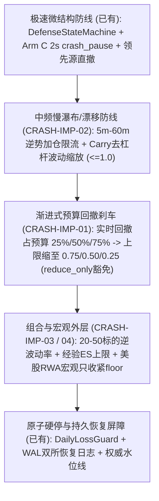

# 宏观防崩盘与组合风控深度研究及 AlephTX 改进方案（2026-11-22）

> **边界与合规声明**：本文档为**只读研究结论与风控架构改进设计**，基于对 [`hft.md/crash/llms.txt`](https://hft.md/crash/llms.txt)（本地完整原文快照见 [`HFT_MD_CRASH_LLMS_SOURCE_2026_11_22.md`](./HFT_MD_CRASH_LLMS_SOURCE_2026_11_22.md)，`84,264` bytes，`1,331` lines，`sha256: d9148ac830f45d31a8f39cd5b6cec5c42912a391e533d610889af2f62e959757`）的源码级审计，以及与 AlephTX 现有代码库的逐项对照。当前三条业务赛道（`01_quant_profit`、`02_hedge_arbitrage`、`03_incentive_turnover`）继续维持 **`HOLD`**；本文档**不修改任何源码**，亦**不授权**任何实盘下单、撤单、账户调整、部署或服务重启。文中规则均仅用于生存风控与极端保护，不构成任何行情崩盘预测或投资建议。

---

## §1. 执行摘要与核心定性

1. **原始资料定位**：[`HFT_MD_CRASH_LLMS_SOURCE_2026_11_22.md`](./HFT_MD_CRASH_LLMS_SOURCE_2026_11_22.md) 汇总了“五层防崩盘生存体系”（**Survive → Balance → Adapt → Insure → God Mode**），面向**日频 / 中长线多资产方向性投资组合**（如 Bridgewater 全天候风险平价、AQR 波动率目标与 12 个月时间序列动量、Man Group 危机 Alpha、Universa 尾部期权），并附带纯标准库 Python 模块 `crash_guard.py`、1987–2022 S&P 500 历史崩盘数据集及免费宏观压力数据源索引。
2. **不可直接照搬进 AlephTX**：`crash_guard.py` 预设 `252` 交易日年化日线、多头方向性 Beta 敞口，且自身包含**两处对高频/杠杆永续实盘极度危险的设计缺陷**（历史最大回撤锁死 Bug 与低波期加杠杆 `cap = 1.5..2.0`）。在持有周期秒～数天的永续做市（`01`）与跨所 Delta 中性套利（`02`/`03`）中直接套用日频股票脚本会导致风控迟钝或违反硬安全不变量。
3. **对 AlephTX 真正的高价值影响**：AlephTX 目前在**毫秒～2 秒微结构防御**（[`DefenseStateMachine`](../src/strategy/inventory_neutral_mm/defense.rs#L104-L177)、[`crash_pause.rs`](../src/strategy/inventory_neutral_mm/replay/recorded/crash_pause.rs#L48-L204)）和**当日绝对硬停机**（[`DailyLossGuard`](../src/daily_loss.rs#L26-L180)）两端很强，但**两者之间的“中频慢瀑布区间（5 分钟～数小时）”、“风险预算渐进刹车”以及“多标的 Carry 组合层风控”存在明显空白**。将 `hft.md/crash` 的组合生存理念严格翻译并适配到永续约束下，可形成 **4 项高杠杆改进（`CRASH-IMP-01` ~ `CRASH-IMP-04`）**。

---

## §2. 原文五层体系、`crash_guard.py` 审计与失效边界

### 2.1 五层防御体系与 `crash_guard.py` 核心机制

[`HFT_MD_CRASH_LLMS_SOURCE_2026_11_22.md`](./HFT_MD_CRASH_LLMS_SOURCE_2026_11_22.md#L1044-L1236) 将多资产崩盘防护归纳为 5 层与 13 个核心函数：

| 层级 | 核心思想与机构参照 | 关键方程 / `crash_guard.py` 函数 | 在多资产日频场景的作用 |
| :--- | :--- | :--- | :--- |
| **Level 1 · Survive** | 避免致命回撤（不对称复原需求） | `recovery_gain`: $\frac{x}{1-x}$；`years_to_recover`；`max_drawdown`；`position_size` | 单笔止损占比锁死权益微小比例，避免 `-50%` 需要 `+100%` 才能回本 |
| **Level 2 · Balance** | 按风险而非名义美元平衡（Bridgewater / AQR Risk Parity） | `inverse_vol`: $w_i \propto \frac{1}{\sigma_i}$；`risk_contrib`: $\text{RC}_i = \frac{w_i(\Sigma w)_i}{w^\top \Sigma w}$ | 识别 60/40 表面均衡实则 94% 方差来自股票的伪分散，显式检验相关性矩阵 |
| **Level 3 · Adapt** | 顺应波动率与趋势动态调仓（AQR / Man Group 危机 Alpha） | `ewma_vol`（RiskMetrics $\lambda=0.94$）；`vol_target`: $\min(\text{cap}, \frac{\sigma_{\text{target}}}{\hat{\sigma}})$；`trend_signal`: $\operatorname{sign}(P_t - P_{t-L})$ | 波动上升自动缩仓；长周期趋势在数月慢熊中减仓甚至转空 |
| **Level 4 · Insure** | 用小额持续保费买断深尾（Universa / Taleb） | `put_payoff`: $\max(K - S_T, 0) - p$；`volatility_drag`: $g \approx \mu - \frac{1}{2}\sigma^2$ | 通过减少深尾方差拖累提升长期几何复利增长率 |
| **Level 5 · God Mode** | 组合前四层 + 分式凯利 + ES + 历史压测与宏观监控 | `kelly_fraction`（半凯利）；`var_normal` / `es_normal`；`drawdown_brake`（`-10%/-20%/-30%` 缩至 `75%/50%/25%`）；`stress_test` | 多机制正交叠加：趋势+波幅控制结合回撤刹车、极端肥尾量化与跨周期压测 |

### 2.2 源码审计发现的 2 处实盘高危缺陷（绝不可直接复用）

1. **`CrashGuard.exposure()` 的历史最大回撤死锁 Bug（[原文 L1213](./HFT_MD_CRASH_LLMS_SOURCE_2026_11_22.md#L1213)）**
   - 原文代码为：
     ```python
     e *= drawdown_brake(max_drawdown(equity_curve[-260:]) if equity_curve else 0.0)
     ```
   - `max_drawdown(equity_curve[-260:])` 计算的是**过去 260 期滚动窗口内曾出现过的最大峰谷回撤**，而非**当前权益相对运行高点的实时回撤**（$1 - \frac{E_t}{\max_{s \le t} E_s}$）。一旦某日触发过 `-30%` 历史回撤，哪怕账户随后迅速反弹并创下历史新高，只要该老回撤仍落在最近 260 个采样点内，仓位乘数都会被死锁在 `0.25x` 长达一整年。实盘改造必须使用**实时相对当前高点的回撤**并辅以明确恢复迟滞，而非历史极值。
2. **`vol_target(..., cap=1.5..2.0)` 允许低波期自动加杠杆（[原文 L1144-L1146](./HFT_MD_CRASH_LLMS_SOURCE_2026_11_22.md#L1144-L1146)）**
   - 当 $\hat{\sigma}_{\text{now}} < \sigma_{\text{target}}$ 时，`vol_target` 返回最高 `1.5x–2.0x` 的仓位放大乘数。在加密与永续市场中，**极低波动压缩期往往紧邻大规模清算插针或流动性抽离**；让风控模块自动突破策略基准仓位上限，直接违背 AlephTX 在 [`DefenseStateMachine::set_external_floor`](../src/strategy/inventory_neutral_mm/defense.rs#L115-L116) 确立的硬不变量（**风控层只能收紧、绝不放大基础限额**）。任何波动率缩放乘数在 AlephTX 中必须严格封顶在 $\le 1.0$。

### 2.3 必须同步认识的失效边界（`Where each approach fails` + 永续微结构扩展）

原文第 [`L1320-L1328`](./HFT_MD_CRASH_LLMS_SOURCE_2026_11_22.md#L1320-L1328) 行本身明确列出了各方法的失效模式，结合永续交易场景应特别注意以下 6 点：

1. **风险平价失效（2022 式股债双杀）**：当相关性突然趋近 `1`（或接近原文提到的 $\sqrt{\rho}$ 分散化下界）时，依赖历史低相关性的多标的配权无法提供保护。加密市场亦然（AlephTX 实证已证明 `{BTC, ETH, SOL, XRP}` 四币对 BTC $\beta$ 高达 `1.16–1.25`，危机下高度共振）。
2. **趋势过滤滞后（2020 式闪崩与震荡磨损）**：慢趋势规则来不及响应几分钟到几小时内的闪电崩盘；而在均值回归主导的震荡市则频繁产生误判损耗。
3. **波动率目标的“低位砍仓”副作用**：因为波动率基于已实现收益估计，属于事后指标，可能在恐慌顶部/价格最低点把仓位砍到最小，导致错失随后的流动性修复与厚点差收益。
4. **正态分布 VaR / 理想凯利的肥尾陷阱**：`var_normal` / `es_normal` 基于高斯假设，严重低估加密跳空、连环强平与断腿尾部；二元常系数 `kelly_fraction` 要求胜率 $p$ 与赔率 $b$ 经严格样本外校准，绝不能用作未经校准的加注放大器。
5. **显式虚值期权对冲成本**：Level 4 尾部期权在平静年份持续净流血；对于高换手/中性套利小体量系统，**“选择性空仓 / 撤单退出权（Option Not to Quote）”**往往比长期支付昂贵期权权利金更具费效比。
6. **高频结构性特有风险未覆盖**：`hft.md/crash` 完全没有涉及跨所永续的 **300ms 减速带断腿、资金费率骤反、ADL 自动减仓强平、以及 `USDG`/`USDC`/`USDT` 稳定币脱锚**——这部分必须由 [`ARBITRAGE_STRATEGY_DEEP_RESEARCH_AND_IMPROVEMENTS_2026_11_22.md`](./ARBITRAGE_STRATEGY_DEEP_RESEARCH_AND_IMPROVEMENTS_2026_11_22.md) 中的 `ARB-IMP-07` ~ `ARB-IMP-10` 协同兜底。

---

## §3. 与 AlephTX 现有风控底座的源码级逐项对照

| 机制维度 | `hft.md/crash` 原文做法 | AlephTX 现有对应源码实现 | 真实差距与落地转化方向 |
| :--- | :--- | :--- | :--- |
| **波动率调仓** | `ewma_vol`（日线 $\lambda=0.94$）+ `vol_target(..., cap=1.5..2.0)` | **`01` 做市已超越原文**：[`VolatilityRegime`](../src/strategy/inventory_neutral_mm/volatility_regime.rs#L16-L74) 统计 5 分钟完成 K 线高低波幅 RMS；[`inventory_neutral_mm.rs`](../src/strategy/inventory_neutral_mm.rs#L1327-L1332) 仅缩**加仓侧** `bid_scale`/`ask_scale`，不压减仓侧 | **`02` 套利/Carry 缺位**：[`multiday_carry.rs`](../src/strategy/multiday_carry.rs#L24-L69) 仍是静态 `target_leg_notional_usd`，缺少封顶 $\le 1.0$ 的去杠杆波动率缩放 |
| **回撤刹车** | `drawdown_brake`（`-10% / -20% / -30%` 缩仓至 `75% / 50% / 25%`；原 `CrashGuard` 错用 260 期历史最大回撤） | **当前为二值硬熔断**：[`DailyLossGuard`](../src/daily_loss.rs#L109-L156) 与 [`MultiDayCarryConfig::max_loss_budget_usd`](../src/strategy/multiday_carry.rs#L38) 达阈值前均维持 `100%`，触线直接当日永久 `Halt` | **高价值缺口**：缺少按**实时风险预算消耗比例**（`25% / 50% / 75%`）渐进降额的软刹车过渡带 |
| **趋势过滤** | `trend_signal`（252 日现货价格动量） | **仅有极短周期防御**：[`DefenseStateMachine`](../src/strategy/inventory_neutral_mm/defense.rs#L150-L154) 短动量 `SideDefense` + [`crash_pause.rs`](../src/strategy/inventory_neutral_mm/replay/recorded/crash_pause.rs#L48-L204) Arm C（`2s` 急跌买侧熔断） | **中频断层**：缺少 **`5m–60m` 慢瀑布/逼空加仓限流**（如 W13 美股 `NVDA` 缓跌 `-400 bp` 收割被动买单）；`02` 赛道缺少基差/资金费自身趋势过滤 |
| **凯利上限与尾部度量** | `kelly_fraction`（半凯利）+ `var_normal` / `es_normal` | 无在线凯利缩放（仓库政策严禁以未校准凯利放大下单），离线以 10h 净现金与尾部亏损验收 | 可将**冻结窗口经验 Expected Shortfall（非正态 CVaR）+ 保守分式凯利（$\le 0.25\times$）**引入离线资金上限审核 |
| **风险平价分配** | `inverse_vol` + `risk_contrib`（含相关性矩阵 $\Sigma$ 检查） | [路线图 S2](./STRATEGIC_AND_TACTICAL_OPTIMIZATION_ROADMAP_2026_11_21.md#L88-L91) 已规划将 Carry 扩展到 20–50 标的，但尚无多标的组合配权器 | 直接适用于 **20–50 标的宽分散多日 Carry** 的风险预算配权与高相关性压力检验 |
| **宏观压力与崩盘压测** | VIX 期限结构 / FRED `BAMLH0A0HYM2` / `STLFSI4`；S&P 500 五次崩盘回测 | [`DefenseStateMachine::set_external_floor`](../src/strategy/inventory_neutral_mm/defense.rs#L118-L124) 已预留外部只收紧防线接口；离线以合成故障注入和 `W13` 等真实急跌录盘检验 | 对**美股 RWA 永续**（`NVDA/SPY/QQQ/SNDK`）可接入只收紧的日级宏观上限；并构建**永续微结构专属崩盘压测套件** |

---

## §4. AlephTX 崩盘防护层改进清单（`CRASH-IMP-01` ~ `CRASH-IMP-04`）

总体五层纵深防御架构（已有底座与新增/补齐边界）：



---

### `CRASH-IMP-01` · 渐进式预算回撤刹车（P0 · 优先级最高）
- **涉及文件 / 符号**：[`src/daily_loss.rs`](../src/daily_loss.rs)（`DailyLossGuard`）、[`src/strategy/multiday_carry.rs`](../src/strategy/multiday_carry.rs)（`MultiDayCarryConfig`）、[`src/strategy/inventory_neutral_mm.rs`](../src/strategy/inventory_neutral_mm.rs)（报价规模缩放入口）。
- **改造设计**：
  1. **修复原版脚本核心 Bug，采用实时回撤百分比**：
     定义当前交易周期（UTC 日或 Carry 活动期）内相对运行权益高点 $E_{\text{peak}}$ 的实时回撤损耗占总允许风险预算 $B_{\text{max}}$（如日损限额或 `max_loss_budget_usd`）的消耗比：
     $$r_{\text{dd}} = \frac{\max(0,\, E_{\text{peak}} - E_t)}{B_{\text{max}}} \in [0,\, 1]$$
     （彻底避免 `crash_guard.py` L1213 把 260 期历史最大回撤误作当前状态导致永远锁死的问题）。
  2. **阶梯降档与恢复迟滞（Hysteresis）**：
     - 设默认阶梯：`r_dd >= 0.25 -> 0.75x`、`r_dd >= 0.50 -> 0.50x`、`r_dd >= 0.75 -> 0.25x`、`r_dd >= 1.00 -> 0.0x`（触发现有持久化硬熔断）；
     - 升级立即生效，回撤好转恢复需跨过缓冲带（如降回上一档以下再降 `5%–10%` 预算并满足冷却时间）防止在阈值边缘反复震荡。
  3. **持久化防重启漏洞**：将当前周期 `peak_equity` 与已生效档位随 `DailyLossState` 原子写盘（`sync_all` + rename），防止重启后丢失当期峰值高点而重获满额预算。
- **验收标准**：通过多段先跌后反弹创新高、阈值附近抖动、进程崩溃重启恢复的单元测试；验证 `10h` 因果回放中“尾部回撤收敛”是否在不牺牲正常平静期收益的前提下压缩 `max_loss` 分布。
- **红线约束**：**乘数严格 $\le 1.0$**；且**绝对禁止**回撤刹车缩小或拦截 `reduce_only` 平仓、断腿对冲或减仓侧报价。

### `CRASH-IMP-02` · 中频慢瀑布趋势限流与 Carry 去杠杆波动率缩放（P0）
- **涉及文件 / 符号**：[`src/strategy/inventory_neutral_mm/volatility_regime.rs`](../src/strategy/inventory_neutral_mm/volatility_regime.rs)、[`src/strategy/inventory_neutral_mm/defense.rs`](../src/strategy/inventory_neutral_mm/defense.rs)、[`src/strategy/multiday_carry.rs`](../src/strategy/multiday_carry.rs)、[`src/strategy/relative_value/paper/maker_first.rs`](../src/strategy/relative_value/paper/maker_first.rs)。
- **改造设计**：
  1. **补齐 `5m–60m` 慢单边瀑布过滤（`01` 做市赛道）**：
     基于已完成且时间戳严格因果校验的多分钟中价序列（复用 `VolatilityRegime` 采样时钟规范），计算滚动因果对数漂移 $\Delta_{W}$ 与波动率标准化趋势强度 $z_{\text{trend}} = \frac{\Delta_W}{\hat{\sigma}_W}$；当 $|z_{\text{trend}}|$ 超过阈值时，**只压低逆势加仓侧挂单规模/缩紧库存上限**（下跌只缩买侧、上涨只缩卖侧），保留顺势减仓侧全额流动性。
  2. **跨所基差/Carry 漂移过滤与去杠杆缩放（`02` 对冲套利赛道）**：
     - 严禁把现货 252 日方向搬到 Delta 中性套利里；改为跟踪**跨所基差与资金费差的滚动中频漂移**，在基差/Carry 持续逆势单边扩张期限制加仓；
     - 在 `MultiDayCarryConfig` / `relative_value` 引入单向封顶的波动率目标缩放 $m_{\text{vol}} = \min\!\left(1.0,\, \frac{\sigma_{\text{target}}}{\max(\hat{\sigma}_{\text{basis},t},\, \epsilon)}\right)$，在基差波动剧烈放大时自动按比例压低单笔目标名义额。
- **验收标准**：在包含慢单边阴跌（如东京 `W13` RWA 急跌窗口）与高震荡切换的 `selection_dev` 10h 单元上做单因素消融，对比“仅 2s 急跌熔断”与“2s 急跌 + 15m 慢趋势限流”在非库存逆向选择亏损上的净改善。
- **红线约束**：必须同时满足 `03_incentive_turnover` 隔离原则——不得用趋势过滤或缩放豁免已成交头寸的全额对冲义务。

### `CRASH-IMP-03` · 多标的 Carry 逆波动率分配与经验 ES / 保守凯利上限（P1）
- **涉及文件 / 符号**：[`src/strategy/cross_sectional.rs`](../src/strategy/cross_sectional.rs)、[`src/strategy/multiday_carry.rs`](../src/strategy/multiday_carry.rs)、离线研究组合评估脚本（服务 [路线图 S2](./STRATEGIC_AND_TACTICAL_OPTIMIZATION_ROADMAP_2026_11_21.md#L88-L91) 20–50 标的扩展）。
- **改造设计**：
  1. **组合层风险平价分配（`inverse_vol` + 相关性压力 $\text{RC}_i$）**：
     对入选的 $N$ 个流动永续 Carry 对，按各自近期基差/组合日收益波动率 $\hat{\sigma}_i$（非单腿价格裸波幅）计算逆波动率初筛权重 $w_i \propto 1/\hat{\sigma}_i$；再代入历史样本相关性矩阵 $\hat{\Sigma}$ **以及人为拉高非对角相关性的危机压力矩阵 $\Sigma_{\text{stress}}$（$\rho_{ij} \to \max(\rho_{ij}, 0.7)$）**核算各品种风险贡献 $\text{RC}_i$，防止看似分散的多品种在危机瞬间沦为单一因子暴露。
  2. **经验 Expected Shortfall（非正态 CVaR）+ 保守分式凯利上限（仅作离线资金天花板）**：
     基于已冻结 `selection_dev` 的多日净现金序列（拒绝正态近似 `es_normal`），计算经验 $97.5\%$ Expected Shortfall $\widehat{\text{ES}}_{97.5\%}$ 与保守四分之一凯利上限（$\le 0.25 f^*$），将单标的与全组合允许杠杆上界锁死在 $\text{ES}$ 预算之内。
- **验收标准**：对比等美元配仓（$1/N$）与“逆波动率 + 压力 $\text{RC}_i$ 约束”在多标的连续回放上的组合夏普、最大回撤及最坏 2.5% 尾部损失。
- **红线约束**：重申仓库铁律——**凯利公式永远不能用于掩盖负期望或未经校准的概率估计**，且禁止在运行时自动根据短期胜率动态加杠杆。

### `CRASH-IMP-04` · 美股 RWA 宏观压力只收紧护栏 + 永续崩盘压力测试套件（P2）
- **涉及文件 / 符号**：[`src/strategy/inventory_neutral_mm/defense.rs`](../src/strategy/inventory_neutral_mm/defense.rs#L118-L124)（`set_external_floor`）、离线压测脚本与场景夹具。
- **改造设计**：
  1. **美股 RWA 日级宏观压力外部防线（只收紧）**：
     针对 `NVDA / SPY / QQQ / AAPL / TSLA / SNDK` 等美股 HIP-3 / RWA 永续做市与盘外基差策略，离线/异步拉取免费公开压力信号（如 VIX 期限结构是否处于近月高于远月的 Backwardation 倒挂、Cboe VIX 极值、FRED 高收益信用利差 `BAMLH0A0HYM2` 急扩）：当宏观压力处于极端分位时，向 `DefenseStateMachine::set_external_floor` 注入更保守的初始保护档位（如开盘默认缩量 `Caution` 或加大基础价差缓冲），不用于择时方向预测。
  2. **构建 AlephTX 永续专属“五维度历史+合成崩盘压力测试套件”**：
     超越 `hft.md/crash` 仅按 S&P 500 收盘跌幅算静态 Beta 的 `stress_test`，建立专门覆盖永续脆断场景的离线基准压测库：
     - **实录极端行情**：东京 `W13` 急跌真录等高波动十分位窗口；
     - **非对称延迟断腿**：模拟 HL 瞬间成交 + Lighter 300ms 减速带滑点翻倍场景；
     - **危机流动性枯竭**：L1–L5 深度瞬间萎缩 80%、价差扩至 10×；
     - **Carry 与稳定性黑天鹅**：多标的基差相关性跳至 `0.95`、资金费率在 2 小时内倒挂 + 稳定币 `USDG`/`USDC` 脱锚 `50 bp`。
- **验收标准**：每次重大策略参数或风控逻辑升级前，必须全套跑通上述 5 类崩盘压力夹具并输出各分项最大亏损、最坏未平敞口驻留时长与硬停机触发合规证明。
- **红线约束**：宏观信号须严格记录发布时间（`available_at_ms`）禁止未来函数；绝不因外部“风平浪静”信号而自动放宽内部微观风控阈值。

---

## §5. 验证门禁与研究纪律

1. **三赛道严格独立**：`01_quant_profit`、`02_hedge_arbitrage`、`03_incentive_turnover` 各自独立评估；任何回撤刹车或趋势限流改造若面向 `03` 赛道，绝不能削弱已确认成交头寸的全额对冲要求。
2. **因果与冻结**：所有阈值（如 `25%/50%/75%` 回撤阶梯、中频漂移窗口长度 $W$ 与 `z_trend` 门槛、波动率封顶目标）均须先在 `selection_dev` 做单因素消融后写入冻结清单（记录 SHA-256），再于 untouched `holdout` 连续 10 小时单元一次性验证。
3. **如实记录负结果**：参考 [`ARBITRAGE_STRATEGY_DEEP_RESEARCH_AND_IMPROVEMENTS_2026_11_22.md`](./ARBITRAGE_STRATEGY_DEEP_RESEARCH_AND_IMPROVEMENTS_2026_11_22.md#L301-L314)，若中频趋势限流在震荡窗口产生过多误杀导致净现金不增反降，或渐进刹车拖累修复期收益，须原样留痕并否决对应参数 arm。

---

## §6. 参考资料与溯源索引

- **本地原文完整快照**：[`HFT_MD_CRASH_LLMS_SOURCE_2026_11_22.md`](./HFT_MD_CRASH_LLMS_SOURCE_2026_11_22.md)（`84,264` bytes，`1,331` lines，`sha256: d9148ac830f45d31a8f39cd5b6cec5c42912a391e533d610889af2f62e959757`；在线来源：[`https://hft.md/crash/llms.txt`](https://hft.md/crash/llms.txt)）。
- **关联跨所套利改进研究**：[`ARBITRAGE_STRATEGY_DEEP_RESEARCH_AND_IMPROVEMENTS_2026_11_22.md`](./ARBITRAGE_STRATEGY_DEEP_RESEARCH_AND_IMPROVEMENTS_2026_11_22.md) · [`STRATEGIC_AND_TACTICAL_OPTIMIZATION_ROADMAP_2026_11_21.md`](./STRATEGIC_AND_TACTICAL_OPTIMIZATION_ROADMAP_2026_11_21.md)。
- **AlephTX 核心风控与策略源码**：
  - 防御状态机与外部限流接口：[`src/strategy/inventory_neutral_mm/defense.rs`](../src/strategy/inventory_neutral_mm/defense.rs)
  - 5 分钟波幅制度估计与报价侧缩放：[`src/strategy/inventory_neutral_mm/volatility_regime.rs`](../src/strategy/inventory_neutral_mm/volatility_regime.rs) · [`src/strategy/inventory_neutral_mm.rs`](../src/strategy/inventory_neutral_mm.rs#L1322-L1340)
  - Arm C 2s 因果急跌买侧熔断：[`src/strategy/inventory_neutral_mm/replay/recorded/crash_pause.rs`](../src/strategy/inventory_neutral_mm/replay/recorded/crash_pause.rs)
  - 持久化日损硬熔断：[`src/daily_loss.rs`](../src/daily_loss.rs)
  - 多日 Carry 与截面框架：[`src/strategy/multiday_carry.rs`](../src/strategy/multiday_carry.rs) · [`src/strategy/cross_sectional.rs`](../src/strategy/cross_sectional.rs) · [`src/strategy/relative_value/paper/maker_first.rs`](../src/strategy/relative_value/paper/maker_first.rs)
