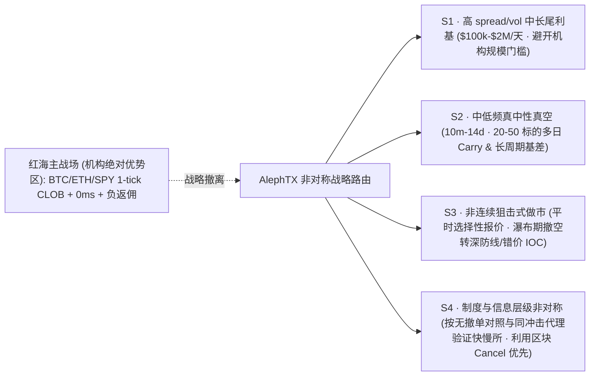

# AlephTX 战略错位与战术微结构优化路线图（2026-11-21）

> **边界与合规声明**：本文档为**研究候选清单与工程架构演进蓝图**（经静态审阅校准）。当前三条业务赛道（`01_quant_profit`、`02_hedge_arbitrage`、`03_incentive_turnover`）继续维持 **`HOLD`**，本文档不授权任何实盘下单、撤单、账户调整、部署或服务重启；任何候选向实盘晋级均须满足各赛道独立、全周期的费后现金/合格周转成本与安全门禁。文中所有源码路径与行号均基于当前工作区静态审查，实证数字均引自仓库已归档研究报告与公开行情诊断。

---

## 0. 核心判断（Executive Summary）

面对顶级量化做市机构（拥有 `-0.2 ~ -1.5 bp` Maker 返佣、同机房裸金属 `<1 ms` 硬件和交易所/项目方协议），我们在**绝对费率与最后 1–3 毫秒硬件竞速**上确实无法正面胜出。但这并不意味着“策略无能为力”。

对 `oasis-tokyo` 实测网络和仓库现有约 9.7 万行源码的交叉审计表明，**当前亏损并非全因“网络延迟太大”，而是“战略选场错位”与“战术软件内耗”叠加**：

1. **`oasis-tokyo` 具备较好的东京边缘网络连通性（但非端到端撮合总延迟）**：
   GCP `asia-northeast1-b` 到主流东京撮合边缘的实测 TCP 握手为 `3.4–5.7 ms`（Arcus `3.4 ms`、Lighter RH `4.6 ms`、Backpack `4.8 ms`、Lighter Core `5.5 ms`、Hyperliquid `5.7 ms`），部分场所 BBO 到达延迟中位数 `3.0–4.0 ms`（Lighter Core/RH `3.0 ms`、Binance USD-M `4.0 ms`）。需要注意的是，TCP 握手只度量网络边缘连通性，**不等于**包含场所撮合排队、链上共识（如 Hyperliquid HyperCore）或速率/减速带在内的端到端挂撤总耗时；Arcus 公开成交流与 L2 快照之间约 `65 ms` 的中位年龄差也仅是**待验证的领先线索**，尚需通过无撤单基准回放对照或公共市场穿档代理实测，并由获授权的实盘测量标定真实撤单生效时间。
2. **战略错配（把劣势摆在对方最强点上）**：
   用 Tier 0 散户费率 + `200–300 ms` 免费档减速带，长期在 `BTC / ETH / SPY / QQQ` 这些价差仅 `0.14–0.5 bp`（1 个 tick）的最拥挤公开 CLOB 上与 0ms 付费机构抢 FIFO 队列。
3. **战术内耗（软件延迟、信息滞后、基础价差约束与高成本强平）**：
   策略热路径轮询休眠 `5–10 ms`、东京 2 vCPU 被采集压出 `13–17%` cgroup 限流、比 L2 快照更快的公开成交流未进实盘共享内存、冻结 `t50_iso0` 配置族下基础入场价差 `99.99923%` 被上下限锁死、有对冲时直接禁用单侧撤单、以及高昂的超时吃单强平。

**破局总方针**：
- **战略层（打非对称错位战）**：离开 `1-tick` 毫秒级红海，向 **高 `spread/vol` 中长尾利基市场**、**`10 分钟 – 14 天` 中低频真中性真空**、**非连续“按体制启停”的狙击式做市** 以及 **制度/信息层级非对称套利** 转移；
- **战术层（在守住持久化与敞口安全红线前提下压榨现有架构潜力）**：消除热路径无谓休眠与 CPU 抢占（同时严守 `AbortedBeforeDispatch`/落盘屏障）、将经无撤单基准对照或同冲击代理验证的快成交流接入 SHM、升级为领先源驱动的“事前单侧撤单”（含危险侧全量身份校验）、以安全撤单绝对优先的队列位置辅助报价、并以独立立项/自营专属的“宽库存带自然对消 + 受场所级风控约束的被动 Skew 派发 + 多档保护 IOC”替代原地强平。

---

## 1. 现状底盘盘点：已有资产 vs. 源码级 6 大内耗

### 1.1 我们已经拥有的机构级底座

经过 Sprint 1–19 的建设，AlephTX 并非从零起步，核心优势资产已经成型：

- **低延迟 IPC 与多通道执行骨架**：`12 × 2048` 槽位无锁 Seqlock 共享内存（64B BBO `aleph-matrix` + 256B Top-5 深度 `aleph-depth` + 128B V2 私有事件环 `aleph-events-v2`）、`Maker / Cancel / Taker` 三通道签名隔离与 WAL 双场所恢复日志（[README.md](../README.md)）。
- **已落地的策略与风控原语**：
  - 五态防御状态机 `DefenseStateMachine`（[defense.rs](../src/strategy/inventory_neutral_mm/defense.rs)）；
  - 跨所压力 `CrossMarketPressure`、外部订单流 `OrderFlow` 与慢速基差跟踪器 `BasisTracker`（[market_state.rs](../src/strategy/inventory_neutral_mm/market_state.rs)）；
  - 因果队列净减少推断 `ReplayQueueDepth`（[replay_queue_depth.rs](../src/strategy/replay_queue_depth.rs)）；
  - 交易所无关截面引擎 `CrossSectionalDirection::FundingCarry` 与单边做市屏蔽接口 `mm_blocked_entry_sides`（[cross_sectional.rs](../src/strategy/cross_sectional.rs#L18-L26)）；
  - 独立多日 Carry 离线筛选模型 `MultiDayCarryScenario`（[multiday_carry.rs](../src/strategy/multiday_carry.rs#L203-L300)）；
  - 价差/短波选标器（[screen_market_spread_to_vol.py](../scripts/screen_market_spread_to_vol.py)）与连续库存净额对冲研究框架（[research_ant_inventory.py](../scripts/research_ant_inventory.py)）。
- **严格的因果湖仓验证系统**：20 TB Medallion 湖仓 + VDSO `<25 µs` 时钟守卫 + 严格消除前视偏差和积分幻觉的 10h 因果回放器。

### 1.2 源码与架构中暴露的 6 处“可控内耗”

以下 6 处瓶颈均经当前源码与仓库实证核对（其中第 6 项已同步最新工作区修复与未闭环状态）：

| 编号 | 源码/部署定位 | 现状与实证边界 | 对策略盈利与安全的影响 |
| --- | --- | --- | --- |
| **L1 · 热路径休眠与 CPU 抢占** | [lighter_inventory_mm.rs](../src/bin/lighter_inventory_mm.rs#L110) [inventory_neutral_mm.rs](../src/strategy/inventory_neutral_mm.rs#L4220-L4248) | 私有事件环空闲硬睡 `10 ms`；SHM 唤醒 `WAKE_CHECK_INTERVAL = 5 ms`；东京 `2 vCPU` 主机混跑执行与三路重型采集，负载 `~3.0`，主采集 cgroup 限流 `13–17%` | 边缘 TCP 仅 `3–6 ms`，软件休眠和 CPU 饥饿把本地响应推高到 `15–50+ ms` 尾部抖动（改进时必须严守 T1 落盘屏障） |
| **L2 · 最快公共逐笔流未进实盘 SHM** | [arcus.go](../feeder/exchanges/arcus.go#L92-L166) [binance.go](../feeder/exchanges/binance.go#L76-L226) | `arcus.go` 只订阅 `l2Orderbook`（独立统计显示相对源时间慢 `p50 93 ms / p99 192 ms`），未订阅 `arcus_trades`（`p50 9.7–28 ms`）；`binance.go` 只订阅 USD-M `@bookTicker`，无现货 BBO 与 `@aggTrade`。两条流的**中位年龄差 `~65 ms` 不能直接等同于可用撤单窗口** | 尚未配对拆出“快照发布滞后 vs. 未来价格变动”（见 [Sprint 19](./SPRINT19_ARCUS_LEASE_DURABLE_LEDGER_AUDIT_AND_HANDOFF_PROTOCOL_2026_11_21.md#L48-L51)），但缺少高速成交流使实时风控无法第一时间捕获扫单冲击 |
| **L3 · 防御状态机只看滞后本地盘口** | [defense.rs](../src/strategy/inventory_neutral_mm/defense.rs#L126-L176) [inventory_neutral_mm.rs](../src/strategy/inventory_neutral_mm.rs#L2561-L2694) | `DefenseStateMachine::evaluate` 仅输入本地 `local_spread_bps` 与 `momentum_bps`；`CrossMarketPressure` 和 `OrderFlow` 仅用于略微加宽储备，不触发单侧即时撤单 | 月首 `t50_iso0` 中 `71.9%`（`128/178` 笔）成交发生在 `PendingCancel` 状态，贡献了 **97%** 的 1s 亏损（`-$2.898 / -$2.987`，见 [SPRINT18](./SPRINT18_PER_REASON_CANCEL_PENDING_MARKOUTS_2026_11_19.md)） |
| **L4 · `t50_iso0` 基础价差受限与全撤退化** | [inventory_neutral_mm.rs](../src/strategy/inventory_neutral_mm.rs#L3009-L3031) [inventory_neutral_mm.rs](../src/strategy/inventory_neutral_mm.rs#L3347-L3361) | 在冻结 `t50_iso0` 配置族的 19 窗 4,959,069 次报价计算中，**基础入场价差 `99.99923%` 上下限重合**（0 次处于自由变化区间），但 `γ` 仍可作用于库存保留价、减仓侧亦有二次价差计算（见 [报价约束审计](./RESEARCH_SYNTHESIS_AND_QUOTE_CONSTRAINTS_2026_11_20.md#L99-L128)）；当 `self.hedge.is_some()` 或任一越界单缺 `order_index` 时直接双边全撤 | 证据支持暂停同一配置族下单独调 `κ`，但不能断定全部 A–S 参数或利润下限均无作用；全撤退化会破坏对冲模式下的安全侧队列优先级 |
| **L5 · 昂贵的强平出口与减仓串位** | [inventory_neutral_mm.rs](../src/strategy/inventory_neutral_mm.rs#L4086) [live_hedge.rs](../src/live_hedge.rs#L948-L990) | 50s 超时 Taker 平仓占月首 Taker 成交额 `92.07%`；`W01` SPY 跨所被迫在 Arcus 吃单占比达 `38.5%`；历史 `bound_breach` 成交中 `57.39%` 名义额实际在增仓/穿零（见 [周期归因](./INVENTORY_CYCLE_CASH_ATTRIBUTION_2026_11_20.md#L50-L63)）；实盘 `plan_ioc` 只看 HL L1 单档深度 | 赚来的微薄点差交给了平仓滑点与吃单费；L1 碎单卡死导致对冲阻塞 |
| **L6 · 双轨断层与未闭环底层缺陷** | [maker_first.rs](../src/strategy/relative_value/paper/maker_first.rs#L1550-L1565) [durable.rs](../src/hedging/durable.rs) · [model.rs](../src/hedging/durable/model.rs) · [storage.rs](../src/hedging/durable/storage.rs) · [rest.rs](../src/exchanges/arcus/rest.rs#L109-L130) | 回放与实盘分裂；`maker_first` 缺跨资金费结算生命周期（包括迟到成交归属时点）；工作区中 **`R1`、`R2`、`R5` 及 `EXEC-C1..C4` 已通过独立复核**，**`R3`（卖侧显式外侧成交界 + 越界保真恢复 + 同资产计价费用预算）与 `R4`（`schema 2` 重放/审计收紧关闭新鲜度门槛）已完成离线修补并过单测（待 Codex 复核）**，且 `CancelLease`/`ExecutionJournal` 尚未接入 live supervisor | 未补齐结算生命周期前，多日 Carry 无法在真实回放验收；`R3`/`R4` 独立复核与上线集成门禁未过前严禁接实盘 |

---

## 2. 战略层面：四大“非对称错位竞争”支柱

顶级做市机构的商业模式依赖于**极高的每日资金周转与全市场基础设施摊销**。这种体量反过来给他们套上了“**容量诅咒**”和“**合规/流动性义务**”的枷锁。我们缩小差距的核心战略，就是把资本配置到巨头**懒得做、做不了或制度约束不划算**的四个非对称象限：

### 战略支柱 S1 · 选战场重于调参数：猎杀“机构容量诅咒”的高 `spread/vol` 利基

- **为什么在 BTC/ETH/SPY/QQQ 必输**：在买一卖一仅 `0.14–0.5 bp` 的头部市场，半点差只有 `0.07–0.25 bp`。没有 `-0.3 bp` 以上的现金返佣，单靠点差根本不可能覆盖 `-1.0 ~ -2.4 bp` 的逆向选择。
- **中小资金的天然护城河**：管理上亿美元做市资金的机构，不会为日成交仅数百万美元、单日天花板 `$200–$2,000` 的新上永续或中小盘标的投入专属工程师与定制风控。
- **落地方法（升级选标漏斗）**：扩展现有的 [screen_market_spread_to_vol.py](../scripts/screen_market_spread_to_vol.py)，从“只看中位数价差/1秒波动”升级为**四维准入评分**：
  1. **费后点差安全边际**：`0.5 * median_spread_bps - maker_fee_bps` 必须大于历史实测 **1s 条件逆向选择损失的 2 倍以上**；
  2. **非知情流量密度**：统计公共成交中的小额散户单占比与非穿档成交比例（如 `W13` 观察到 `ANT` 平均每笔成交仅 `$416`，远低于机构大单主导标的）；
  3. **领先源可观测度**：外部主所/现货锚必须比本地盘口存在经**无撤单对照或公共市场穿档代理实测验证**的领先窗口，使我们具备可操作的反应余量；
  4. **规则与费率干净度**：严格由 [venues.rs](../src/venues.rs) 核验合约乘数、预言机口径与交易时段，杜绝未知规则陷阱。

### 战略支柱 S2 · 时间尺度错位：退出 `<1 s` 竞速肉搏，占领 `10 分钟 – 14 天` 真中性真空

延迟优势具有极强的时间尺度衰减效应：

$$\text{相对延迟劣势} \approx \frac{\Delta \tau_{\text{latency}}}{\tau_{\text{holding}}}$$

在 `1 秒` 持仓下，`5 ms` 甚至 `200 ms` 减速带都是生与死的差距；但在 **数小时到数天** 的持有尺度下，连 `300 ms` 减速带带来的执行偏差都可以压缩到趋近于零，并且 `PostOnly` 被动进场本身在 Lighter Core（`0 ms`）或 Arcus RWA/ANT（`0 bp` Maker）几乎无摩擦。

- **主攻方向 A — 20–50 标的宽分散多日 `PostOnly` 跨所/跨币 Funding Carry**：
  - 彻底放弃只有 `{BTC, ETH, SOL, XRP}` 的四币组合（四者对 BTC $\beta$ 均在 `1.16–1.25`，去除共同因子后几乎没有独立截面信号，见 [残差可行性审计](./RESIDUAL_SIGNAL_AND_CASH_FEASIBILITY_2026_11_20.md#L39)）。
  - 把 [cross_sectional.rs](../src/strategy/cross_sectional.rs)（`FundingCarry`）和 [multiday_carry.rs](../src/strategy/multiday_carry.rs) 扩展至 **20–50 个流动性及格的永续标的**。
  - **关键边界（区分“估值筛选”与“可执行净现金”）**：现有的 `MultiDayCarryScenario`（[multiday_carry.rs](../src/strategy/multiday_carry.rs#L297-L396)）仅在**同一帧瞬时建立双腿仓位并在退出帧按 Maker 费率直接结算**，尚未模拟排队位置、部分成交或断腿漂移；而 [maker_first.rs](../src/strategy/relative_value/paper/maker_first.rs#L1550-L1565) 目前仍缺乏跨资金费持仓的结算生命周期（含 `source_time` 仓位水位与迟到成交归属哪个结算时点）。因此，Phase 1 必须先补齐这些执行与结算机制，才能把多日 Carry 的账面估值转化为可晋级实盘的净现金。
- **主攻方向 B — 长周期结构性基差均值回归（严格对齐预言机）**：
  - 放弃 5–180 秒的短周期套利和瞬间保本强退（[配对保本退出审计](./PAIRED_CASH_EXIT_AUDIT_2026_11_20.md) 证实瞬时触发后经历 `3.6–4.0 s` 撤单与双腿 IOC 落地，账面正估值全数变负）。
  - 仅在 **RTH 连续同源预言机时段**、且两所基差偏离显著超过 `双腿可执行进出成本 + 3σ 缓冲区` 时被动建仓，耐心持有数小时等待自然收敛或被动平仓。

### 战略支柱 S3 · 非连续“狙击式流动性供给”：毒流期空仓，只做极端错价与平静回归

两条独立事实共同支撑“分体制非连续报价”：（1）`W13` 东京 RWA 公开行情归因（档案 `tokyo-rwa-20261120T164448Z-w13.ndjson.gz`，`sha256` 前缀 `4c15ef02e7802fb2`，`selection_dev`，`16:44Z–02:59Z` 共 `10.25 h`：美股主盘 `4.25 h` / 盘前盘后 `4 h` / 休市 `2 h`；基于 `3,202,283` 条输入记录且 `0` 坏行产出聚合结果 `mh_lead_out.json`，`sha256` 前缀 `33ddece4727081a3`）覆盖六只普遍下跌标的（`SPY -82.1`、`QQQ -79.0`、`NVDA -400.0`、`AMZN -70.1`、`AAPL -43.1`、`TSLA -112.8 bp`），按 `900 s` 市场去均值 OLS 分桶统计：以 `Q200_B1000` 单一基准计，Arcus Maker 成交额 `$2.425M`，按中价标记的权益变化 `-$518.55`（拆分为持仓涨跌 `-$62` 与**非库存亏损分母 `-$456`**）；在跨方案比较中，将各方案非库存部分对标的收益与 `|收益|` 回归后，`|收益|` 项所列三个方案的系数估计均为负（`Q200_B1000` 基准 `t = -6.7`、逐笔对冲 `t = -10.5`、`0.5 bp` 撤单 `t = -1.9`），且**最高波动十分位（市场 `|return|` 前 10%，阈值 `≥ 48–52 bp`）在不同方案下承担了各自非库存亏损的 `27%–38%`**；（2）[全面自我审视](./COMPREHENSIVE_SELF_REVIEW_2026_11_18.md#L55) 指出恐慌急跌期间 DEX 与 Binance 盘口经常出现 **`15–40 bps`** 的可观测公开价差。

**但公开毛错价绝不自动等于可执行利润**：[同一节审视](./COMPREHENSIVE_SELF_REVIEW_2026_11_18.md#L55) 明确要求在套利计算中**预扣四笔手续费与残余断腿救援成本**。按最保守全吃单口径举例：若双边开平四笔各按 `4.5 bp`（Hyperliquid/Arcus Crypto Tier 0）计算，**仅单腿名义额手续费就高达 `18 bp`**——尚未计入多档扫盘滑点与断腿救援就已直接击穿 `15 bp` 错价！

顶级机构受限于流动性协议（LPP 在线率要求、DMM 考核），在剧烈波动期往往**被迫继续挂单挨打**；小团队没有这个义务，应当坚决利用**选择性不交易权（Option Not to Quote）**：

1. **平时（低波均值回归态）**：仅在外部领先源平稳、本地 `spread/vol` 达标时开启窄幅选择性被动报价；
2. **高波/毒流期（瀑布、新闻、剧烈偏移态）**：放弃一二档贴盘，立刻触发 `SideDefense / Halt` 撤掉迎击单边趋势的一侧；
3. **极端错价狙击候选（以真实可执行净现金为准）**：仅当趋势耗竭、**可扫盘双腿净错价显著覆盖“真实四笔费率 + 多档扫盘滑点 + 断腿救援缓冲”**时，才触发极深防线被动接针或保护性 IOC；所有候选必须经完整周期双腿可执行净现金回放验收，不能把公开盘口毛价差当盈利。

### 战略支柱 S4 · 制度与微结构非对称套利（用规则差异补足硬件差距）

- **撮合优先级与减速带角色分工**：
  - 在 **Hyperliquid / HIP-3**（区块内 `Cancel / ALO` 排在 `GTC / IOC` 之前，参见 [Hyperliquid HyperCore Overview](https://hyperliquid.gitbook.io/hyperliquid-docs/hypercore/overview)）：适合作为**防御性被动挂单腿**（撤单不会被同区块新到 IOC 抢跑），而不适合做高紧急度的 IOC 追单腿；
  - 在 **Lighter Core**（`PostOnly 0 ms` 挂单，但 Standard 撤单 `300 ms`）：极其适合 **低换手、大距离、时间不敏感的 `PostOnlyPeg` Carry 建仓/平仓**，最忌讳用来做需要毫秒级抢撤的贴一档高频做市；
  - 在 **Arcus**（RWA `0 bp` Maker、取消优先通道，若未来获得经过核实的低费/返佣档与免 KPI 期）：适合做慢一拍被领先源保护的被动态，但绝不能走高比例吃单强平路径。
- **信息层级单向传导（规避“成功撤单反事实偏差”）**：
  - 独立流各自的中位年龄差（如 Arcus L2 快照 `93 ms` 与成交 `28 ms` 之差 `~65 ms`）或 TCP 握手 RTT **不能**直接证明某对交易所存在可利用的撤单窗口。
  - 更关键的方法论约束在于**反事实不可观测性**：**一旦己方撤单成功，同一笔订单“原本会在何时被毒流成交”就成了反事实**；若只统计撤单后依然成交的订单，样本会系统性偏向撤单失败案例。因此，S4 验证快慢所排序必须遵守：
    1. **预先定义无撤单对照或市场事件代理**：离线必须以**无撤单基准回放对照（No-Cancel Control Replay）**或**公共市场穿档/扫穿事件代理（`t_market_sweep`）**，与信号本机可用时刻 `t_signal_available` 配对，并**完整保留未成交样本与未知样本**（参考 [Sprint 19 因果拆分要求](./SPRINT19_ARCUS_LEASE_DURABLE_LEDGER_AUDIT_AND_HANDOFF_PROTOCOL_2026_11_21.md#L48-L51)）；
    2. **严格区分模型延迟与实测延迟**：离线回放仅将 `cancel_delay + RTT` 作为显式模型输入做敏感性区间；**真实撤单生效时间分布只能由后续获授权的实测提供**。
  - 对于持续存在但原因不明的跨所折价（如 `SPY/QQQ` 在 Arcus 恒定低于 Lighter `8–14 bp`），先查清双方指数/预言机与结算口径根因，绝不把结构性估值差误当套利收益。

---

## 3. 战术层面：8 项直接对应源码的高杠杆工程与策略改造

把战略落到每一行代码上，以下 8 项战术改造不需要交易所特殊照顾，直接把 `oasis-tokyo` 和现有代码库潜能榨干：

### T1 · 物理/进程隔离、`<200 µs` 唤醒与严格持久化屏障
- **现状痛点**：[lighter_inventory_mm.rs](../src/bin/lighter_inventory_mm.rs#L110) 空闲睡眠 `10 ms`；[inventory_neutral_mm.rs](../src/strategy/inventory_neutral_mm.rs#L4220-L4248) 周期检测睡眠 `5 ms`；东京 `2 vCPU` 上三路采集压出 `13–17%` cgroup 限流。同时，[live_hedge.rs](../src/live_hedge.rs#L761-L774)（`#L906-L911`）和 [daily_loss.rs](../src/daily_loss.rs#L121-L154) 当前采用原地同步写盘与 `sync_data()`，保证了崩溃不丢状态；而在现行 [journal.rs](../src/live_hedge/journal.rs#L111-L134) 与 [audit.rs](../src/live_hedge/audit.rs#L583-L602) 规范下，任何已落盘 `Intent` 若缺乏对应终态记录，均会被视作未决意图并把后续 IOC 标为 `invalid_intent`。
- **改造方案**：
  1. **执行与重型录制物理隔离**：实盘交易与 `feeder-app` 独立配额或独享轻量高频实例（`isolcpus` / 独占核，避免 `gzip` 压缩和飞轮扫描抢占热路径 CPU）；
  2. **事件驱动 + 微秒级短自旋唤醒**：将私有事件消费者与 `wait_for_next_cycle` 改为基于 SHM 版本号的短时自适应退避（`50 µs -> 200 µs -> 1 ms`）或条件通知，压低空闲唤醒抖动；
  3. **持久化卸载的硬秩序与未发送收尾屏障（严禁 fire-and-forget）**：若将磁盘 `fsync` 移至专用后台 I/O 线程，必须严格保留同步与终态审计屏障：
     - **对冲 IOC 发单前**：必须 `.await` 专用落盘线程返回 `Intent` 持久化确认后再发往交易所；**等待确认期间以及任何写入失败时，全量阻断新增风险敞口**；并在落盘确认返回后**重新校验报价与双腿仓位证据的新鲜度**；
     - **落盘后确定放弃发单的审计闭环**：若复核发现新鲜度过期且**确定尚未调用网络发送（`provably never sent`）**，必须同步持久化一条**可审计的未发送终态记录（如 `AbortedBeforeDispatch`）**并同步扩展 [audit.rs](../src/live_hedge/audit.rs#L583-L602) 核验该闭合流转后，方可释放本地状态；**只要无法严格证明请求从未发出（如发送期中断、超时或未发送记录写盘失败），必须继续保留最坏敞口并强制进入双场所恢复对账**；
     - **日损熔断守卫**：`DailyLossGuard` 在触发 `equity <= 0` 或超日损阈值时，必须等待 `breached = true` 持久化确认完成才允许结束停机阻断流程；写入失败时 Fail-Closed（全撤挂单、阻断一切新开仓、禁止重启自动解除熔断）。

### T2 · 将经过反事实无偏实测的“快成交流”与多源核心锚接入 SHM
- **现状痛点**：[feeder/exchanges/arcus.go](../feeder/exchanges/arcus.go#L92-L166) 未订阅 `arcus_trades`；[feeder/exchanges/binance.go](../feeder/exchanges/binance.go#L76-L226) 未订阅 Binance 现货 BBO、USD-M `@aggTrade` 和 Top-5 盘口深度；且据 [数据源登记](./RESEARCH_DATA_SOURCES.md#L365-L374)，当前仅 Binance USD-M `@bookTicker` 在东京同机登记采集，异地历史 `aggTrades` 缺 Oasis 接收时间戳且不可替代同机到达证据。
- **改造方案**：
  1. **同机共采前置与双对照增量验证**：验证因果前须先补齐东京同机带 VDSO 时戳的 `arcus_trades` 与 Binance 现货 `@bookTicker` / `@aggTrade` 样本（不以异地历史逐笔充数）；随后在扣除显式 `cancel_delay + RTT` 模型输入并**完整保留未成交与未知样本**的前提下，同时完成**无撤单基准对照**（或公共穿档事件代理配对，标出潜在错失成交与 `0s` 快照发布滞后）以及**同一批同机窗口上相对现行基线撤单策略的增量净现金与毒流对比**（真实撤单生效分布待后续获授权实测标定）；
  2. 验证通过后，在 Go Feeder 中为 Arcus 补接 `arcus_trades`，为 Binance 补接现货 `@bookTicker` 与 USD-M `@aggTrade`；
  3. 严格遵守 `AGENTS.md` ABI 纪律，**不污染 128B 私有事件环 `aleph-events-v2`**，而是新增独立的公共逐笔/信号共享内存段，第一时间捕获跨所扫单冲击方向。

### T3 · 领先源驱动的“事前单侧撤单”与有界对冲撤单护栏
- **现状痛点**：[defense.rs](../src/strategy/inventory_neutral_mm/defense.rs#L126-L176) 只看本地滞后指标；[inventory_neutral_mm.rs](../src/strategy/inventory_neutral_mm.rs#L3343-L3361) 有对冲时直接禁用 `per_side_bound_cancel`，且现行逐单撤单会跳过缺失 `order_index` 的在途订单（须升级触发全撤与对账边界，见 [cancel_all_and_sync](../src/strategy/inventory_neutral_mm.rs#L1744-L1770)）；外部源短暂陈旧切换本地盘口时 `pricing_mid` 阶跃污染本地波动率计算。
- **改造方案**：
  1. **接通领先源直撤通路**：把 [market_state.rs](../src/strategy/inventory_neutral_mm/market_state.rs#L55-L202) 中已实现的 `CrossMarketPressure`（去慢速基差后的外部领先偏离）与新增的快成交流单边扫单强度，直接接入 `DefenseStateMachine::evaluate` 作为 `SideDefense` 触发条件——**只要领先源朝不利方向跳变超过阈值，跳过周期等待直接撤离危险侧**；
  2. **放开对冲模式下的单侧保留硬条件（对应 [LIVE_TRADING.md](./LIVE_TRADING.md#L124-L155)）**：在 `self.hedge.is_some()` 下允许只撤危险侧、保留安全侧挂单，**必须同时满足以下全部前提，缺一即立即升级场所全撤（`cancel_all_and_sync`）并进入权威对账**：
     - (a) 主场所与对冲场所的**持仓、账户可用保证金及盘口证据均新鲜**；
     - (b) **危险侧每一笔待撤订单及拟保留的安全侧挂单均已确认绑定有效的 `order_index`**；只要危险侧存在任一缺失身份（`order_index.is_none()`）或回执不明的订单，或者定向逐单撤单失败/回执不明，禁止跳过，必须立刻调用 `cancel_all_and_sync` 并进入对账；
     - (c) 保留该侧挂单的最坏成交情景（连同全部 `PendingCancel`、缺失身份订单、回执不明 `submission_uncertain` 订单及未完结部分成交，直到终态回执和独立仓位证据齐备）**不突破单腿上限、最坏组合净敞口上限与各所保证金限额**；
     - (d) 危险越界撤单不再混入 `maker_lane` 的 `[Cancel, Place]` 批量改单，直接走独立 `cancel_lane` 抢发。
  3. **跨源波动率隔离**：在 [inventory_neutral_mm.rs](../src/strategy/inventory_neutral_mm.rs#L2363-L2529) 维护外部与本地两条独立收益率基线，禁止源切换瞬间的价差跳变进入 `TimeScaledVolatility` 与动量状态。

### T4 · A–S 归一化解耦 + 跨所条件微价查表 + 修复 `SelfFillAlpha`
- **现状痛点**：在冻结的 `t50_iso0` 配置族中，[inventory_neutral_mm.rs](../src/strategy/inventory_neutral_mm.rs#L3009-L3031) 基础入场价差 `99.99923%` 贴死边界（见 [报价约束审计](./RESEARCH_SYNTHESIS_AND_QUOTE_CONSTRAINTS_2026_11_20.md#L99-L128)）——该证据说明在该配置族下单独扫描 `κ` 无效，但 `γ` 仍可作用于库存保留价，且减仓侧另有二次价差计算，因此**不能**泛化为全部 A–S 参数失效，下调利润下限也须另做独立对照实验。同时，简单单所 L1 微价线性回归已在 BTC 验证集失利（[短期预测审计](./SHORT_HORIZON_FORECAST_AUDIT_2026_11_20.md)），`SelfFillAlpha`（[inventory_neutral_mm.rs](../src/strategy/inventory_neutral_mm.rs#L389-L435)）未过滤主动 IOC 且按笔而非按量脉冲。
- **改造方案**：
  1. **归一化 A–S 方程与独立对照**：令归一化库存 $x = q / Q_{\max} \in [-1, 1]$，消除 `gamma_inv` 币数与 `inventory_skew_bps` 双重叠加；暂停无意义的单因子 `κ` 扫描，先通过 `diagnose_quote_constraints` 量化并设计预注册对照（是否调整利润下限需看完整周期净现金结果，不预设必定有益）；
  2. **跨所条件收缩微价表（`VMM-04`）**：放弃单所 L1 全局线性回归，改为离线在 `(外部领先偏离分位, 本地 L1/L5 失衡, 价差 ticks)` 离散网格上拟合条件期望 $E[\Delta m_h \mid \text{state}]$（匹配场所实际延迟 $h$），热路径 `O(1)` 查表，并在**成交条件下**检验 1s/10s markout 与完整周期现金是否真正净改善；
  3. **修复 `SelfFillAlpha`**：仅对被动 Maker 成交按 `fill_size / base_order_size` 注入脉冲，彻底过滤主动平仓 IOC 引发的虚假漂移信号。

### T5 · 队列位置辅助报价决策（Queue-Position EV，安全撤单绝对优先）
- **现状痛点**：目前所有挂单缺乏队列位置估计；但需明确微观结构物理限制——[replay_queue_depth.rs](../src/strategy/replay_queue_depth.rs#L5-L8) 与 [Sprint 8 队列边界](./SPRINT8_FEASIBILITY_BOUNDARIES_QUEUE_SENSITIVITY_AND_CARRY_PIVOT_2026_11_18.md#L54-L58) 已指出，**按价位聚合的 L2 深度（MBP）无法区分撤掉的是排在己方前面还是后面的订单**。
- **改造方案**：
  - 复用 [replay_queue_depth.rs](../src/strategy/replay_queue_depth.rs#L5-L103) 的盘口/逐笔时间窗口对齐逻辑，在内存里构建启发式/概率性前方队列估计 $Y_t$ 与位置比例 $x_t$ 作为**报价辅助信号**（不冒充 L3 逐笔队列真值）：
    1. **安全撤单绝对优先**：`DefenseStateMachine`、陈旧盘口、越界/保证金/风险限制及领先源冲击触发的撤单**始终无条件优先于保留队列位置**；
    2. **常规改单抑制与退避**：仅在**安全且未触发任何撤单保护**的平静窗口内，对估计排位靠前的挂单抑制非必要微调重挂，对刚挂出、几乎只会在穿档毒单到来时才成交的队尾单更早退避；
    3. **断档立即失效**：只要遇到行情断档、陈旧、时间戳乱序或可见深度丢失，立即使当前队列估计失效并保守重置，防止用过期位置误判拦截正常撤单。

### T6 · 跨所被动 Skew 派发、多档保护 IOC 与分赛道库存带边界
- **现状痛点**：单所做市靠 50s 超时 Taker 平仓；`maker_first` SPY 强退吃单率达 `38.5%`；`live_hedge.rs` 的 `plan_ioc`（[live_hedge.rs](../src/live_hedge.rs#L948-L990)）只看 HL 第一档深度；且 69 笔 `bound_breach` 中 `57.39%` 成交在加仓/穿零。
- **改造方案**：建立带严格分赛道边界与场所级敞口/保证金约束（对齐 [LIVE_TRADING.md](./LIVE_TRADING.md#L124-L155) 与 [十小时研究合同](./TEN_HOUR_RESEARCH.md#L23-L30)）的库存消化机制：
  1. **分赛道隔离“库存带延迟对冲”（严禁越过周转合同）**：
     - **`03_incentive_turnover` 现行合同明确要求已确认成交保持全额对冲**（[TEN_HOUR_RESEARCH.md](./TEN_HOUR_RESEARCH.md#L23-L30)），不得以“宽库存带内等待自然对消、不对冲小额净敞口”绕过全额对冲约束去压低 `03` 赛道表面成本；
     - “带内自然对消 / 延迟对冲”（如 [research_ant_inventory.py](../scripts/research_ant_inventory.py) 与 [ANT 前沿分析](./ANT_PROFIT_AND_TURNOVER_FRONTIER_2026_11_20.md#L100-L115)）**严格限定为单/多所自营做市（`01_quant_profit`）或单独立项、独立账本与独立方向风险预算的离线研究候选**；
     - 在每家交易所执行边界独立校验 `reduce_only`：当辅助对冲所当前仓位为 `0` 时，在该所挂卖单本质是**新开空头腿**（严禁标记 `reduce_only`）；仅当目标所确有反向已确认仓位且不超过该所净持仓量时，才可作为 `reduce_only` 平仓单；
  2. **跨所被动 Skew 派发的三重硬约束与被动对冲升级顺序**：当持仓允许且需在低费/深池辅助交易所挂偏斜 `PostOnly` 派发库存时，必须同时受限于：**① 各单腿绝对敞口上限**、**② 跨所最坏组合净敞口上限**、**③ 各场所独立保证金/强平缓冲上限**（防止组合净敞口接近零时，两边因总仓位过大同时耗尽保证金）。所有 `PendingCancel`、回执不明订单和部分成交**持续保留最坏敞口预留**，直至收到交易所权威终态回报和最新持仓/成交水位证据方可释放；在此基础上设定严格的**被动对冲等待上限与 IOC 接管顺序**（衔接 [live_hedge.rs](../src/live_hedge.rs#L543-L554) `MAX_BLOCKED` 阻塞保护）：(a) 为 `PostOnly` 被动对冲设置显著短于 `MAX_BLOCKED` 并严格嵌套其中的最长等待阈值 `max_passive_hedge_wait_ms`（同时受逆向价格止损带与敞口上限触发），超时或触发时立即阻断新增风险报价；(b) **先撤单、再对账、严禁并发**：必须先撤被动挂单并等待**权威撤单终态回报**（吸收撤单在途的迟到/部分成交）及**双边最新已确认持仓与成交水位证据**，在终态与仓位确权前严禁并发下发保护性 IOC；若阻塞超时突破 `MAX_BLOCKED`，触发 **Fail-Closed** 停机而非盲发 IOC；(c) 仅在扣减全部已确认部分/迟到成交后，方可用保护性多档 IOC 按**确认后的剩余敞口 `remaining_delta`** 吃单平清，防止长期裸露或重复对冲；
  3. **多档扫盘保护 IOC（`Box<dyn HedgeVenue>`）**：改造 `live_hedge.rs` 支持计算 `limit_price` 保护带内的多档累计可吃单深度（Volume-Weighted Sweep Depth），打破单档 `< $10` 碎单卡死限制。

### T7 · 同步当前安全底座状态并统一实盘/回放核（`StrategyCore`）
为避免重复认领或把离线单测当成上线验证，严格按当前工作区代码状态分级清单推进：

| 状态分类 | 具体条目与当前代码定位 | 剩余必须完成的验收 |
| --- | --- | --- |
| **已离线修复并过单测** （不等同于上线验证） | • **`R1`（墙钟跳变检查）**：[rest.rs](../src/exchanges/arcus/rest.rs#L109-L130) 已用 `wall_clock_ns()` 配合 [cancel_lease_tests.rs](../src/exchanges/arcus/rest/tests/cancel_lease_tests.rs#L80-L85)； • **`R2`（同毫秒多笔成交顺序）**：[durable.rs](../src/hedging/durable.rs) 与 [native/tests.rs](../src/hedging/durable/native/tests.rs) 已拆分 `==` 与 `<`，严格倒序及终止后迟到仍触发恢复，并完整保存净仓、逐资产费用与 `trade_id`； • **`R3`（已离线修补并过单测，待 Codex 复核）**：[durable.rs](../src/hedging/durable.rs) · [model.rs](../src/hedging/durable/model.rs) · [tests.rs](../src/hedging/durable/tests.rs) 新增 `LegLimits.quote_asset`、`PreparedOrder.max_fill_price`（买单必须等于限价、卖单必传已证外侧上界；`LegacyPreparedOrder` 保持 `schema 1` 兼容）、卖单按最坏上界预留及交由 `record_fill` 保真落盘后对价格越界/超限额/超费/负可用预算自动拉起 `recovery_required`，且仅允许同资产 `quote_asset` 费用与返佣进入报价预算（非报价币返佣隔离、`fees_by_asset` 原样保留）； • **`R4`（已离线修补并过单测，待 Codex 复核）**：[durable.rs](../src/hedging/durable.rs#L792-L800) · [tests.rs](../src/hedging/durable/tests.rs) 将 `Event::Closed` 的收据新鲜度重放豁免收窄至 `!(replaying && self.legacy_schema_1)`，`schema 2` 的写入、`recover` 与 `audit_journal` 执行同一 `max_observation_age_us` 门槛； • **`R5`（原子建锁与权限校验）**：[storage.rs](../src/hedging/durable/storage.rs) 与 [tests.rs](../src/hedging/durable/tests.rs) 已改用 `create_new(true)`（`0o600`）原子建锁，碰撞回落校验权限/inode/符号链接并通过并发单测； • **`EXEC-C1`（无损盘中对账）**：[recovery.rs](../src/exchanges/lighter/trading/recovery.rs#L105) 已实现 `reconcile_non_flat`； • **`EXEC-C2`（CGo `i32` 价检）**：[ffi_native.rs](../src/exchanges/lighter/ffi_native.rs#L252-L255) 已强制 `c_int::try_from`； • **`EXEC-C3`（僵尸单 `order_index`）**：[order_tracker.rs](../src/order_tracker.rs#L879-L892) 已补齐 `order_index` 回填与成交差值重对账； • **`EXEC-C4`（`equity <= 0` 熔断）**：[daily_loss.rs](../src/daily_loss.rs#L121-L133) 与 [alerts.py](../deploy/oasis/alerts.py#L78) 已修复。 | 补齐端到端故障注入集成测试并接通真实 live supervisor 边界；按**具体候选通路**在对应演练环境（`Core+HL` 走 `MODE=testnet`，Arcus/RH 走专属通路演练）验收 |
| **待 Codex 独立复核收口** | • **`R3`/`R4` 复例与重放一致性质检**：由 `@Codex` 对工作区 [durable.rs](../src/hedging/durable.rs) · [model.rs](../src/hedging/durable/model.rs) · [tests.rs](../src/hedging/durable/tests.rs) 复核 `R3a` 卖单越界保真恢复、`R3b` 同资产费用隔离及 `R4` `schema 2` 重放/审计与 `schema 1` 兼容性（见 [Sprint 19 审计](./SPRINT19_ARCUS_LEASE_DURABLE_LEDGER_AUDIT_AND_HANDOFF_PROTOCOL_2026_11_21.md#L27-L36)）。 | `@Codex` 独立签收 `R3`/`R4` 复例回归通过，并保持 `schema 1` 旧档可读与已有仓位平仓恢复兼容 |
| **待集成与核统一** | • 新增 `AbortedBeforeDispatch`（或等效未发送终态）并同步更新 [audit.rs](../src/live_hedge/audit.rs#L583-L602)； • 将 `CancelLease` + `ExecutionJournal` 接入 live supervisor； • 将 `live_hedge.rs` L1 深度扩展为多档并泛型化为 `Box<dyn HedgeVenue>`； • 为 Arcus / TradeXYZ 与 RH 等非 Core–HL 通路分别补齐专属生产监督入口、启动校验与恢复接线（现行 `--live` 仅运行 Core + 原生 HL）； • 抽象纯函数状态机 `StrategyCore::on_event(LogicalTime, Event) -> SmallVec<[ExecutionIntent; 4]>` 统一回放与实盘核。 | 打通跨所资金费/多腿实盘共享核心与各通路独立生产入口，双端零告警门禁通过 |

### T8 · 升级回测系统自身：“去掉过度悲观盲区，补齐实盘真摩擦”
- **现状痛点**：旧保守回放假设 `ahead = level_size` 且不计前方撤单，导致所有回测几乎只在“被毒流扫穿档位”时才成交；同时录制回放又缺乏 Lighter 4 分钟刷新错峰和配额消耗真实曲线。
- **改造方案**：
  1. **双队列边界并行评估**：所有做市回放同时输出悲观队尾下界（`ahead = 1.0`）与 `ProbabilisticQueueConfig` 概率区间（见 [SPRINT8](./SPRINT8_FEASIBILITY_BOUNDARIES_QUEUE_SENSITIVITY_AND_CARRY_PIVOT_2026_11_18.md#L52-L59)），准确评估优化手段到底改善了多少良性排队成交；
  2. **治理数据源连续性**：部署 Lighter 4 分钟刷新错峰消除 `195` 个双空簿盲区；分离盘口 `0s` 发布滞后与交易所真实未来变动；坚持以 **完整 FIFO 库存周期现金 + 全部试错次数调整后的 DSR/PBO** 验收，拒绝任何“单日主导”或“只看局部 1s 指标”的伪晋级。

---

## 4. 优先级落地路线图（Phase 0 → Phase 3）与硬验收门槛

| 阶段 | 核心工作内容 | 对应模块 | 定量晋级门槛（Go / No-Go Gate） |
| --- | --- | --- | --- |
| **Phase 0 · 立即** （1–3 天：安全底座与无偏因果归因） | 1. 完成 **`R3`/`R4` 独立复核收口**（卖侧外侧界最坏预算、同资产计价费用隔离与 `schema 2` 重放新鲜度门槛已离线修补并过单测）、WAL `AbortedBeforeDispatch` 闭环及 **`R1–R5`/`EXEC-C1..C4` live supervisor 集成回归**； 2. 隔离东京执行与重型录制 CPU/磁盘干扰； 3. 依 [数据源登记](./RESEARCH_DATA_SOURCES.md#L365-L374)，当前仅 Binance USD-M `@bookTicker` 在东京同机采集（异地历史 `aggTrades` 缺 Oasis 接收时间戳、不可替代）：先前置补齐带 VDSO 时戳的 `arcus_trades` / Binance 现货 BBO 与 `@aggTrade` 同机共采，再按**无撤单基准回放对照**或**公共市场穿档代理 `t_market_sweep`** 配对 `t_signal_available`（保留未成交与未知样本），并在**同一组同机窗口上与现行基线撤单策略对比增量净收益**，拆解 Arcus 快成交流与 SPY/QQQ 折价根因。 | `src/exchanges/arcus/` `src/hedging/durable/` `deploy/oasis/` `docs/RESEARCH_DATA_SOURCES.md` | 全量 Rust/Go/Python 门禁 0 告警通过； 经独立复核确认 `R3` 两项复例与 `R4` `schema 2` 重放回归闭合，且集成故障注入覆盖时钟回跳、同 ms 多笔成交、未发送中止状态与断流恢复； 在已同机共采数据上，经“无撤单对照 + 相对现行基线撤单策略增量比较”（显式代入 `cancel_delay + RTT`）验证哪些信号净改善费后现金并降低毒流暴露（真实撤单生效分布待后续获授权实测）。 |
| **Phase 1 · 第 1–2 周** （中低频可执行 Carry 突围） | 1. 在 `maker_first` 补齐**跨资金费结算生命周期**（含 `source_time` 仓位水位与迟到成交归属时点）及排队/部分成交/断腿模拟，使多日 Carry 脱离纯估值模型（`MultiDayCarryScenario` 仅作粗筛）； 2. 扩展 20–50 标的 `FundingCarry` 与长周期同源预言机基差回放； 3. 上线四维 `spread/vol` 选标漏斗与极端错价狙击候选（以真实四笔费用 + 扫盘滑点 + 断腿救援后的双腿可执行净现金检验，不以毛价差替代）。 | `src/strategy/cross_sectional.rs` `src/strategy/relative_value/paper/maker_first.rs` `src/strategy/multiday_carry.rs` `scripts/screen_market_spread_to_vol.py` | 事前冻结参数并在连续多个**未见 10h / 多日可执行回放单元**跑出费后正净现金（含资金费、断腿滑点、终端平仓与覆盖）； 单日收益贡献不超过总盈利 50%； 全部失败变体记入库存，DSR/PBO 通过。 |
| **Phase 2 · 第 2–4 周** （做市核心微结构重构与全周期现金验收） | 1. 落地 T1（`<200 µs` 唤醒 + **落盘/未发送同步屏障**）与 T2（经无撤单对照验证的快成交流进 SHM）； 2. 落地 T3–T6（领先源事前单侧撤单及危险侧全量身份校验、A–S 归一化/条件微价对照、安全优先的队列辅助报价、分赛道隔离的跨所被动派发 + 多档 IOC）； 3. 统一 `StrategyCore` 并并行输出 `ProbabilisticQueueConfig` 双边界。 | `feeder/exchanges/{arcus,binance}.go` `src/strategy/inventory_neutral_mm/` `src/live_hedge.rs` | 严禁仅靠“待撤占比”或“理论 Tier 5 返佣 `-$20/M`”放行（仓库反例：[0.7 bp 变体](./BOUND_BREACH_LINKAGE_AND_GUARD_2026_11_20.md#L110-L133)待撤 1s 改善 `$1.00` 但 15 窗压力现金反由 `+$3.00` 跌至 `-$0.24`）。必须在**全新未见连续 10h 窗**上按 [十小时验收合同](./TEN_HOUR_RESEARCH.md#L23-L28) 与 [费档口径](./ANT_PROFIT_AND_TURNOVER_FRONTIER_2026_11_20.md#L19-L33) 分赛道过门禁： • **Quant Profit (`01`)**：按**已证实费档**、真实见证资金费、可执行终端平仓与完整覆盖统计后，**完整周期净现金稳定为正**且回撤可控（不预支未证实返佣）； • **Incentive Turnover (`03`)**：严格遵守**已确认成交全额对冲合同**，按**目标场所合格成交额**计提全部费用、资金费、强退与终端平仓成本（积分与未证实返佣计 `$0`）落入预冻结成本与亏损预算； • 待撤成交占比 `< 25%` 与外部主动吃单率 `< 20%` 仅作过程诊断指标。 |
| **Phase 3 · 按具体通路分层演练、生产入口验收与微仓准入** （`MODE=shadow` → 通路专属演练 → 专属生产入口验收与授权微仓） | 严格区分证据来源，且**测试网演练与微仓准入均绑定具体候选通路及其生产入口**（见 [LIVE_TRADING.md](./LIVE_TRADING.md#L61-L109)、[lighter_inventory_mm.rs](../src/bin/lighter_inventory_mm.rs#L191-L199)、[shadow 模式](../src/bin/lighter_inventory_mm.rs#L261-L266)、[session 限制](../src/bin/lighter_inventory_mm/session.rs#L90-L154)、[supervise 接线](../src/bin/lighter_inventory_mm/session.rs#L637-L680)）： 1. **`MODE=shadow`（仅单所、零网络发单、合成订单事件）**：验证行情→决策延迟、策略意图、`DefenseStateMachine` 状态切换与单所风控； 2. **通路专属演练与故障注入**：    • **Lighter Core / Core + 原生 HL**：使用现行监督入口 `MODE=testnet`（与 `--live` 共用 `session::launch -> supervise`，仅切换网络）；    • **Arcus / TradeXYZ 或 Lighter RH 双腿候选**：现行 `--testnet`/`--live` 入口不支持其发撤与对账（`session.rs:144` 限 Arcus 为主网参考行情、`session.rs:90` 明确拒绝 RH `[inventory_hedge]`，`supervise` 仅构造 `LighterTrading` + 原生 HL），必须在其**各自专属执行适配器与沙箱/测试网环境**独立完成发撤、部分成交、断流与恢复演练（不可由 Core–HL `testnet` 代签）； 3. **专属生产入口验收与授权微仓（`$100–$500` + `live_attribution.py`）**：仅 Core / Core + 原生 HL 候选使用现行 `MODE=live`；**Arcus / TradeXYZ 或 Lighter RH 双腿候选还须独立验收其专属生产监督入口、启动校验、风控阻断与 WAL 恢复接线**，方可授权微仓运行并采集真实撤单生效时间、排队成交率、配额消耗与实盘 1s/5s markout 标定。 | `src/bin/lighter_inventory_mm.rs` `src/bin/lighter_inventory_mm/session.rs` `scripts/live_attribution.py` `deploy/oasis/` | `MODE=shadow` 零非预期风控误触发； **候选通路自身专属测试环境与专属生产监督入口**均完成启动校验、断网/限流/部分成交/崩溃恢复与全撤对账验收（不借用 Core–HL `--live`/`--testnet` 入口代签）； 微仓实盘 1s/5s markout、全周期成本与回放置信区间收敛，不以未兑现积分或亏损做市换取 VIP 门槛。 |

---

## 5. 明确“不再浪费算力与时间”的红线清单（Anti-Patterns）

基于 Sprint 1–19 已经完成的严格证伪，后续开发严禁再以下列方式空耗算力与时间：

1. **禁止继续在 `t50_iso0` 参数族上做单点微调**：已证实该配置族基础入场价差 `99.99923%` 贴死边界，单档/多档、OFI 阈值 3→6 bp、超时 20–100s、`0.7 bp` 静态 `bound_breach` 保护均已证伪淘汰（若研究其他 A–S 机制或下限调整，必须走新预注册全周期净现金对照）。
2. **禁止在 `200–300 ms` 免费档上用慢通道去卷 1-tick 主流币/核心美股公开簿**：在 BTC/ETH/SPY/QQQ 的 `0.15 bp` 价差里做无领先撤单的贴一档做市，或追求虚幻的 `$2/M` 刷量目标，属于数学不可行域。
3. **禁止在 `50–300 ms` 延迟下做“先 Maker 后吃单对冲”短周期竞速套利或瞬时保本触发强退**：已证实入场裸露漂移（`3.7 s`）是价差收益的 `8.3` 倍，保本触发经过 `3.6–4.0 s` 落地全数亏损。
4. **禁止在 4 个高度共线大币（BTC/ETH/SOL/XRP）上反复扫横截面反转/动量参数**：样本量与独立性不足（`DSR = 0.141`, `PBO > 0.82`），换时钟即翻号。
5. **禁止在策略按已证实实付费档尚未满足目标全周期现金/成本边界、且未核清返佣资格与对手方实付费封顶折算率前，签署带强制成交量/在线率 KPI 的做市协议**：否则名义返佣不足以覆盖逆向选择与强退成本，放量只会加速亏损。
