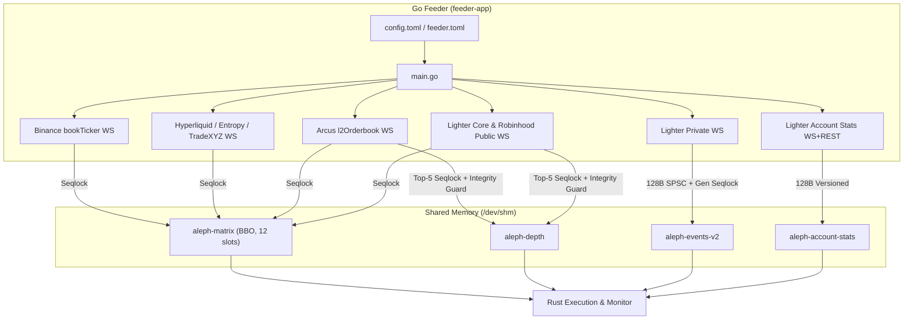

# feeder/

> Go real-time ingestion (`feeder-app`) for `/dev/shm` IPC and standalone multi-venue public recorder (`cmd/perp-capture`) with VDSO-consistent monotonic/wall clock guards.

## Key Entry Points

| Path | Description |
|------|-------------|
| `main.go` (`feeder-app`) | Supervised/public SHM feeder across Lighter Core, Lighter Robinhood, Arcus, Hyperliquid Core, Entropy (`io:*`), TradeXYZ (`xyz:*`), and Binance (plus Lighter private V2 events & account stats) |
| `cmd/perp-capture/` (`perp-capture`) | Continuous or in-process rolling (`-segment-duration`) public NDJSON.gz recorder across Lighter Core, Lighter Robinhood, Hyperliquid Core, Entropy (`io:*`), TradeXYZ (`xyz:*`), Arcus (`-arcus-trades` + books), BULK, Extended, and Binance `bookTicker` |
| `config/` | Shared TOML loader (`[symbols]`, `[lighter]` + `feeder_public_symbols`, `[lighter_robinhood]`, `[arcus]`, `[hyperliquid]`, `[entropy]`, `[tradexyz]`, `[binance]`) |
| `exchanges/` | Active WebSocket adapters (`lighter*`, `arcus`, `hyperliquid`, `binance`) — legacy v3 adapters (`backpack`, `edgex`, `01`) archived under `../legacy/v3_archive/feeder/exchanges/` |
| `shm/` | Lock-free shared-memory writers (`matrix.go`, `depth.go`, `events.go`, `events_v2.go`, `account_stats.go`) |

## Architecture



## Critical Invariants

- **Shared C-ABI Layout**: Every struct in `shm/` is pinned by cross-language size and offset tests against Rust (`src/types/events.rs`, `src/shm_*.rs`). Never alter field order or sizes independently.
- **Full-Book Continuity (`exchanges/lighter.go`)**: Verify `offset == prevOffset + 1` (or snapshot reset), reject crossed/NaN books, and invalidate both `aleph-matrix` and `aleph-depth` immediately on sequence gaps or disconnects so Rust never quotes off a stale book.
- **Precise Capture Clock (`cmd/perp-capture/timing.go`)**: Sample `time.Now()` via `consistentNow()` (`<= 25 us` paired VDSO span) so KVM hypervisor preemptions between `CLOCK_REALTIME` and `CLOCK_MONOTONIC` cannot trigger false wall/monotonic divergence aborts during 10-hour captures.

## Verification

```bash
cd feeder && go test -race ./...
make build-feeder
```
