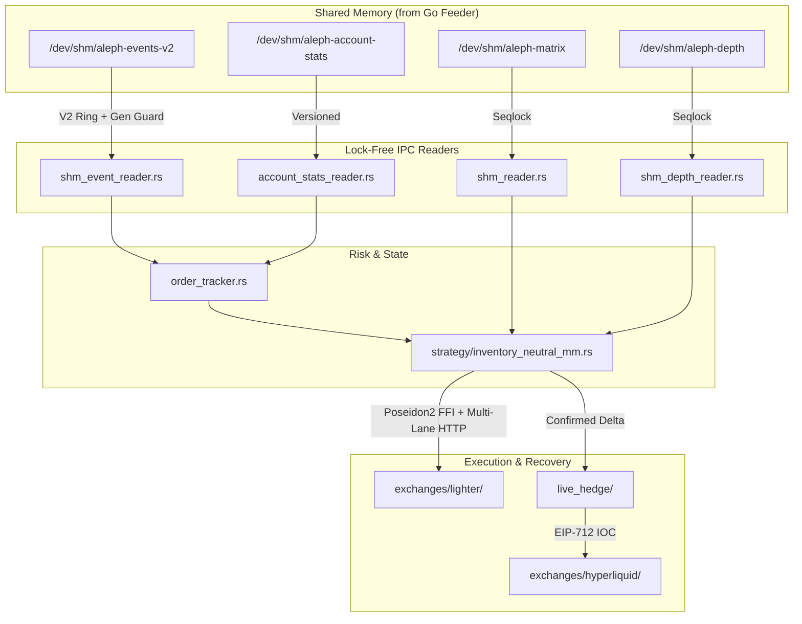

# src/

> Rust quantitative core: lock-free SHM readers, per-order bilateral risk state machine (`OrderTracker`), Lighter Core & Robinhood execution, durable Hyperliquid hedging (`live_hedge`), and causal cross-venue replay (`capture`, `strategy/relative_value`).

## Key Files (Root Level)

| File | Description |
|------|-------------|
| `lib.rs` | Module declarations and Lighter FFI/risk/trading re-exports (`lighter_ffi`, `lighter_risk`, `lighter_trading`) |
| `config.rs` | `AppConfig`, `InventoryNeutralMMConfig`, `DeploymentIsolationConfig`, fleet STP validation, tick/step helpers |
| `order_tracker.rs` | Per-order bilateral risk state machine (`confirmed_position`, `worst_case_long/short`, watermarks, V2 events) |
| `daily_loss.rs` | Persistent UTC daily loss baseline and halt guard across restarts |
| `shm_reader.rs` | Lock-free BBO matrix reader (`ShmBboMessage`, 64-byte seqlock, 7 exchange slots) |
| `shm_depth_reader.rs` | Lock-free top-5 depth SHM reader (`ShmDepthSnapshot`, 2,048 symbol versions) |
| `shm_event_reader.rs` | Lock-free 128-byte V2 private event ring reader (`ShmPrivateEventV2`, integrity-loss barrier) |
| `account_stats_reader.rs` | Lock-free 128-byte account stats SHM reader (independent equity & position timestamps) |
| `telemetry.rs` / `telemetry_sink.rs` | Structured session telemetry snapshots and durable JSONL writer for Oasis console |
| `funding_evidence.rs` | Reconciled funding payment verification and ledger attribution |

## Subdirectories

| Directory | Description |
|-----------|-------------|
| `bin/` | Active binaries: `lighter_inventory_mm` (supervised live/testnet/check), `cross_venue` (capture/compile/replay/lakehouse CLI), `maker_replay` (`research-replay` feature) |
| `exchanges/` | Active venue clients (`lighter/`, `hyperliquid/`, `arcus/`, `bulk/`, `variational/`) — legacy v3 clients (`backpack`, `edgex`) archived in `../legacy/v3_archive/` |
| `strategy/` | Active strategies (`inventory_neutral_mm`, `relative_value/`, `cross_venue`, `matched_settlement`) |
| `live_hedge/` | Durable Hyperliquid IOC hedge executor, write-ahead recovery journal, and offline fee/recovery audit |
| `capture/` | Multi-venue public NDJSON compiler, clock/continuity auditor, and Medallion Lakehouse manifest/catalog tools |
| `venues/` | Static/public venue capability registry (Lighter Core/RH, Native HL, Entropy, TradeXYZ, Arcus, BULK) |
| `types/` | Core C-ABI event layouts (`ShmPrivateEventV2` 128B) and order/position domain types |

## Architecture



## Safety & Hot-Path Invariants

- **Worst-Case Bilateral Risk**: Reserve exposure before dispatch (`start_tracking`) and retain reservations across pending cancels, ambiguous HTTP acks, and stream gaps until authoritative terminal + watermark evidence arrives.
- **Acquire Memory Barriers**: Always pair atomic version loads with `Ordering::Acquire` fences on ARM64 / x86-64 seqlock reads.
- **Zero-Allocation Quote Path**: Keep `try_read` and quote evaluation free of heap allocations and blocking work; drop lock guards before `.await`.
- **FFI Memory Ownership**: Strings returned from `lighter-signer` CGO (`C.CString`) must be freed exclusively via `FreeCString()`.

## Verification

```bash
make trade MODE=check CONFIG=config.example.toml
make fmt-check && make check && make test && make build
```
