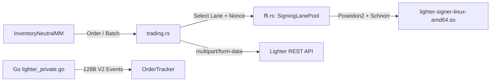

# src/exchanges/lighter/

Lighter (`Mainnet` `304`, `Testnet` `300`, and `RobinhoodMainnet` `466324`) execution, signing, and margin-risk module.

## Key Files

| File | Description |
|------|-------------|
| `mod.rs` | `LighterNetwork` domain definitions (`chain_id`, endpoints, settlement domain) and `valid_market_id` |
| `ffi.rs` | `LighterSigner` CGO bindings (`lighter-signer-linux-amd64.so`) and `SigningLanePool` multi-key dispatcher |
| `risk.rs` | Exact isolated/cross liquidation price, `liquidation_distance_bps`, and `portfolio_cross_mmr_usd` |
| `trading.rs` | `LighterTrading` HTTP/batch client, per-lane `pending`/`confirmed` nonce state machine, and REST reconciliation |

## Architecture



## Nonce & Multi-Key Lane Invariants

- **Per-Lane Isolation**: Each `(api_key_index, private_key)` lane owns an independent `LaneNonceState` (`confirmed_nonce`, `pending_nonce`) serialized by its lane mutex.
- **Transport Rollback vs Rejection Resync**: Pre-ingestion HTTP transport errors roll back `pending_nonce` when safe; explicit `21104` (invalid nonce) or `21711` (invalid expiry) triggers `/api/v1/nextNonce` resynchronization for that `api_key_index`.
- **Domain Separation**: `RobinhoodMainnet` (`chain_id = 466324`, USDG collateral) is supported in supervised `quant` mode and offline capture/replay, and rejected fail-closed in `inventory_hedge` mode to prevent implicit USDG/USDC cross-collateral mixing.

## Verification

```bash
make trade MODE=check CONFIG=config.example.toml
cargo test --locked --lib exchanges::lighter
```
